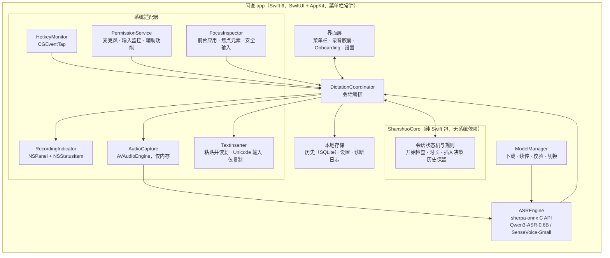
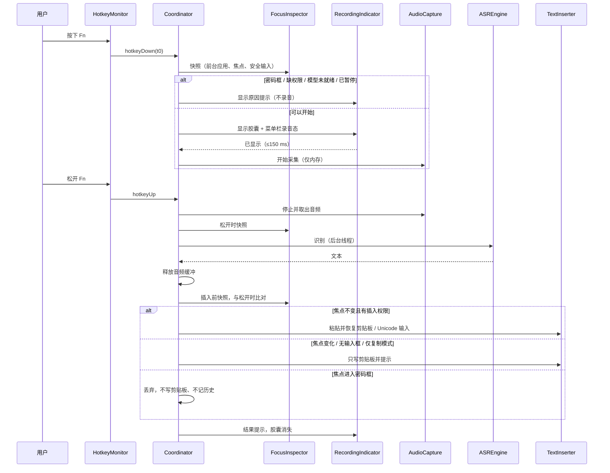

# 工程上下文：FEAT-001 闪说核心闭环（REQ-001）

> **状态**：草案（plan 阶段，2026-10-21）。ED-001 技术栈和"待确认"的资源问题需要用户确认；确认前不执行 `start-feature` / `add-task`，下文 Task 编号均为计划编号。
> **关联**：Requirement `REQ-001`，产品上下文 [REQ-001.product.md](REQ-001.product.md)（Ready，原型 v0.2 `eae5529`）。REQ-002、REQ-003 另立 Feature，本 Feature 只为它们预留接口（见 ED-008）。

## 当前有效方案

### 架构设计

#### 背景

REQ-001 要交付一个 macOS 菜单栏常驻应用：按住全局快捷键录音，录音前必须先显示录音提示；松开后在本机用 Qwen3-ASR-0.6B 识别中英文，再把文本插入松开时的活跃输入框；缺插入权限时退化为仅复制模式。新项目，仓库里只有产品文档、调研笔记和交互原型，没有生产代码，也还没有 `.sdlc-v1/project.md`（技术栈确认后由本 Feature 的 T004 创建）。

长期方向来源：[ASR 选型笔记](../../research/asr-model-selection.md)、REQ-001 的 DEC-001～DEC-016 和 NFR-001～NFR-007。本 Feature 的预期结果：基线机型上达到 NFR-002/NFR-003，SCN-001～SCN-012、SCN-019 在真实应用中通过，产出可内部试用的签名 DMG。

#### 复用评估

需求：全局按住式快捷键（含 Fn）、录音提示浮层、本地中英混说识别（带热词）、跨应用插入、权限引导、模型下载管理。

| 候选 | 证据 | 覆盖与差距 | 集成与维护 | 许可证与风险 | 结论 |
|---|---|---|---|---|---|
| A. 原生 Swift 自研外壳 + 成熟依赖（sherpa-onnx） | sherpa-onnx v1.13.8（2026-09-10）的 C API 有 `SherpaOnnxOfflineQwen3ASRModelConfig`（含 `hotwords` 字段），官方 `swift-api-examples/SherpaOnnx.swift` 已封装 Qwen3-ASR；团队在 yovoice 中用过 sherpa-onnx 1.13.8 和 SwiftPM 的 macOS 外壳 | 识别引擎直接复用；快捷键、浮层、插入、Onboarding 需自写，可参考 Handy（MIT）和 clips 模板的已验证做法 | macOS 原生 API 直接调用，权限和 TCC 行为最可控；空闲开销最低（NFR-004）；后续做 Windows 需另写外壳 | sherpa-onnx Apache-2.0；自研代码量最大 | **推荐** |
| B. Fork Handy（Tauri 2 + Rust + React） | MIT；已有按住/切换录音、录音浮层、剪贴板粘贴并恢复、历史、词典、LLM 后处理；Whisper / Parakeet 引擎 | 缺 Qwen3-ASR（需接 sherpa-onnx Rust crate 1.13.8）；录音前必须先显示提示、安全输入、焦点变化、仅复制模式、9 步 Onboarding 都要改核心流程；中文界面与品牌需替换（品牌资产不开源） | 跨平台底座，将来做 Windows 省力；要长期跟上游合并；WebView 带来常驻内存 | MIT 可闭源分发；上游 README 记录了剪贴板恢复时序问题（#502） | 备选：若首发后很快要做 Windows，优先考虑 |
| C. Fork VoiceInk（原生 Swift） | GPL-3.0；macOS 14.4+；whisper.cpp、FluidAudio（Parakeet）、SenseVoice-Small；个人词典、AI 增强、按应用切换模式 | 功能超出首发范围（屏幕上下文、助手模式），删减成本高；不支持 Qwen3-ASR | 上游不接受 PR，只能长期维护私有 fork | GPL-3.0：分发的应用必须整体以 GPL-3.0 开源 | 不采用 |

决定：**引入成熟依赖**（sherpa-onnx 作为识别运行时）+ 自研原生外壳。不 fork Handy 的具体原因：REQ-001 的硬规则（录音提示先于采集、提示失败不录音、安全输入框不可用、焦点变化改复制、仅复制模式）都落在会话主流程上，fork 后要重写的正是 Handy 最核心的部分，跨平台的好处在 CON-003（只做 macOS）下暂时用不上。clips 模板（`workspace/20260922-agent-native-research/templates/clips/desktop`）未找到许可证文件，只参考思路，不复制代码。

参考的已验证做法（只借鉴思路，代码自写）：
- clips `shortcuts.rs`：Fn 键用 ListenOnly 的 CGEventTap 监听 `flagsChanged` 中的 SecondaryFn 位，按边沿触发开始与结束；ListenOnly tap 需要"输入监控"权限，只有辅助功能权限不够；tap 被系统超时禁用后要自动重新启用。
- clips `insert_text_for_frontmost`：普通应用用"写剪贴板 → 模拟 ⌘V → 恢复原剪贴板"，终端类应用改为直接输入 Unicode 字符。
- Handy README：Fn 只在 Apple 键盘上有事件（第三方键盘在固件里处理 Fn），与 DEC-002 外接键盘默认右 Option 一致；固定延时恢复剪贴板在负载高时会把旧内容粘进去，Handy 用"剪贴板被读取的通知"来推迟恢复。

#### 架构与组件

职责边界：`ShanshuoCore` 只放可单测的规则，规则从原型 `prototype/domain.js` 迁移，测试用例从 `prototype/tests/domain.test.js` 迁移；系统适配层每个组件包在协议之后，测试时可替换；`DictationCoordinator` 是唯一持有会话状态的对象，所有系统事件都经它进入状态机。

#### 关键设计决定

| ID | 决定 | 理由 | 状态 |
|---|---|---|---|
| ED-001 | 技术栈：Swift 6 + SwiftUI/AppKit 原生菜单栏应用（`LSUIElement`），仅 arm64，最低 macOS 14；Xcode 工程 + 一个本地 SwiftPM 包 `ShanshuoCore` | 见复用评估；本机工具链为 Xcode 26.6 / Swift 6.3.3 | **待用户确认** |
| ED-002 | 识别运行时：sherpa-onnx v1.13.8，使用官方预编译的 macOS 静态库，通过 C API + 官方 `SherpaOnnx.swift` 封装在进程内调用；启动后在后台加载模型并常驻内存 | 进程内调用延迟最低；常驻才能满足 NFR-006（不因重新加载多等 1 秒以上）。代价是常驻内存约 1 GB 以上，T001 实测 | 默认，T001 验证 |
| ED-003 | 快捷键：ListenOnly CGEventTap 监听 `flagsChanged`（Fn = SecondaryFn 位，右 Option = 设备相关的右 Option 位）和组合键的 `keyDown`/`keyUp`。这需要"输入监控"权限，因此 Onboarding 中"快捷键所需的其他权限"一步固定为**输入监控**，属于必需步骤 | 只依赖输入监控，不依赖辅助功能，所以仅复制模式（DEC-003）下快捷键照样可用；Fn 单键无法用 Carbon 热键 API 注册 | 默认，T002 验证授权后是否需要重启 |
| ED-004 | Esc 取消：已授予辅助功能时，录音和处理期间临时改用可拦截的 tap 吞掉 Esc，避免 Esc 同时关掉前台应用的对话框；仅复制模式下只能监听，Esc 会同时送达前台应用 | 拦截按键需要辅助功能权限 | 默认，T002 验证 |
| ED-005 | 插入策略：默认"写剪贴板 → 模拟 ⌘V → 恢复原剪贴板"，用 `NSPasteboardItem` 的延迟数据提供回调得知目标已读取后再恢复，读取超时（暂定 1 秒）后兜底恢复；Terminal、iTerm2 改用 `CGEventKeyboardSetUnicodeString` 分段输入，不碰剪贴板；具体按应用清单由 T002 实测定稿 | 解决固定延时恢复的时序问题；终端常有自定义粘贴绑定 | 默认，T002 验证 |
| ED-006 | 焦点与安全输入：按下、松开、插入前三个时刻都记录"前台应用 PID + 焦点元素标识"；安全输入用 `IsSecureEventInputEnabled()` 加焦点元素子角色 `AXSecureTextField` 共同判断。没有辅助功能权限时无法读取焦点元素，只比较前台应用并检查系统安全输入状态 | DEC-013 的焦点变化与密码框规则 | 默认 |
| ED-007 | 录音提示先于采集：Coordinator 先显示 NSPanel 胶囊（非激活、`canJoinAllSpaces` + `fullScreenAuxiliary`，位于活跃窗口所在屏幕）并切换菜单栏图标，收到胶囊已显示的回调后才启动 AVAudioEngine；显示失败则不启动采集（FR-004） | DEC-005；NFR-001 的 150 毫秒预算从按键事件算起 | 默认 |
| ED-008 | 识别后处理管线：识别结果经过 `TextPostProcessor` 协议链再交给插入，REQ-001 只有"原样输出"一个实现；REQ-003 的词典替换和 REQ-002 的整理以后作为新实现接入，不改会话状态机 | 只预留一个协议，不提前实现 REQ-002/003 | 默认 |
| ED-009 | 模型分发：首次运行时下载，不打包进 DMG；默认源 Hugging Face（`csukuangfj2/sherpa-onnx-qwen3-asr-0.6B-int8-2026-03-25`），中国大陆网络使用 ModelScope 或自建镜像；HTTP Range 断点续传；应用内置每个文件的 SHA-256，校验失败自动重下 | DMG 保持小体积；FR-013 | 默认，T003 确认镜像源 |
| ED-010 | 本地数据：历史存 SQLite（GRDB.swift，MIT），7 天保留在启动时和每小时清理一次；设置存 UserDefaults；诊断日志用 `os.Logger` 加滚动文件，只记录事件类型、耗时和错误码，日志 API 不接收文本参数（FR-014） | 历史需要按时间查询和删除 | 默认 |
| ED-011 | 工程标识：显示名"闪说"，可执行文件名 `Shanshuo`，Bundle ID 建议 `com.arnow117.shanshuo` | DEC-014 只定了中文名 | **待用户确认** |
| ED-012 | 分发：Developer ID 签名 + Hardened Runtime（只开 `com.apple.security.device.audio-input`）+ notarytool 公证 + DMG；不上 App Store（DEC-010）；首发不做自动更新 | 产品范围未包含自动更新 | 默认；**需要 Apple Developer 账号**（本机未找到 Developer ID 证书） |

#### 数据模型 / 关键实体

- `DictationSession`（内存）：`id`、`phase`（idle / listening / recognizing / inserting / cancelled / failed）、`startedAt`、`targetAtPress`、`targetAtRelease`、`audioBuffer`（16 kHz 单声道 Float32，3 分钟上限约 11 MB，会话结束即释放）、`failureReason`。
- `TargetSnapshot`：`bundleID`、`pid`、`focusedElementID?`、`isSecure`。
- `HistoryRecord`（SQLite）：`id`、`createdAt`、`targetBundleID`、`targetAppName`、`recognizedText`、`finalText`、`insertResult`（inserted / copied）。不存在"密码框"类型的记录（DEC-013）。
- `InstalledModel`：`modelID`、`version`、`files[{name, sha256, bytes}]`、`path`、`isActive`。
- `PermissionState`：每次需要时向系统查询，不缓存为真值（REQ-001 关键实体）。

#### 时序与数据流

#### 横切质量设计

- **延迟预算（NFR-002，15 秒语音，P50 ≤ 1.0 秒）**：停止采集 ≤ 20 ms；识别是主要耗时（T001 实测，目标 ≤ 800 ms）；焦点快照与插入 ≤ 100 ms；剪贴板恢复不计入"文本出现"时间。识别在独立的串行队列上执行，模型常驻。
- **空闲开销（NFR-004）**：空闲时不运行 AVAudioEngine；event tap 回调只做位判断；不轮询，权限变化在 Onboarding 窗口打开时才每秒检测一次。
- **隐私**：音频只在内存缓冲中存在，会话结束（包括取消和失败）立即清零释放；不写临时文件；日志不含文本；模型下载请求不带用户标识。
- **可靠性**：event tap 被系统禁用时（`tapDisabledByTimeout` / `tapDisabledByUserInput`）自动重新启用，并在菜单栏提示；识别崩溃风险由 T001 的长时间压测评估，必要时把引擎移到 XPC 子进程（不在首版计划内）。
- **无障碍（NFR-007）**：SwiftUI 控件加 `accessibilityLabel`；胶囊状态同时用文字表达；Onboarding 与设置可全程键盘操作，用 XCUITest 检查。

#### 风险与取舍

| 风险 | 影响 | 缓解 / 验证 | 回退 |
|---|---|---|---|
| Qwen3-ASR-0.6B 在 M1 上 CPU 延迟达不到 NFR-002 | 核心体验 | T001 对比 CPU 与 CoreML provider、线程数；同时测 SenseVoice-Small | 按 DEC-004 回到产品：默认改 SenseVoice 或调整指标 |
| macOS 新版对程序读取剪贴板弹出隐私提示（Apple 自 macOS 15.4 起预告，系统设置中有"从其他应用粘贴"项） | "恢复原剪贴板"每次都要读取剪贴板，可能频繁弹窗 | T002 在 macOS 26.4.1 实机验证 | 对支持的应用改用 Unicode 输入或辅助功能 API 直接写入选中文本；必要时回到产品调整"恢复剪贴板"规则 |
| 输入监控授权后需要重启应用才生效 | Onboarding 多一次重启 | T002 验证；产品规格已有"重新打开"步骤（用户故事 2 第 5 条） | 按规格走重启续接 |
| 安全输入开启时收不到快捷键事件 | 密码框中按键无提示 | T002 验证；DEC-013 依赖条目已说明可接受 | 无提示但不录音 |
| ModelScope 没有 sherpa-onnx 的 Qwen3-ASR 包 | 国内下载慢或失败 | T003 验证 | 自建镜像（例如对象存储），清单与 SHA-256 不变 |
| 第三方键盘没有 Fn 事件 | 外接键盘用户 | DEC-002 已规定外接键盘默认右 Option；T002 验证检测外接键盘的方法 | 引导用户改快捷键 |

#### 需求覆盖

| 验收条件 | 设计 / 契约 | 计划 Task | 计划验证 |
|---|---|---|---|
| 用户故事 1 场景 1～12，FR-001、FR-003、FR-005、FR-009、FR-015 | ED-003～ED-007，状态机 | T005、T006、T007、T009、T010 | `swift test`（规则）；XCUITest 驱动 TextEdit、备忘录；DEC-012 应用矩阵手测 |
| 用户故事 2 场景 1～10，FR-006～FR-008 | ED-003（输入监控必需）、PermissionService | T006、T011 | XCUITest（Onboarding 窗口）+ 新建 macOS 用户账户全新安装手测 |
| 用户故事 3 场景 1～9，FR-004、FR-010～FR-012、FR-014 | ED-007、ED-010 | T007、T013 | 自动化计数提示出现率（SC-004）；日志扫描无文本；检查本机无音频文件 |
| 用户故事 4 场景 1～3，FR-013 | ED-009 | T003、T012 | 断网、校验失败、删除模型的集成测试 |
| FR-002、NFR-002、NFR-003 | ED-002 | T001、T008、T015 | eval-bench 报告（M1 基线 + M5 参考） |
| NFR-001、NFR-004～NFR-007 | 横切质量设计 | T015 | 计时脚本、Activity Monitor 采样、应用矩阵、VoiceOver 检查 |
| DEC-010 / ED-012 签名公证 | ED-012 | T016 | `spctl --assess`、`stapler validate` |

原型场景 SCN-001～SCN-012、SCN-019 是上表的行为来源，原型本身不代替生产验证。

### 实施计划

#### 目标 / 非目标

- 目标：REQ-001 全部验收条件；内部试用版 DMG。
- 非目标：REQ-002 智能整理、REQ-003 词典（只留 ED-008 接口）；自动更新；Windows；XPC 进程隔离；遥测。

#### 技术栈

| 层 | 选择 | 版本 |
|---|---|---|
| 语言 / UI | Swift 6、SwiftUI + AppKit | Xcode 26.6（Swift 6.3.3），部署目标 macOS 14.0，arm64 |
| 识别 | sherpa-onnx C API + 官方 Swift 封装 | v1.13.8（固定版本，升级另开 Task） |
| 模型 | Qwen3-ASR-0.6B int8（默认）、SenseVoice-Small int8（轻量） | `sherpa-onnx-qwen3-asr-0.6B-int8-2026-03-25` 等，SHA-256 固定在清单 |
| 存储 | GRDB.swift（SQLite）、UserDefaults | GRDB 7.x |
| 测试 | Swift Testing / XCTest、XCUITest | 随 Xcode |
| 评测 | Python 3 脚本调用 sherpa-onnx Python 包（与 App 同版本） | `sherpa-onnx==1.13.8` |

#### 实施阶段

1. **阶段 0：验证（阻塞后续）**：T001 ASR 评测、T002 平台验证、T003 下载源验证。出口条件：NFR-002/NFR-003 在基线机型上可达，或已回到产品确认调整；ED-002～ED-005、ED-009 定稿。
2. **阶段 1：基础**：T004 工程骨架、T005 领域核心。
3. **阶段 2：核心闭环（用户故事 1）**：T006～T010。
4. **阶段 3：Onboarding 与模型管理（用户故事 2、4）**：T012 → T011。
5. **阶段 4：隐私与历史（用户故事 3）**：T013。
6. **阶段 5：验收与发布准备**：T015、T016。

### 工程任务（计划）

| 计划 ID | 标题 | 代码范围 | 依赖 | 完成条件 | 验证 |
|---|---|---|---|---|---|
| T001 | [验证] 本地 ASR 评测台 | `bench/asr/`（脚本、测试集清单、报告） | — | 120 条测试集（中文 40、英文 30、混说 30、专有词 20）上 4 个候选的 CER/WER/MER；5/15/30 秒语音的 P50/P95 延迟；常驻内存；热词数量与延迟、准确率的关系（供 REQ-003）；M1 基线 + M5 参考 | 报告入库，结论写回本文件与 DEC-004 |
| T002 | [验证] macOS 平台能力 | `spikes/platform/`（一次性 Swift 命令行与小应用，不进产品） | — | 给出结论：Fn / 右 Option / Esc 监听与输入监控是否需重启；安全输入下的事件；胶囊在全屏应用和多显示器上的显示；DEC-012 共 13 个应用的插入方式与成功率；macOS 26 剪贴板读取提示；系统设置深链接与授权后免重启（DEC-016） | 结论表入库，ED-003～ED-006 定稿 |
| T003 | [验证] 模型下载源 | `spikes/model-download/` | — | Hugging Face 与 ModelScope（或自建镜像）在中国大陆网络下的可用性与速度；Range 续传；文件 SHA-256 清单 | 结论入库，ED-009 定稿 |
| T004 | 工程骨架 | `app/`（Xcode 工程）、`Packages/ShanshuoCore/`、`scripts/`、`.sdlc-v1/project.md` | T001、T002 结论 | 菜单栏空壳可运行；`scripts/test.sh` 跑通单测与 UI 测试；签名配置占位；`project.md` 记录技术栈与命令 | `scripts/test.sh` |
| T005 | 领域核心与规则迁移 | `Packages/ShanshuoCore/` | T004 | 会话状态机、开始检查（含密码框）、时长规则、插入决策、历史保留迁移完成，原型 20 组测试中属于 REQ-001 的全部迁移为 Swift 测试 | `swift test` |
| T006 | 系统适配：权限、快捷键、焦点 | `app/Shanshuo/Platform/{Permission,Hotkey,Focus}*` | T004、T002 | 三项权限实时检测；Fn / 右 Option / 自定义组合键按住与松开；Esc；焦点与安全输入快照 | 单测（协议替身）+ 手测清单 |
| T007 | 录音提示与音频采集 | `app/Shanshuo/Platform/{Indicator,Audio}*`、`app/Shanshuo/UI/Pill*` | T005、T006 | 胶囊先于采集；显示失败不采集；菜单栏录音态；倒计时；提示音可关；音频只在内存 | XCUITest + 计时日志（NFR-001） |
| T008 | 识别引擎 | `app/Shanshuo/ASR/`、`Vendor/sherpa-onnx/` | T004、T001 | Qwen3-ASR 与 SenseVoice 两个实现；启动后后台加载；识别在后台队列；测试用 WAV 夹具 | 集成测试（夹具音频 → 期望文本） |
| T009 | 文本插入与仅复制模式 | `app/Shanshuo/Platform/Insert*` | T006、T002 | ED-005 的策略与按应用选择；剪贴板恢复；仅复制模式提示与"开启直接插入" | XCUITest（TextEdit）+ DEC-012 矩阵手测 |
| T010 | 核心闭环集成 | `app/Shanshuo/Coordinator/` | T005～T009 | 用户故事 1 场景 1～12 全部可演示；测试构建可用 WAV 文件替代麦克风输入 | XCUITest 端到端 + 真机麦克风冒烟 |
| T011 | Onboarding | `app/Shanshuo/UI/Onboarding/` | T010、T012 | 9 步、可返回、中途退出续接、练习框、权限修复卡片（DEC-015、DEC-016） | XCUITest + 新用户账户全新安装手测（SC-001） |
| T012 | 模型管理 | `app/Shanshuo/Models/`、设置 › 语音模型 | T003、T008 | 下载、暂停、续传、切换源、校验、切换模型、删除、修复入口 | 集成测试（本地 HTTP 服务模拟断网与坏文件） |
| T013 | 隐私、暂停与历史 | `app/Shanshuo/{History,Privacy}/`、设置 › 历史 / 隐私 | T010 | 暂停 1 小时 / 手动恢复；7 天历史、删除、清空、关闭；隐私页；日志无文本 | 单测 + 日志扫描脚本 + XCUITest |
| T014 | 设置窗口与菜单栏 | `app/Shanshuo/UI/Settings/`、`MenuBar*` | T011～T013 | 通用（快捷键、输入设备、提示音）各页与原型一致；菜单栏项与状态 | XCUITest |
| T015 | 质量指标与兼容性验收 | `bench/e2e/`、`docs/validation/` | T010～T014 | NFR-001、NFR-002、NFR-004～NFR-007 实测；DEC-012 应用插入成功率 ≥ 98% | 报告入库（供 sdlc-validate） |
| T016 | 签名、公证与 DMG | `scripts/release/`、entitlements | T004（可提前），Apple Developer 账号 | 可公证的 DMG；Gatekeeper 校验通过 | `spctl --assess`、`xcrun stapler validate` |

执行顺序：T001、T002、T003 可并行，是所有实现 Task 的前置；T004 → T005 → T006/T008（可并行）→ T007、T009 → T010 → T012 → T011 → T013 → T014 → T015；T016 在拿到账号后任何时候都可开始。

### 使用入口与实际使用验证

用户可见入口：菜单栏图标与菜单、全局快捷键、录音胶囊、Onboarding 窗口、设置窗口。参数来源：快捷键、输入设备、提示音、历史开关来自设置；模型来自 ModelManager。实际使用验证：在 M1 / 16 GB 基线机和本机（M5 / 16 GB，macOS 26.4.1）上用真实麦克风完成 SCN-001～SCN-012、SCN-019，并在 DEC-012 的 13 个应用中各听写 10 次。

### 测试策略

- 规则层：`swift test`，用例来自原型测试，保证生产规则与已确认原型一致。
- 系统适配层：协议替身做单测；真实系统行为由 T002 结论和手测清单覆盖。
- 端到端：XCUITest 驱动闪说自己的窗口，并通过 Bundle ID 驱动 TextEdit 等目标应用；测试构建允许用 WAV 文件替代麦克风输入（只在 DEBUG 构建中编译）。
- 评测：`bench/asr` 和 `bench/e2e` 的报告绑定 commit，作为 sdlc-validate 的证据。

### 回滚方式

内部试用阶段用 DMG 分发：回滚即重新分发上一版 DMG；模型文件与应用版本解耦，回滚不需要重新下载模型。数据只增加 SQLite 历史表，旧版本忽略即可。

### 发布后观察

按 REQ-001 产品上下文"发布后观察计划"执行；本 Feature 提供应用内本地统计（首次听写完成、延迟分布、插入失败次数、修复卡片出现次数），只存本机，不上传。

## 实现记录（实际）

尚未开始。

## 验证记录（实际）

尚未开始。

## 评审记录（实际）

尚未开始。

## 发布与观察记录（实际）

尚未开始。
