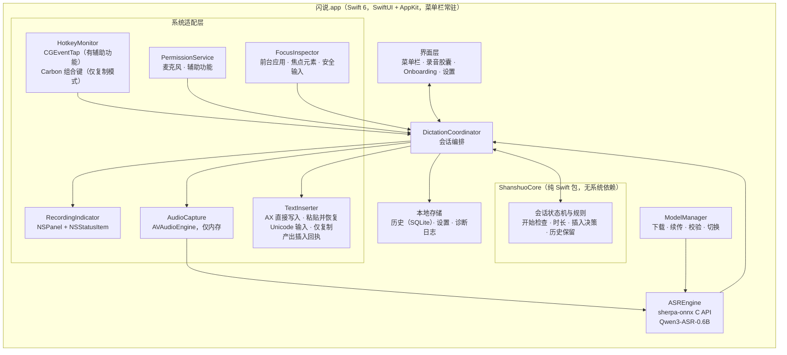
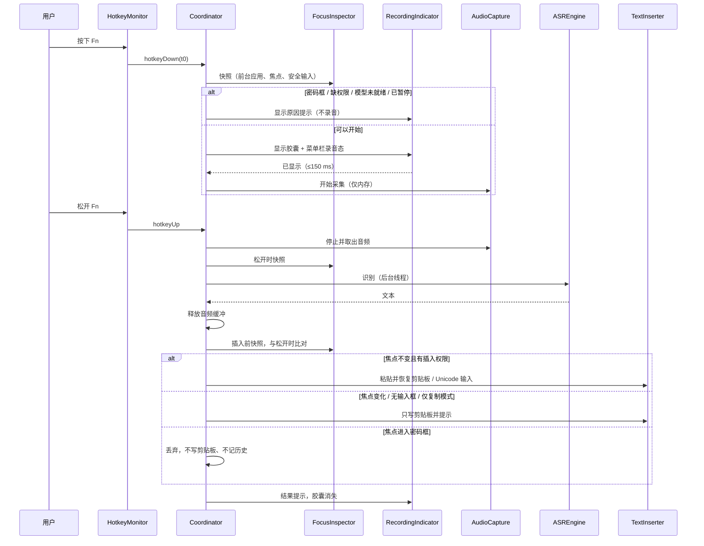

# 工程上下文：FEAT-001 闪说核心闭环（REQ-001）

> **状态**：已确认（plan 阶段），build 进行中。2026-10-21 20:48 用户确认 ED-001 技术栈、ED-011 Bundle ID，以及分发、基线机型和测试集等资源问题；21:20 用户确认 REQ-001 DEC-020（没有辅助功能时快捷键改为 ⌃⇧ Space），T006 的前置条件已满足。
> **关联**：Requirement `REQ-001`，产品上下文 [REQ-001.product.md](REQ-001.product.md)（Ready，原型 v0.3）。REQ-002、REQ-003 另立 Feature，本 Feature 只为它们预留接口（见 ED-008）。

## 当前有效方案

### 架构设计

#### 背景

REQ-001 要交付一个 macOS 菜单栏常驻应用：按住全局快捷键录音，录音前必须先显示录音提示；松开后在本机用 Qwen3-ASR-0.6B 识别中英文，再把文本插入松开时的活跃输入框；缺插入权限时退化为仅复制模式。新项目，仓库里只有产品文档、调研笔记和交互原型，没有生产代码，也还没有 `.sdlc-v1/project.md`（技术栈确认后由本 Feature 的 T004 创建）。

长期方向来源：[ASR 选型笔记](../../research/asr-model-selection.md)、REQ-001 的 DEC-001～DEC-016 和 NFR-001～NFR-007。本 Feature 的预期结果：在开发机上达到 NFR-002/NFR-003（DEC-019），SCN-001～SCN-012、SCN-019 在真实应用中通过，产出可供测试者安装的测试版（DEC-018）。

#### 复用评估

需求：全局按住式快捷键（含 Fn）、录音提示浮层、本地中英混说识别（带热词）、跨应用插入、权限引导、模型下载管理。

| 候选 | 证据 | 覆盖与差距 | 集成与维护 | 许可证与风险 | 结论 |
|---|---|---|---|---|---|
| A. 原生 Swift 自研外壳 + 成熟依赖（sherpa-onnx） | sherpa-onnx v1.13.8（2026-09-10）的 C API 有 `SherpaOnnxOfflineQwen3ASRModelConfig`（含 `hotwords` 字段），官方 `swift-api-examples/SherpaOnnx.swift` 已封装 Qwen3-ASR；团队在 yovoice 中用过 sherpa-onnx 1.13.8 和 SwiftPM 的 macOS 外壳 | 识别引擎直接复用；快捷键、浮层、插入、Onboarding 需自写，可参考 Handy（MIT）和 clips 模板的已验证做法 | macOS 原生 API 直接调用，权限和 TCC 行为最可控；空闲开销最低（NFR-004）；后续做 Windows 需另写外壳 | sherpa-onnx Apache-2.0；自研代码量最大 | **推荐** |
| B. Fork Handy（Tauri 2 + Rust + React） | MIT；已有按住/切换录音、录音浮层、剪贴板粘贴并恢复、历史、词典、LLM 后处理；Whisper / Parakeet 引擎 | 缺 Qwen3-ASR（需接 sherpa-onnx Rust crate 1.13.8）；录音前必须先显示提示、安全输入、焦点变化、仅复制模式、9 步 Onboarding 都要改核心流程；中文界面与品牌需替换（品牌资产不开源） | 跨平台底座，将来做 Windows 省力；要长期跟上游合并；WebView 带来常驻内存 | MIT 可闭源分发；上游 README 记录了剪贴板恢复时序问题（#502） | 备选：若首发后很快要做 Windows，优先考虑 |
| C. Fork VoiceInk（原生 Swift） | GPL-3.0；macOS 14.4+；whisper.cpp、FluidAudio（Parakeet）、SenseVoice-Small；个人词典、AI 增强、按应用切换模式 | 功能超出首发范围（屏幕上下文、助手模式），删减成本高；不支持 Qwen3-ASR | 上游不接受 PR，只能长期维护私有 fork | GPL-3.0：分发的应用必须整体以 GPL-3.0 开源 | 不采用 |

决定：**引入成熟依赖**（sherpa-onnx 作为识别运行时）+ 自研原生外壳。不 fork Handy 的具体原因：REQ-001 的硬规则（录音提示先于采集、提示失败不录音、安全输入框不可用、焦点变化改复制、仅复制模式）都落在会话主流程上，fork 后要重写的正是 Handy 最核心的部分，跨平台的好处在 CON-003（只做 macOS）下暂时用不上。clips 模板（`workspace/20260922-agent-native-research/templates/clips/desktop`）未找到许可证文件，只参考思路，不复制代码。

参考的已验证做法（只借鉴思路，代码自写）：
- clips `shortcuts.rs`：Fn 键用 ListenOnly 的 CGEventTap 监听 `flagsChanged` 中的 SecondaryFn 位，按边沿触发开始与结束；tap 被系统超时禁用后要自动重新启用。clips 的注释认为 ListenOnly tap 需要"输入监控"，与 DEC-017 引用的 Apple 论坛实测不一致，以 T002 的实机结果为准。
- clips `insert_text_for_frontmost`：普通应用用"写剪贴板 → 模拟 ⌘V → 恢复原剪贴板"，终端类应用改为直接输入 Unicode 字符。
- Handy README：Fn 只在 Apple 键盘上有事件（第三方键盘在固件里处理 Fn），与 DEC-002 外接键盘默认右 Option 一致；固定延时恢复剪贴板在负载高时会把旧内容粘进去，Handy 用"剪贴板被读取的通知"来推迟恢复。

#### 架构与组件

职责边界：`ShanshuoCore` 只放可单测的规则，规则从原型 `prototype/domain.js` 迁移，测试用例从 `prototype/tests/domain.test.js` 迁移；系统适配层每个组件包在协议之后，测试时可替换；`DictationCoordinator` 是唯一持有会话状态的对象，所有系统事件都经它进入状态机。

#### 关键设计决定

| ID | 决定 | 理由 | 状态 |
|---|---|---|---|
| ED-001 | 技术栈：Swift 6 + SwiftUI/AppKit 原生菜单栏应用（`LSUIElement`），仅 arm64，最低 macOS 14；Xcode 工程 + 一个本地 SwiftPM 包 `ShanshuoCore` | 见复用评估；本机工具链为 Xcode 26.6 / Swift 6.3.3 | **已确认**（2026-10-21 20:48 "技术栈选1"） |
| ED-002 | 识别运行时：sherpa-onnx v1.13.8，使用官方预编译的 macOS 静态库，通过 C API + 官方 `SherpaOnnx.swift` 封装在进程内调用；启动后在后台加载模型并常驻内存 | 进程内调用延迟最低；常驻才能满足 NFR-006（不因重新加载多等 1 秒以上）。代价是常驻内存约 1 GB 以上，T001 实测 | 定稿（T001，见 `bench/asr/reports/2026-10-21-m5.md`）：默认 Qwen3-ASR-0.6B int8。与 Fun-ASR-Nano 准确率差值的 95% 区间全部跨过 0；Qwen3 每次识别可单独传热词，加载 1.1 s（Fun-ASR-Nano 3.1 s，热词只能加载时设定且受 512 KV 上限限制，100 个热词时被截断）。常驻内存约 1.9 GB（max_total_len 2048），产品按实际热词量调小。SenseVoice-Small 英文 WER 31.5%，不满足 NFR-003，不再作为轻量备选（REQ-001 DEC-021）；Whisper 排除。性能核上的延迟由用户终端结果补充 |
| ED-003 | 快捷键有两套实现，随辅助功能权限自动切换，不申请输入监控（REQ-001 DEC-017）。**有辅助功能**：session 级 CGEventTap 监听 `flagsChanged`（Fn = SecondaryFn 位，右 Option = 设备相关的右 Option 位）和组合键的 `keyDown`/`keyUp`；每 5 秒检查 `CGEvent.tapIsEnabled`，被系统禁用或签名身份变化导致失效时重新安装。**没有辅助功能（仅复制模式）**：用 Carbon `RegisterEventHotKey` 注册按住 ⌃⇧ Space，它能分别收到按下和松开事件，不需要任何权限，但不能注册单独的 Fn 或右 Option。权限变化时立即切换实现并提示用户（REQ-001 DEC-020） | 用户不接受输入监控；同类产品只要求辅助功能 | 默认；T002 验证只有辅助功能时能否收到 Fn 事件，收不到则回到产品 |
| ED-004 | Esc 取消：有辅助功能时，录音和处理期间临时改用可拦截的 tap 吞掉 Esc，避免 Esc 同时关掉前台应用的对话框；仅复制模式下，录音期间临时用 Carbon 注册 Esc 热键，结束后立即注销 | 拦截按键需要辅助功能；Carbon 热键在注册期间同样会拦下 Esc | 默认，T002 验证 |
| ED-005 | 插入策略按目标应用依次选择：(1) **AX 直接写入**：焦点元素支持写入 `kAXSelectedTextAttribute` 且该应用在 T002 实测清单中时，直接写入光标处，不碰剪贴板；(2) **粘贴并恢复**：先完整读出用户剪贴板的全部条目和类型，再写入识别文本（同时标记 `org.nspasteboard.TransientType` 和 `org.nspasteboard.ConcealedType`，让剪贴板管理器和系统剪贴板历史忽略这次临时写入），模拟 ⌘V，用 `NSPasteboardItem` 的延迟数据回调得知目标已读取后恢复原内容，1 秒内未读取则兜底恢复；(3) **Unicode 输入**：Terminal、iTerm2 用 `CGEventKeyboardSetUnicodeString` 分段输入。仅复制模式只写剪贴板，不读取 | 回答用户 20:48 的提问："恢复原剪贴板"确实要求每次粘贴前先以程序方式读取剪贴板，这是同类产品（Handy、clips 模板）的通行做法。AX 直接写入能在支持的应用中完全绕开读取；读取时是否触发 macOS 的"从其他应用粘贴"提示由 T002 用独立 .app 实测 | 定稿（T002，见 `spikes/platform/RESULTS.md`）：备忘录 AX 直接写入 6/6 成功并通过读回校验；独立 .app 的剪贴板访问策略首次启动即为 alwaysAllow，读取不弹提示，保留恢复原剪贴板。其余 12 个应用的矩阵移到 T015 用正式版测 |
| ED-006 | 焦点与安全输入：按下、松开、插入前三个时刻都记录"前台应用 PID + 焦点元素标识"；安全输入用 `IsSecureEventInputEnabled()` 加焦点元素子角色 `AXSecureTextField` 共同判断。没有辅助功能权限时无法读取焦点元素，只比较前台应用并检查系统安全输入状态 | DEC-013 的焦点变化与密码框规则 | 默认 |
| ED-007 | 录音提示先于采集：Coordinator 先显示 NSPanel 胶囊（非激活、`canJoinAllSpaces` + `fullScreenAuxiliary`，位于活跃窗口所在屏幕）并切换菜单栏图标，收到胶囊已显示的回调后才启动 AVAudioEngine；显示失败则不启动采集（FR-004） | DEC-005；NFR-001 的 150 毫秒预算从按键事件算起 | 默认；T002 实测胶囊从按键到显示 P50 1 ms、最大 34 ms；采集启动见 ED-016 |
| ED-008 | 识别后处理管线：识别结果经过 `TextPostProcessor` 协议链再交给插入，REQ-001 只有"原样输出"一个实现；REQ-003 的词典替换和 REQ-002 的整理以后作为新实现接入，不改会话状态机。REQ-003 的静默学习另需插入回执（ED-013） | 只预留接口，不提前实现 REQ-002/003 | 默认 |
| ED-009 | 模型分发：首次运行时下载，不打包进 DMG。逐文件下载（不用 GitHub 整包 tar.bz2）；源顺序 Hugging Face → hf-mirror.com，URL 固定到 commit revision；HTTP Range 断点续传，网络出错时保留 `.part` 并可换源续传，服务器忽略 Range 时从头下载；应用内置清单（每个文件的大小与 SHA-256，大文件取 HF LFS 哈希，小文件下载核对后计算），校验失败自动重下一次，仍失败报错，写完校验通过才原子重命名。ModelScope 没有 sherpa-onnx 包，公开分发前如需国内源再自建镜像（清单不变，只加源模板）。默认模型以 T001 结论为准 | DMG 保持小体积；FR-013；逐文件可单独续传与校验 | 已定稿（T003，2026-10-21）；中国大陆直连未实测，公开分发前复测 |
| ED-010 | 本地数据：历史存系统 SQLite3，使用参数绑定，不引入尚未接入的 GRDB；7 天保留在启动时和每小时清理一次；设置存 UserDefaults；诊断只接收事件枚举、耗时和错误码，不接收听写文本（FR-014） | 当前仅需单表写入、按时间查询和删除；复用 macOS 自带 SQLite3，避免为 swiftc 工程增加新的第三方构建链。数据库与含文本的附属文件只允许当前用户访问；关闭历史后不再写入，已有内容由明确的删除/清空动作处理 | 2026-10-22 工程细化，产品保留与控制规则不变 |
| ED-011 | 工程标识：显示名"闪说"，可执行文件名 `Shanshuo`，Bundle ID `com.arnow117.shanshuo` | DEC-014 只定了中文名 | **已确认**（2026-10-21 20:48 "6可以的"） |
| ED-012 | 测试版签名（REQ-001 DEC-018）：在本机创建一个长期有效的自签名代码签名证书"Shanshuo Test Signing"，从 T002 的第一个实验应用起，所有构建都用这个身份签名并开启 Hardened Runtime（只开 `com.apple.security.device.audio-input`）。固定身份才能让 macOS 在重新构建后继续承认已授予的麦克风和辅助功能权限。不做公证，不上 App Store，不做自动更新；测试者第一次打开时在"系统设置 › 隐私与安全性"中允许打开 | 本机没有任何签名身份（`security find-identity` 为 0）；ad-hoc 签名每次构建身份都会变 | 默认；证书与私钥不入库，导出备份由用户保管 |
| ED-013 | 插入回执（为 REQ-003 静默学习预留）：每次插入成功后，TextInserter 返回 `InsertionReceipt`（目标元素、插入的文字、定位插入段所需的上下文），只保存在内存中。本 Feature 只产出回执，并在"离开输入框、下一次按下快捷键、2 分钟到期"三个时刻发出结束事件；读取输入框文字和学习逻辑属于 REQ-003 的 Feature | REQ-003 DEC-007；把系统接入点留在插入层，避免以后改核心流程 | 默认；T002 验证 DEC-012 应用中 AX 读取输入框文字的可用性 |
| ED-014 | 识别线程的调度优先级：识别串行队列用 `DispatchQoS.userInitiated`（松开快捷键后用户在等结果），模型后台加载用 `.utility`；识别器在 userInitiated 队列上创建和调用。onnxruntime 自建的线程池是否继承这个 QoS 未验证，T008 集成测试要在识别期间记录能效核与性能核负载，确认用上了性能核；线程数取 T001 终端实测的最优值 | 2026-10-21 T001 发现：被系统限制在低 QoS 的进程在 Apple M5 上只会调度到 6 个能效核，Qwen3-ASR 实时率从约 0.1 变为约 0.28（15 秒语音识别需 4 秒以上），NFR-002 直接不达标 | 默认；T008 验证 |
| ED-015 | 热词用法（供 REQ-003 的 Feature）：Qwen3-ASR 每次识别只传十几个相关词条，不传整本词典；识别结果为空、只有 system/user/assistant 这类角色标记，或长度不足按时长估计值的 30% 时，去掉热词再识别一次并记录诊断事件 | T001：0 个热词实体召回 67.6%，7～10 个 89.2%，50 个 75.7%，100 个 70.3%；耗时随热词数增加；只给 1 个热词时有 1 条输出变成"system" | 默认；词条挑选方式在 REQ-003 规划时决定 |
| ED-016 | 音频设备预热：麦克风已授权时，应用启动后在后台创建 AVAudioEngine 并 `prepare()`，按下快捷键时只需 `start()`；T007 实测 `prepare()` 是否会点亮系统麦克风指示，会点亮则改为只在首次听写前预热并接受首次延迟 | T002：AVAudioEngine 冷启动 1655 ms，之后 P50 56 ms；按键到第一块音频 P50 163 ms。冷启动时用户开头约 1.6 秒的话会丢失 | 默认；T007 验证 |
| ED-017 | 加速执行（用户 2026-10-21 22:30"加速做集成交付"）：(a) T004～T010 合并为一条纵向切片，直接复用 `spikes/platform/ShanshuoProbe` 中已验证的快捷键、胶囊、插入、采集代码；(b) 不建 Xcode 工程：纯逻辑放 SwiftPM 包 `Packages/ShanshuoCore`（`swift test`），应用代码由 `scripts/build.sh` 用 swiftc 编译并组装、签名 .app（与探测应用相同做法）；(c) XCUITest 改为脚本化端到端（测试构建用 WAV 文件替代麦克风）加手测；(d) DEC-012 的 13 个应用矩阵在 T015 用正式版测；(e) T008 只实现 Qwen3-ASR，T012 不做模型切换（用户 22:37 确认，REQ-001 DEC-021） | 探测应用已证明 swiftc + 自签名身份能产出权限稳定的 .app，省去工程配置时间；XCUITest 对菜单栏应用和系统权限弹窗支持差，投入产出低 | 默认 |

### 2026-10-22 交付约束细化

- 异步插入与会话共用取消边界。Coordinator 取消时，插入器必须撤销尚未执行的粘贴、超时复制及相关回调；每次不可逆写入前重新检查当前操作和安全状态。旧会话不能凭迟到回调写入新会话。临时剪贴板只在仍由本应用持有时恢复。
- 模型管理为单一写入者：下载、暂停、换源、校验、删除、修复都带操作代次；过期回调不能重新启用旧模型。ASR 的创建、使用和卸载保持在同一串行队列；删除前先停止新会话，取消当前会话，等待卸载完成，再修改该模型目录。完成校验后才触发加载。
- 模型下载流式写入 `.part`，不能将整个大文件放进内存。Range 的起点和完整长度必须与清单一致；200 响应需截断重下，206 校验 Content-Range，416 只能对实际完整且校验通过的文件作完成处理，否则从头恢复。完整文件检查大小与 SHA-256，再原子重命名；不存在“仅文件名齐全就就绪”的状态。生产路径只使用内置的固定清单与 HTTPS 源。
- 模型加载/删除/修复期间禁止开始新听写。下载取消保留可恢复的部分文件；校验失败自动重下一次，仍失败则显示恢复入口。系统错误转换为明确、无私人内容的错误状态。
- 引导、设置和菜单栏共享权限、模型、快捷键、暂停和练习状态，系统权限每次从 OS 读取；引导进度可续接，但权限与模型 readiness 不能由已保存的“完成”标记替代。仅复制模式的练习须从真实识别结果复制/粘贴完成，不能预填假文本通过。
- 公共源码构建不依赖发布私钥或本机绝对路径。开发者可选择自己的签名身份或 ad-hoc 构建；发布资产使用已有测试签名身份，并附全部许可。release 配置不携带开发模型路径、测试注入或私人数据。源码公开与发布授权见 REQ-001 DEC-022，未改变产品质量阈值。
- 实现期间的单元、集成与模拟系统证据不替代 T015 的真机、权限、性能和兼容性验证；所有环境缺口与未测项目显式记录，最终验证不得将其算作通过。

#### 数据模型 / 关键实体

- `DictationSession`（内存）：`id`、`phase`（idle / listening / recognizing / inserting / cancelled / failed）、`startedAt`、`targetAtPress`、`targetAtRelease`、`audioBuffer`（16 kHz 单声道 Float32，3 分钟上限约 11 MB，会话结束即释放）、`failureReason`。
- `TargetSnapshot`：`bundleID`、`pid`、`focusedElementID?`、`isSecure`。
- `HistoryRecord`（SQLite）：`id`、`createdAt`、`targetBundleID`、`targetAppName`、`recognizedText`、`finalText`、`insertResult`（inserted / copied）。不存在"密码框"类型的记录（DEC-013）。
- `InstalledModel`：`modelID`、`version`、`files[{name, sha256, bytes}]`、`path`、`isActive`。
- `PermissionState`：麦克风、辅助功能两项；每次需要时向系统查询，不缓存为真值（REQ-001 关键实体）。
- `InsertionReceipt`（内存）：`targetPID`、`element`（AXUIElement 引用）、`insertedText`、`method`（ax / paste / unicode）、`locator`（定位插入段所需的上下文）、`insertedAt`。结束事件发出后立即释放（ED-013）。

#### 时序与数据流

#### 横切质量设计

- **延迟预算（NFR-002，15 秒语音，P50 ≤ 1.0 秒）**：停止采集 ≤ 20 ms；识别是主要耗时（T001 实测，目标 ≤ 800 ms）；焦点快照与插入 ≤ 100 ms；剪贴板恢复不计入"文本出现"时间。识别在独立的串行队列上执行，模型常驻。
- **空闲开销（NFR-004）**：空闲时不运行 AVAudioEngine；event tap 回调只做位判断；不轮询，权限变化在 Onboarding 窗口打开时才每秒检测一次。
- **隐私**：音频只在内存缓冲中存在，会话结束（包括取消和失败）立即清零释放；不写临时文件；日志不含文本；模型下载请求不带用户标识。粘贴时读出的原剪贴板内容只在内存中保留到恢复完成；插入回执同样只在内存中。
- **可靠性**：event tap 被系统禁用时（`tapDisabledByTimeout` / `tapDisabledByUserInput`）自动重新启用，并在菜单栏提示；识别崩溃风险由 T001 的长时间压测评估，必要时把引擎移到 XPC 子进程（不在首版计划内）。
- **无障碍（NFR-007）**：SwiftUI 控件加 `accessibilityLabel`；胶囊状态同时用文字表达；Onboarding 与设置可全程键盘操作，用 XCUITest 检查。

#### 风险与取舍

| 风险 | 影响 | 缓解 / 验证 | 回退 |
|---|---|---|---|
| Qwen3-ASR-0.6B 在开发机上 CPU 延迟达不到 NFR-002 | 核心体验 | T001 对比 CPU 与 CoreML provider、线程数；同时测 SenseVoice-Small | 已关闭：T001 后用户确认只用 Qwen3（REQ-001 DEC-021）；延迟以用户终端实测补充 |
| macOS 新版对程序读取剪贴板弹出隐私提示（Apple 自 macOS 15.4 起预告，系统设置中有"从其他应用粘贴"项） | 粘贴路径每次都要先读取剪贴板，可能弹窗 | 本机 macOS 26.4.1 对终端进程的 `accessBehavior` 为 `alwaysAllow`；T002 用独立 .app 再测 | 扩大 AX 直接写入的应用范围；必要时回到产品调整"恢复剪贴板"规则 |
| 只授予辅助功能时收不到 Fn 事件（两份来源说法不一致，见调研笔记） | DEC-017 不成立 | T002 第一项就验证 | 回到产品：要么申请输入监控，要么默认快捷键改为组合键 |
| 重新签名后 tap 存在但收不到事件 | 快捷键静默失效 | 固定签名身份（ED-012）；定时检查 `tapIsEnabled` 并重装（ED-003） | 菜单栏提示并引导重新授权 |
| ⌃⇧ Space 与输入法或其他应用的快捷键冲突 | 仅复制模式下无法使用 | T002 在系统拼音、搜狗、微信输入法下测试 | 改用 T002 选出的其他组合，并允许用户自定义 |
| 安全输入开启时收不到快捷键事件 | 密码框中按键无提示 | T002 验证；DEC-013 依赖条目已说明可接受 | 无提示但不录音 |
| ModelScope 没有 sherpa-onnx 的 Qwen3-ASR 包（T003 已证实） | 国内直连下载慢或失败 | 测试版用户与开发者处于同一网络环境；公开分发前在不经代理的国内网络复测 | hf-mirror.com 作为后备源（第三方，无 SLA）；需要时自建镜像（ModelScope 自有仓库或对象存储），清单与 SHA-256 不变 |
| 第三方键盘没有 Fn 事件 | 外接键盘用户 | DEC-002 已规定外接键盘默认右 Option；T002 验证检测外接键盘的方法 | 引导用户改快捷键 |

#### 需求覆盖

| 验收条件 | 设计 / 契约 | 计划 Task | 计划验证 |
|---|---|---|---|
| 用户故事 1 场景 1～12，FR-001、FR-003、FR-005、FR-009、FR-015 | ED-003～ED-007，状态机 | T005、T006、T007、T009、T010 | `swift test`（规则）；XCUITest 驱动 TextEdit、备忘录；DEC-012 应用矩阵手测 |
| 用户故事 2 场景 1～10，FR-006～FR-008 | ED-003（只需辅助功能；仅复制模式用组合键）、PermissionService | T006、T011 | XCUITest（Onboarding 窗口）+ 新建 macOS 用户账户全新安装手测 |
| 用户故事 3 场景 1～9，FR-004、FR-010～FR-012、FR-014 | ED-007、ED-010 | T007、T013 | 自动化计数提示出现率（SC-004）；日志扫描无文本；检查本机无音频文件 |
| 用户故事 4 场景 1～3，FR-013 | ED-009 | T003、T012 | 断网、校验失败、删除模型的集成测试 |
| FR-002、NFR-002、NFR-003 | ED-002 | T001、T008、T015 | eval-bench 报告（开发机 M5 / 16 GB，写明缺少 M1 数据，DEC-019） |
| NFR-001、NFR-004～NFR-007 | 横切质量设计 | T015 | 计时脚本、Activity Monitor 采样、应用矩阵、VoiceOver 检查 |
| DEC-018 / ED-012 测试版签名 | ED-012 | T002（创建签名身份）、T016 | 重新构建后权限保持；`codesign --verify --deep --strict` |

原型场景 SCN-001～SCN-012、SCN-019 是上表的行为来源，原型本身不代替生产验证。

### 实施计划

#### 目标 / 非目标

- 目标：REQ-001 全部验收条件；测试版安装包（DEC-018）。
- 非目标：REQ-002 智能整理、REQ-003 词典与静默学习（只留 ED-008、ED-013 接口）；公证与自动更新；Windows；XPC 进程隔离；遥测。

#### 技术栈

| 层 | 选择 | 版本 |
|---|---|---|
| 语言 / UI | Swift 6、SwiftUI + AppKit | Xcode 26.6（Swift 6.3.3），部署目标 macOS 14.0，arm64 |
| 识别 | sherpa-onnx C API + 官方 Swift 封装 | v1.13.8（固定版本，升级另开 Task） |
| 模型 | Qwen3-ASR-0.6B int8（唯一，REQ-001 DEC-021） | `sherpa-onnx-qwen3-asr-0.6B-int8-2026-03-25` 等，SHA-256 固定在清单 |
| 存储 | GRDB.swift（SQLite）、UserDefaults | GRDB 7.x |
| 测试 | Swift Testing / XCTest、XCUITest | 随 Xcode |
| 评测 | Python 3 脚本调用 sherpa-onnx Python 包（与 App 同版本） | `sherpa-onnx==1.13.8` |

#### 实施阶段

1. **阶段 0：验证（阻塞后续）**：T001 ASR 评测、T002 平台验证、T003 下载源验证。出口条件：NFR-002/NFR-003 在开发机上可达，或已回到产品确认调整；ED-002～ED-005、ED-009、ED-012、ED-013 定稿；REQ-001 DEC-020 已确认。
2. **阶段 1：基础**：T004 工程骨架、T005 领域核心。
3. **阶段 2：核心闭环（用户故事 1）**：T006～T010。
4. **阶段 3：Onboarding 与模型管理（用户故事 2、4）**：T012 → T011。
5. **阶段 4：隐私与历史（用户故事 3）**：T013。
6. **阶段 5：验收与测试版打包**：T015、T016。

### 工程任务（计划）

| 计划 ID | 标题 | 代码范围 | 依赖 | 完成条件 | 验证 |
|---|---|---|---|---|---|
| T001 | [验证] 本地 ASR 评测台 | `bench/asr/`（脚本、测试集清单、报告） | — | 120 条测试集（中文 40、英文 30、混说 30、专有词 20），优先取自现成的公开数据集：专有词部分的候选为 SeACo-Paraformer 论文发布的 AISHELL-1 命名实体测试集、ContextASR-Bench 等，先核实可获得性与许可证，不足部分再自录；4 个候选的 CER/WER/MER；5/15/30 秒语音的 P50/P95 延迟；常驻内存；热词数量与延迟、准确率的关系（供 REQ-003）；只在开发机 M5 上测，报告写明缺少 M1 数据（DEC-019） | 报告入库，结论写回本文件与 DEC-004 |
| T002 | [验证] macOS 平台能力 | `spikes/platform/`（一次性 Swift 命令行与小应用，不进产品） | — | 先创建 ED-012 的签名身份，实验应用都用它签名。结论项：(1) 只授予辅助功能时 CGEventTap 能否收到 Fn / 右 Option / Esc（DEC-017）；(2) 不授予任何权限时 Carbon ⌃⇧ Space 的按下与松开、与常见输入法的冲突（REQ-001 DEC-020）；(3) 重新构建后权限是否保持；(4) 安全输入下的事件；(5) 胶囊在全屏应用和多显示器上的显示；(6) DEC-012 共 13 个应用的插入方式与成功率，含 AX 直接写入是否可用；(7) 独立 .app 读取剪贴板是否弹提示，Transient 标记是否让系统剪贴板历史忽略；(8) 13 个应用中 AX 能否读取输入框文字（供 REQ-003）；(9) 系统设置深链接与授权后免重启（DEC-016） | 结论表入库，ED-003～ED-006、ED-012、ED-013 定稿 |
| T003 | [验证] 模型下载源 | `spikes/model-download/` | — | Hugging Face 与 ModelScope（或自建镜像）在中国大陆网络下的可用性与速度；Range 续传；文件 SHA-256 清单 | 结论入库，ED-009 定稿 |
| T004 | 工程骨架 | `app/`（swiftc 构建，无 Xcode 工程，ED-017）、`Packages/ShanshuoCore/`、`scripts/`、`Vendor/`、`.sdlc-v1/project.md` | T001、T002 结论 | 菜单栏空壳可运行；`scripts/test.sh` 跑通单测、构建与识别冒烟测试（UI 测试按 ED-017 改为脚本化集成测试 + 手测清单）；ED-012 签名；`project.md` 记录技术栈与命令 | `scripts/test.sh` |
| T005 | 领域核心与规则迁移 | `Packages/ShanshuoCore/` | T004 | 会话状态机、开始检查（含密码框）、时长规则、插入决策、历史保留迁移完成，原型 20 组测试中属于 REQ-001 的全部迁移为 Swift 测试 | `swift test` |
| T006 | 系统适配：权限、快捷键、焦点 | `app/Shanshuo/Platform/{Permission,Hotkey,Focus}*` | T004、T002 | 两项权限实时检测；快捷键两套实现（event tap / Carbon）随权限自动切换；Fn / 右 Option / 自定义组合键按住与松开；Esc；焦点与安全输入快照 | 单测（协议替身）+ 手测清单 |
| T007 | 录音提示与音频采集 | `app/Shanshuo/Platform/{Indicator,Audio}*`、`app/Shanshuo/UI/Pill*` | T005、T006 | 胶囊先于采集；显示失败不采集；菜单栏录音态；倒计时；提示音可关；音频只在内存 | XCUITest + 计时日志（NFR-001） |
| T008 | 识别引擎 | `app/Shanshuo/ASR/`、`Vendor/sherpa-onnx/` | T004、T001 | Qwen3-ASR 实现（REQ-001 DEC-021）；启动后后台加载；识别在 userInitiated 串行队列（ED-014），测试中记录识别期间的核心负载；测试用 WAV 夹具 | 集成测试（夹具音频 → 期望文本） |
| T009 | 文本插入与仅复制模式 | `app/Shanshuo/Platform/Insert*` | T006、T002 | ED-005 三种插入方式与按应用选择；剪贴板 Transient 标记与恢复；插入回执与结束事件（ED-013）；仅复制模式提示与"开启直接插入" | XCUITest（TextEdit）+ DEC-012 矩阵手测 |
| T010 | 核心闭环集成 | `app/Shanshuo/Coordinator/` | T005～T009 | 用户故事 1 场景 1～12 全部可演示；测试构建可用 WAV 文件替代麦克风输入 | XCUITest 端到端 + 真机麦克风冒烟 |
| T011 | Onboarding | `app/Shanshuo/UI/Onboarding/` | T010、T012 | 9 步、可返回、中途退出续接、练习框、权限修复卡片（DEC-015、DEC-016） | XCUITest + 新用户账户全新安装手测（SC-001） |
| T012 | 模型管理 | `app/Shanshuo/Models/`、设置 › 语音模型 | T003、T008 | 下载、暂停、续传、切换源、校验、切换模型、删除、修复入口 | 集成测试（本地 HTTP 服务模拟断网与坏文件） |
| T013 | 隐私、暂停与历史 | `app/Shanshuo/{History,Privacy}/`、设置 › 历史 / 隐私 | T010 | 暂停 1 小时 / 手动恢复；7 天历史、删除、清空、关闭；隐私页；日志无文本 | 单测 + 日志扫描脚本 + XCUITest |
| T014 | 设置窗口与菜单栏 | `app/Shanshuo/UI/Settings/`、`MenuBar*` | T011～T013 | 通用（快捷键、输入设备、提示音）各页与原型一致；菜单栏项与状态 | XCUITest |
| T015 | 质量指标与兼容性验收 | `bench/e2e/`、`docs/validation/` | T010～T014 | NFR-001、NFR-002、NFR-004～NFR-007 实测；DEC-012 应用插入成功率 ≥ 98% | 报告入库（供 sdlc-validate） |
| T016 | 测试版打包与安装说明 | `scripts/release/`、entitlements、`docs/install.md` | T015 | 用 ED-012 身份签名的 .app 与 DMG；安装说明写明首次打开的系统设置步骤和"未在 M1 上测试"（DEC-019） | `codesign --verify --deep --strict`；在另一个 macOS 用户账户中按说明全新安装 |

执行顺序：T001、T002、T003 可并行，是所有实现 Task 的前置；T004 → T005 → T006/T008（可并行）→ T007、T009 → T010 → T012 → T011 → T013 → T014 → T015 → T016。

### 使用入口与实际使用验证

用户可见入口：菜单栏图标与菜单、全局快捷键、录音胶囊、Onboarding 窗口、设置窗口。参数来源：快捷键、输入设备、提示音、历史开关来自设置；模型来自 ModelManager。实际使用验证：在开发机（M5 / 16 GB，macOS 26.4.1）上用真实麦克风完成 SCN-001～SCN-012、SCN-019，并在 DEC-012 的 13 个应用中各听写 10 次；没有 M1 可测，验证报告写明（DEC-019）。

### 测试策略

- 规则层：`swift test`，用例来自原型测试，保证生产规则与已确认原型一致。
- 系统适配层：协议替身做单测；真实系统行为由 T002 结论和手测清单覆盖。
- 端到端：XCUITest 驱动闪说自己的窗口，并通过 Bundle ID 驱动 TextEdit 等目标应用；测试构建允许用 WAV 文件替代麦克风输入（只在 DEBUG 构建中编译）。
- 评测：`bench/asr` 和 `bench/e2e` 的报告绑定 commit，作为 sdlc-validate 的证据。

### 回滚方式

测试版用 DMG 分发：回滚即重新分发上一版 DMG（同一签名身份，权限不受影响）；模型文件与应用版本解耦，回滚不需要重新下载模型。数据只增加 SQLite 历史表，旧版本忽略即可。

### 发布后观察

按 REQ-001 产品上下文"发布后观察计划"执行；本 Feature 提供应用内本地统计（首次听写完成、延迟分布、插入失败次数、修复卡片出现次数），只存本机，不上传。

## 实现记录（实际）

执行方式：2026-10-21 Manus 阶段无可用子 Agent，T001～T004 内联执行；2026-10-22 由主 Agent 恢复同一 Feature，使用 worker 角色实现 T005～T010，主 Agent 审查差异与命令证据。worker 的实际模型元数据未由工具返回，不能据此声称运行时已核验具体模型。

### T001 本地 ASR 评测台（done，2026-10-21）

- **产出**：`bench/asr/`（prepare_data.py、textnorm.py 与测试、run_bench.py、run_terminal.sh、report.py、core_probe.py、testset.jsonl）；报告 `bench/asr/reports/2026-10-21-m5.md`；调研与过程记录见 `research/build-download-and-bench-notes.md`。
- **测试集**：120 条，中文 40、英文 30（FLEURS，CC-BY 4.0），中英混说 30（ASCEND，CC BY-SA 4.0），专有词 20（ContextASR-Dialogue 按轮切分，带实体表）。
- **准确率（宽松口径）**：Qwen3-ASR-0.6B 中文 3.2%、英文 5.3%、混说 11.7%、专有词句 3.8%；Fun-ASR-Nano 3.7% / 7.1% / 9.8% / 5.0%；SenseVoice-Small 5.5% / 31.5% / 14.9% / 7.8%。两者配对差值的 95% 区间全部跨过 0；混说是否达到 10% 在当前样本量下无法判定。
- **热词**：见 ED-015。
- **环境限制**：Manus 代理启动的进程只能使用能效核（见调研笔记），计时由用户终端运行 `bench/asr/run_terminal.sh` 补充；Whisper-turbo 的准确率测试按用户"加速"指示中止（冒烟测试已明显较差）。未在 M1 上测（DEC-019）。
- **结论**：ED-002 定稿，ED-014、ED-015 新增。

### T002 macOS 平台能力（done，2026-10-21，部分结论项移交后续 Task）

- **产出**：`spikes/platform/`（ShanshuoProbe 探测应用与构建脚本、签名脚本、CHECKLIST.md、summarize_probe.py、RESULTS.md、原始日志）。
- **结果**：见 `spikes/platform/RESULTS.md`。通过：仅辅助功能时收到 Fn / 右 Option、无权限 Carbon ⌃⇧Space、重建后麦克风权限保持、胶囊 1 ms 显示、备忘录 AX 写入、剪贴板读取不弹提示、授权后免重启。未测并移交：Esc 拦截与安全输入（T006）、全屏与多显示器（T007）、其余 12 个应用（T015）、深链接（T011）、Transient 标记效果（T009）。
- **新发现**：AVAudioEngine 冷启动 1655 ms → ED-016。
- **结论**：ED-003、ED-005、ED-012 定稿，ED-016 新增。

### T003 模型下载源（done，2026-10-21）

- **产出**：`spikes/model-download/`（download.py、test_download.py、manifest.py、models.json、README.md）；数据与来源见 `research/build-download-and-bench-notes.md`。
- **测试**：`test_download.py` 10/10 通过（本地 HTTP 服务模拟续传、重定向保留 Range、服务器忽略 Range、坏文件重下、两次校验失败不留文件、源不可达换源、跨源续传、未知哈希计算）。
- **真实环境**：decoder.int8.onnx 先从 HF 下载 100 MB 后模拟中断，再从 hf-mirror 续传 651,056,631 字节，SHA-256 与 HF LFS 记录一致；4 个候选模型全量下载无源失败、无校验失败，大文件 15.9～20.6 MB/s。
- **结论**：ED-009 定稿，见上表。
- **限制**：本机网络经过代理客户端的 fake-IP/TUN 模式，出口在新加坡，中国大陆直连未实测。不阻塞测试版，公开分发前复测。
- **对后续 Task 的输入**：T012 按 `download.py` 的行为用 Swift 重写（URLSession 的 Range 续传、`.part` 原子重命名、内置清单），T001 选定默认模型后，清单只保留选中的模型。

### T004 工程骨架（done，2026-10-21）

- **产出**：`Packages/ShanshuoCore/`（SwiftPM，Swift Testing；首条规则 `TranscriptCleaner`：空输出、纯标点和单独的 system/user/assistant 视为未识别到语音，来源 T001 热词运行输出"system"）；`app/Shanshuo/App/`（菜单栏空壳，启动后后台加载模型并在菜单显示状态；`--transcribe` 开发命令行）；`scripts/fetch-vendor.sh`（sherpa-onnx v1.13.8 `osx-arm64-static-no-tts-lib`，SHA-256 固定）、`scripts/build.sh`（先编 ShanshuoCore 静态库模块，再编应用并链接 sherpa-onnx，ED-012 身份签名，Hardened Runtime，临时目录构建后替换）、`scripts/test.sh`；`.sdlc-v1/project.md`。
- **检查**：`bash scripts/test.sh`（2026-10-21 22:43）：单元测试 4/4 通过；构建 8 秒；识别冒烟测试 8 条夹具，中文 0.0%、英文 7.5%、混说 5.7%、专有词 1.4%，无空输出。`open` 启动的应用父进程为 launchd，菜单栏显示模型就绪。
- **偏差**：不建 Xcode 工程、不写 XCUITest（ED-017）。

### T005～T010 核心纵向切片（build 已验收，2026-10-22）

- **T005 领域核心**：在 `Packages/ShanshuoCore/` 新增纯 Swift 的开始限制、时长与倒计时、焦点插入决策、会话 generation、7 天历史保留和剪贴板所有权规则。把原型规则迁移为 Swift Testing：开始拒绝、误触、3 分钟、密码框、直接插入/复制/丢弃、历史、过期异步结果与剪贴板新写入。
- **T006 平台适配**：`SystemPermissionService` 读取实时麦克风和辅助功能状态；`SystemHotkeyMonitor` 用辅助功能 event tap 接收 Fn/右 Option、Esc 和“修饰键加其他键”取消，用 Carbon 的 ⌃⇧ Space 支持无辅助功能时仅复制。`SystemFocusInspector` 只将前台 PID、焦点元素身份、可编辑与安全状态交给核心；没有可验证元素时返回 unknown，不能直接插入。快捷键的完整设置界面留给 T014，当前默认 Fn 并在无辅助功能时自动退化到 ⌃⇧ Space。
- **T007 录音提示与内存音频**：非激活 `NSPanel` 胶囊与菜单栏状态确认可见后才请求采集；提示失败不采集。`MemoryAudioCapture` 的 prepare/start/stop、tap 安装和引擎访问全部在唯一的 `userInitiated` 串行队列，热键回调只进入主线程的 `.starting` 会话状态，不会等待冷启动。每次启动都有可取消的 operation；取消先使 operation 和缓冲回调失效，再由音频队列停止引擎并覆盖内存缓冲。晚到的启动完成只能立即停止，不会复活会话。`AudioEngineEventObserving` 把 `AVAudioEngineConfigurationChange` 和输入设备连接/断开通知送到同一队列：活动 operation 先失效并清零，再通知 Coordinator 取消会话，随后重新计算下一次录音的可用性；替换后的默认设备不能续接旧音频。录音为 16 kHz 单声道、最多 180 秒；计时器持续检查安全输入、权限和设备可用性。
- **T008 本地识别**：`Qwen3ASRService` 把创建、加载、解码和卸载限制在唯一的 `userInitiated` 串行队列。生产服务与显式 `--transcribe` 开发 CLI 共用 `Qwen3ChunkDecoder`：最长录音按连续、无重叠的 20 秒块送入 Qwen3，每块完成后才继续，运行时 token 上限为 1,024；全零块在运行时跳过，避免生成式模型为静音写入幻觉文本。公开夹具派生的临时 180 秒 WAV 已实际解码为 9 块，尾段仍被识别；零信号夹具没有生成文本。生产菜单栏路径不写出文本或音频，WAV 仅由显式开发/测试入口使用。
- **T009 安全插入**：在松开、识别完成和所有延迟写入前重查焦点、安全输入和辅助功能状态。同一可编辑元素只在已验证的备忘录 AX 路径写入，并通过读回证实后产出 2 分钟内存回执；回执在离开焦点、下一次按下或到期时结束。粘贴回退保留剪贴板可读取的全部 item/type，只在 change count 仍属于本次粘贴时恢复；在发出延迟 Command-V 前也必须仍持有该 change count，任何用户或其他应用的新剪贴板写入都会中止粘贴、保留新内容并报告未验证。粘贴板读取不能证明目标已提交文本，因此只报告未验证结果。每个延迟粘贴都有可取消 operation，Esc/锁屏/安全输入等取消会阻止后续 Command-V 或复制，也只恢复仍归本次拥有的剪贴板；完成或取消都会释放临时 provider。终端中的换行文本只复制，Unicode 输入不发送 Return 且只报告未验证结果。
- **T010 会话集成**：`DictationCoordinator` 是唯一的主线程会话所有者。取消、睡眠/锁屏、权限撤销、设备不可用、安全输入和音频重配置递增 generation、取消插入 operation 与音频 operation；迟到的音频、识别或插入回调不会写入。`tests/integration/coordinator_harness.swift` 以协议替身覆盖提示先于采集、提示失败、异步音频启动期间的松开/Esc、启动完成后的失效停止、配置变化发生在 starting/listening 时的丢弃与下一次按下恢复、自动 180 秒停止时的释放焦点、过期回调、复制模式、焦点变化、静音、忙碌、Esc、权限/设备撤销、系统中断和回执结束。
- **自动化检查**：当前未提交快照上，`bash tests/integration/run_text_inserter_harness.sh` 和 `bash tests/integration/run_coordinator_harness.sh` 均 exit 0；前者实际覆盖“30 ms 内用户改写剪贴板时不发送 Command-V、保留新内容并释放 provider”，后者覆盖音频重配置 starting/listening 丢弃与恢复。`SKIP_ASR=1 bash scripts/test.sh` exit 0：13 个 Swift 单元测试通过，构建与签名路径、协调器和生产 `SystemTextInserter` harness 通过；构建期间既有 keychain unlock 诊断不改变该脚本 exit 0。`xcrun swift-format lint` 和 `git diff --check` 通过。ASR 代码、模型和夹具未变，复用同一工作树此前 `bash scripts/test.sh` 的实际结果：8 个本地 ASR 夹具通过（中文 0.0%、英文 7.5%、混说 5.7%、专有词 1.4%，各夹具 empty 0），180 秒/9 块生产分块解码与零信号夹具均通过；本次未重复长时运行。单次冒烟的 RSS 和 RTF 随负载变化，不能代替 T015 性能验收。
- **限制与后续验证**：本轮没有伪造系统权限或真实麦克风 UI 验证。全屏、多显示器、真实麦克风、终端、AX/粘贴应用矩阵和剪贴板管理器必须按 `README.md` 的清单手测。旧 T001 混说 MER 点估计为 11.7%，高于 NFR-003 的 10% 目标；这里的冒烟夹具不能证明 NFR-003，T015 必须复测并如实记录。识别期间的性能核负载也留给 T015。

- **主 Agent 验收**：已复核核心差异与两轮修正证据：自动停止的焦点、迟到启动、取消后的副作用、剪贴板所有权、音频设备事件均有对应生产路径或协议边界回归。接受此段 build；真机麦克风、权限、兼容性与质量指标继续作为 T015 和最终 validate 的必要条件，不因 Task done 而豁免。原生界面工具仅成功建立 TextEdit 合成文档，连接菜单栏应用两次超时，未产生应用通过证据；本轮工具启动的旧测试实例已停止。

## 验证记录（实际）

尚未开始。

## 评审记录（实际）

尚未开始。

## 发布与观察记录（实际）

尚未开始。
