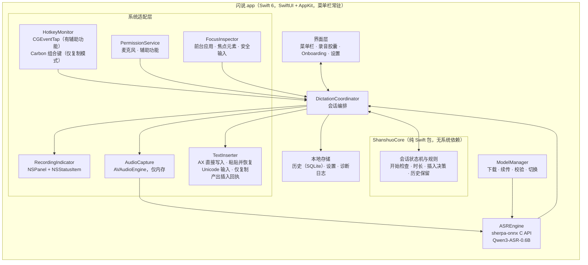
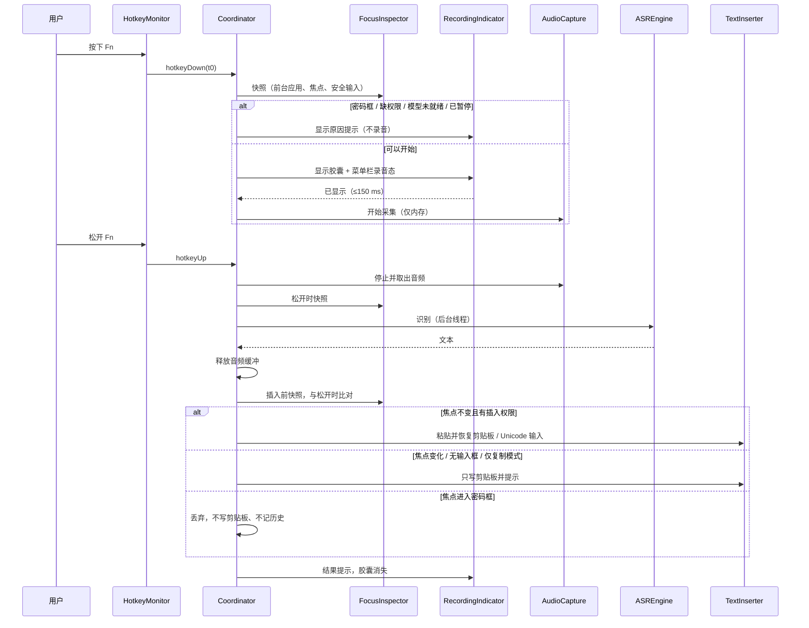

# 工程上下文：FEAT-001 闪说核心闭环（REQ-001）

> **状态**：已确认（plan 阶段），build 进行中。2026-10-21 20:48 用户确认 ED-001 技术栈、ED-011 Bundle ID，以及分发、基线机型和测试集等资源问题；21:20 用户确认 REQ-001 DEC-020（没有辅助功能时快捷键改为 ⌃⇧ Space），T006 的前置条件已满足。
> **关联**：Requirement `REQ-001`，产品上下文 [REQ-001.product.md](REQ-001.product.md)（Ready，原型 v0.3）。REQ-002、REQ-003 另立 Feature，本 Feature 只为它们预留接口（见 ED-008）。

## 当前有效方案

### 架构设计

#### 背景

REQ-001 要交付一个 macOS 菜单栏常驻应用：按住全局快捷键录音，录音前必须先显示录音提示；松开后在本机用 Qwen3-ASR-0.6B 识别中英文，再把文本插入松开时的活跃输入框；缺插入权限时退化为仅复制模式。新项目，仓库里只有产品文档、调研笔记和交互原型，没有生产代码，也还没有 `.sdlc-v1/project.md`（技术栈确认后由本 Feature 的 T004 创建）。

长期方向来源：[ASR 选型笔记](../../research/asr-model-selection.md)、REQ-001 的 DEC-001～DEC-016 和 NFR-001～NFR-007。本 Feature 的预期结果：在开发机上达到 NFR-002/NFR-003（DEC-019），SCN-001～SCN-012、SCN-019 在真实应用中通过，产出可供测试者安装的测试版（DEC-018）。

#### 复用评估

需求：全局按住式快捷键（含 Fn）、录音提示浮层、本地中英混说识别（带热词）、跨应用插入、权限引导、模型下载管理。

| 候选 | 证据 | 覆盖与差距 | 集成与维护 | 许可证与风险 | 结论 |
|---|---|---|---|---|---|
| A. 原生 Swift 自研外壳 + 成熟依赖（sherpa-onnx） | sherpa-onnx v1.13.8（2026-09-10）的 C API 有 `SherpaOnnxOfflineQwen3ASRModelConfig`（含 `hotwords` 字段），官方 `swift-api-examples/SherpaOnnx.swift` 已封装 Qwen3-ASR；团队在 yovoice 中用过 sherpa-onnx 1.13.8 和 SwiftPM 的 macOS 外壳 | 识别引擎直接复用；快捷键、浮层、插入、Onboarding 需自写，可参考 Handy（MIT）和 clips 模板的已验证做法 | macOS 原生 API 直接调用，权限和 TCC 行为最可控；空闲开销最低（NFR-004）；后续做 Windows 需另写外壳 | sherpa-onnx Apache-2.0；自研代码量最大 | **推荐** |
| B. Fork Handy（Tauri 2 + Rust + React） | MIT；已有按住/切换录音、录音浮层、剪贴板粘贴并恢复、历史、词典、LLM 后处理；Whisper / Parakeet 引擎 | 缺 Qwen3-ASR（需接 sherpa-onnx Rust crate 1.13.8）；录音前必须先显示提示、安全输入、焦点变化、仅复制模式、9 步 Onboarding 都要改核心流程；中文界面与品牌需替换（品牌资产不开源） | 跨平台底座，将来做 Windows 省力；要长期跟上游合并；WebView 带来常驻内存 | MIT 可闭源分发；上游 README 记录了剪贴板恢复时序问题（#502） | 备选：若首发后很快要做 Windows，优先考虑 |
| C. Fork VoiceInk（原生 Swift） | GPL-3.0；macOS 14.4+；whisper.cpp、FluidAudio（Parakeet）、SenseVoice-Small；个人词典、AI 增强、按应用切换模式 | 功能超出首发范围（屏幕上下文、助手模式），删减成本高；不支持 Qwen3-ASR | 上游不接受 PR，只能长期维护私有 fork | GPL-3.0：分发的应用必须整体以 GPL-3.0 开源 | 不采用 |

决定：**引入成熟依赖**（sherpa-onnx 作为识别运行时）+ 自研原生外壳。不 fork Handy 的具体原因：REQ-001 的硬规则（录音提示先于采集、提示失败不录音、安全输入框不可用、焦点变化改复制、仅复制模式）都落在会话主流程上，fork 后要重写的正是 Handy 最核心的部分，跨平台的好处在 CON-003（只做 macOS）下暂时用不上。clips 模板（`workspace/20260922-agent-native-research/templates/clips/desktop`）未找到许可证文件，只参考思路，不复制代码。

参考的已验证做法（只借鉴思路，代码自写）：
- clips `shortcuts.rs`：Fn 键用 ListenOnly 的 CGEventTap 监听 `flagsChanged` 中的 SecondaryFn 位，按边沿触发开始与结束；tap 被系统超时禁用后要自动重新启用。clips 的注释认为 ListenOnly tap 需要"输入监控"，与 DEC-017 引用的 Apple 论坛实测不一致，以 T002 的实机结果为准。
- clips `insert_text_for_frontmost`：普通应用用"写剪贴板 → 模拟 ⌘V → 恢复原剪贴板"，终端类应用改为直接输入 Unicode 字符。
- Handy README：Fn 只在 Apple 键盘上有事件（第三方键盘在固件里处理 Fn），与 DEC-002 外接键盘默认右 Option 一致；固定延时恢复剪贴板在负载高时会把旧内容粘进去，Handy 用"剪贴板被读取的通知"来推迟恢复。

#### 架构与组件

职责边界：`ShanshuoCore` 只放可单测的规则，规则从原型 `prototype/domain.js` 迁移，测试用例从 `prototype/tests/domain.test.js` 迁移；系统适配层每个组件包在协议之后，测试时可替换；`DictationCoordinator` 是唯一持有会话状态的对象，所有系统事件都经它进入状态机。

#### 关键设计决定

| ID | 决定 | 理由 | 状态 |
|---|---|---|---|
| ED-001 | 技术栈：Swift 6 + SwiftUI/AppKit 原生菜单栏应用（`LSUIElement`），仅 arm64，最低 macOS 14；Xcode 工程 + 一个本地 SwiftPM 包 `ShanshuoCore` | 见复用评估；本机工具链为 Xcode 26.6 / Swift 6.3.3 | **已确认**（2026-10-21 20:48 "技术栈选1"） |
| ED-002 | 识别运行时：sherpa-onnx v1.13.8，使用官方预编译的 macOS 静态库，通过 C API + 官方 `SherpaOnnx.swift` 封装在进程内调用；启动后在后台加载模型并常驻内存 | 进程内调用延迟最低；常驻才能满足 NFR-006（不因重新加载多等 1 秒以上）。代价是常驻内存约 1 GB 以上，T001 实测 | 定稿（T001，见 `bench/asr/reports/2026-10-21-m5.md`）：默认 Qwen3-ASR-0.6B int8。与 Fun-ASR-Nano 准确率差值的 95% 区间全部跨过 0；Qwen3 每次识别可单独传热词，加载 1.1 s（Fun-ASR-Nano 3.1 s，热词只能加载时设定且受 512 KV 上限限制，100 个热词时被截断）。常驻内存约 1.9 GB（max_total_len 2048），产品按实际热词量调小。SenseVoice-Small 英文 WER 31.5%，不满足 NFR-003，不再作为轻量备选（REQ-001 DEC-021）；Whisper 排除。性能核上的延迟由用户终端结果补充 |
| ED-003 | 快捷键有两套实现，随辅助功能权限自动切换，不申请输入监控（REQ-001 DEC-017）。**有辅助功能**：session 级 CGEventTap 监听 `flagsChanged`（Fn = SecondaryFn 位，右 Option = 设备相关的右 Option 位）和组合键的 `keyDown`/`keyUp`；每 5 秒检查 `CGEvent.tapIsEnabled`，被系统禁用或签名身份变化导致失效时重新安装。**没有辅助功能（仅复制模式）**：用 Carbon `RegisterEventHotKey` 注册按住 ⌃⇧ Space，它能分别收到按下和松开事件，不需要任何权限，但不能注册单独的 Fn 或右 Option。权限变化时立即切换实现并提示用户（REQ-001 DEC-020） | 用户不接受输入监控；同类产品只要求辅助功能 | 默认；T002 验证只有辅助功能时能否收到 Fn 事件，收不到则回到产品 |
| ED-004 | Esc 取消：有辅助功能时，录音和处理期间临时改用可拦截的 tap 吞掉 Esc，避免 Esc 同时关掉前台应用的对话框；仅复制模式下，录音期间临时用 Carbon 注册 Esc 热键，结束后立即注销 | 拦截按键需要辅助功能；Carbon 热键在注册期间同样会拦下 Esc | 默认，T002 验证 |
| ED-005 | 插入策略按目标应用依次选择：(1) **AX 直接写入**：焦点元素支持写入 `kAXSelectedTextAttribute` 且该应用在 T002 实测清单中时，直接写入光标处，不碰剪贴板；(2) **粘贴并恢复**：先完整读出用户剪贴板的全部条目和类型，再写入识别文本（同时标记 `org.nspasteboard.TransientType` 和 `org.nspasteboard.ConcealedType`，让剪贴板管理器和系统剪贴板历史忽略这次临时写入），模拟 ⌘V，用 `NSPasteboardItem` 的延迟数据回调得知目标已读取后恢复原内容，1 秒内未读取则兜底恢复；(3) **Unicode 输入**：Terminal、iTerm2 用 `CGEventKeyboardSetUnicodeString` 分段输入。仅复制模式只写剪贴板，不读取 | 回答用户 20:48 的提问："恢复原剪贴板"确实要求每次粘贴前先以程序方式读取剪贴板，这是同类产品（Handy、clips 模板）的通行做法。AX 直接写入能在支持的应用中完全绕开读取；读取时是否触发 macOS 的"从其他应用粘贴"提示由 T002 用独立 .app 实测 | 定稿（T002，见 `spikes/platform/RESULTS.md`）：备忘录 AX 直接写入 6/6 成功并通过读回校验；独立 .app 的剪贴板访问策略首次启动即为 alwaysAllow，读取不弹提示，保留恢复原剪贴板。其余 12 个应用的矩阵移到 T015 用正式版测 |
| ED-006 | 焦点与安全输入：按下、松开、插入前三个时刻都记录"前台应用 PID + 焦点元素标识"；安全输入用 `IsSecureEventInputEnabled()` 加焦点元素子角色 `AXSecureTextField` 共同判断。没有辅助功能权限时无法读取焦点元素，只比较前台应用并检查系统安全输入状态 | DEC-013 的焦点变化与密码框规则 | 默认 |
| ED-007 | 录音提示先于采集：Coordinator 先显示 NSPanel 胶囊（非激活、`canJoinAllSpaces` + `fullScreenAuxiliary`，位于活跃窗口所在屏幕）并切换菜单栏图标，收到胶囊已显示的回调后才启动 AVAudioEngine；显示失败则不启动采集（FR-004） | DEC-005；NFR-001 的 150 毫秒预算从按键事件算起 | 默认；T002 实测胶囊从按键到显示 P50 1 ms、最大 34 ms；采集启动见 ED-016 |
| ED-008 | 识别后处理管线：识别结果经过 `TextPostProcessor` 协议链再交给插入，REQ-001 只有"原样输出"一个实现；REQ-003 的词典替换和 REQ-002 的整理以后作为新实现接入，不改会话状态机。REQ-003 的静默学习另需插入回执（ED-013） | 只预留接口，不提前实现 REQ-002/003 | 默认 |
| ED-009 | 模型分发：首次运行时下载，不打包进 DMG。逐文件下载（不用 GitHub 整包 tar.bz2）；源顺序 Hugging Face → hf-mirror.com，URL 固定到 commit revision；HTTP Range 断点续传，网络出错时保留 `.part` 并可换源续传，服务器忽略 Range 时从头下载；应用内置清单（每个文件的大小与 SHA-256，大文件取 HF LFS 哈希，小文件下载核对后计算），校验失败自动重下一次，仍失败报错，写完校验通过才原子重命名。ModelScope 没有 sherpa-onnx 包，公开分发前如需国内源再自建镜像（清单不变，只加源模板）。默认模型以 T001 结论为准 | DMG 保持小体积；FR-013；逐文件可单独续传与校验 | 已定稿（T003，2026-10-21）；中国大陆直连未实测，公开分发前复测 |
| ED-010 | 本地数据：历史存系统 SQLite3，使用参数绑定，不引入尚未接入的 GRDB；7 天保留在启动时和每小时清理一次；设置存 UserDefaults；诊断只接收事件枚举、耗时和错误码，不接收听写文本（FR-014） | 当前仅需单表写入、按时间查询和删除；复用 macOS 自带 SQLite3，避免为 swiftc 工程增加新的第三方构建链。数据库与含文本的附属文件只允许当前用户访问；关闭历史后不再写入，已有内容由明确的删除/清空动作处理 | 2026-10-22 工程细化，产品保留与控制规则不变 |
| ED-011 | 工程标识：显示名"闪说"，可执行文件名 `Shanshuo`，Bundle ID `com.arnow117.shanshuo` | DEC-014 只定了中文名 | **已确认**（2026-10-21 20:48 "6可以的"） |
| ED-012 | 测试版签名（REQ-001 DEC-018）：在本机创建一个长期有效的自签名代码签名证书"Shanshuo Test Signing"，从 T002 的第一个实验应用起，所有构建都用这个身份签名并开启 Hardened Runtime（只开 `com.apple.security.device.audio-input`）。固定身份才能让 macOS 在重新构建后继续承认已授予的麦克风和辅助功能权限。不做公证，不上 App Store，不做自动更新；测试者第一次打开时在"系统设置 › 隐私与安全性"中允许打开 | 本机没有任何签名身份（`security find-identity` 为 0）；ad-hoc 签名每次构建身份都会变 | 默认；证书与私钥不入库，导出备份由用户保管 |
| ED-013 | 插入回执（为 REQ-003 静默学习预留）：每次插入成功后，TextInserter 返回 `InsertionReceipt`（目标元素、插入的文字、定位插入段所需的上下文），只保存在内存中。本 Feature 只产出回执，并在"离开输入框、下一次按下快捷键、2 分钟到期"三个时刻发出结束事件；读取输入框文字和学习逻辑属于 REQ-003 的 Feature | REQ-003 DEC-007；把系统接入点留在插入层，避免以后改核心流程 | 默认；T002 验证 DEC-012 应用中 AX 读取输入框文字的可用性 |
| ED-014 | 识别线程的调度优先级：识别串行队列用 `DispatchQoS.userInitiated`（松开快捷键后用户在等结果），模型后台加载用 `.utility`；识别器在 userInitiated 队列上创建和调用。onnxruntime 自建的线程池是否继承这个 QoS 未验证，T008 集成测试要在识别期间记录能效核与性能核负载，确认用上了性能核；线程数取 T001 终端实测的最优值 | 2026-10-21 T001 发现：被系统限制在低 QoS 的进程在 Apple M5 上只会调度到 6 个能效核，Qwen3-ASR 实时率从约 0.1 变为约 0.28（15 秒语音识别需 4 秒以上），NFR-002 直接不达标 | 默认；T008 验证 |
| ED-015 | 热词用法（供 REQ-003 的 Feature）：Qwen3-ASR 每次识别只传十几个相关词条，不传整本词典；识别结果为空、只有 system/user/assistant 这类角色标记，或长度不足按时长估计值的 30% 时，去掉热词再识别一次并记录诊断事件 | T001：0 个热词实体召回 67.6%，7～10 个 89.2%，50 个 75.7%，100 个 70.3%；耗时随热词数增加；只给 1 个热词时有 1 条输出变成"system" | 默认；词条挑选方式在 REQ-003 规划时决定 |
| ED-016 | 音频设备预热：麦克风已授权时，应用启动后在后台创建 AVAudioEngine 并 `prepare()`，按下快捷键时只需 `start()`；T007 实测 `prepare()` 是否会点亮系统麦克风指示，会点亮则改为只在首次听写前预热并接受首次延迟 | T002：AVAudioEngine 冷启动 1655 ms，之后 P50 56 ms；按键到第一块音频 P50 163 ms。冷启动时用户开头约 1.6 秒的话会丢失 | 默认；T007 验证 |
| ED-017 | 加速执行（用户 2026-10-21 22:30"加速做集成交付"）：(a) T004～T010 合并为一条纵向切片，直接复用 `spikes/platform/ShanshuoProbe` 中已验证的快捷键、胶囊、插入、采集代码；(b) 不建 Xcode 工程：纯逻辑放 SwiftPM 包 `Packages/ShanshuoCore`（`swift test`），应用代码由 `scripts/build.sh` 用 swiftc 编译并组装、签名 .app（与探测应用相同做法）；(c) XCUITest 改为脚本化端到端（测试构建用 WAV 文件替代麦克风）加手测；(d) DEC-012 的 13 个应用矩阵在 T015 用正式版测；(e) T008 只实现 Qwen3-ASR，T012 不做模型切换（用户 22:37 确认，REQ-001 DEC-021） | 探测应用已证明 swiftc + 自签名身份能产出权限稳定的 .app，省去工程配置时间；XCUITest 对菜单栏应用和系统权限弹窗支持差，投入产出低 | 默认 |

### 2026-10-22 交付约束细化

- 异步插入与会话共用取消边界。Coordinator 取消时，插入器必须撤销尚未执行的粘贴、超时复制及相关回调；每次不可逆写入前重新检查当前操作和安全状态。旧会话不能凭迟到回调写入新会话。临时剪贴板只在仍由本应用持有时恢复。
- ASR 返回可取消的 operation。取消立即使排队任务失效并释放尚未处理的音频；正在执行的同步原生块允许完成，但不得继续解码其余块。任务开始和每块开始前均检查取消状态，迟到结果不能回写。模型卸载仍在同一串行队列等待当前原生调用结束，不并发销毁识别器。取消长录音后，新听写只等待至多当前块结束。
- 解码前的数字静音优化只跳过完全无有效非零信号的块，不能用整段 RMS 固定阈值判定“没有说话”。低音量有效语音必须进入识别；电平用于界面和诊断，不是语音分类器。此优化不是 VAD，也不替代 T015 的非零环境噪声/无语音测试；若实际无语音仍生成文本，须依据复现证据另行落实识别前语音检测，不能通过提高固定阈值再次丢弃低音量语音。
- 会话期限、权限、安全输入和回执到期所需的主线程 Timer 注册到 RunLoop 的 common modes，菜单保持展开时仍需执行。录音上限不依赖用户关闭菜单。
- AX 的屏幕坐标转换使用主显示器参考坐标（`NSScreen.screens.first`），不能以所有显示器的最高边或当前活跃屏幕作为转换原点。几何回归覆盖主屏上方、下方与负坐标屏幕；合成几何证据不代替多屏真机验证。
- 模型管理为单一写入者：下载、暂停、换源、校验、删除、修复都带操作代次；过期回调不能重新启用旧模型。ASR 的创建、使用和卸载保持在同一串行队列；删除前先停止新会话，取消当前会话，等待卸载完成，再修改该模型目录。完成校验后才触发加载。
- 模型下载流式写入 `.part`，不能将整个大文件放进内存。Range 的起点和完整长度必须与清单一致；200 响应需截断重下，206 校验 Content-Range，416 只能对实际完整且校验通过的文件作完成处理，否则从头恢复。完整文件检查大小与 SHA-256，再原子重命名；不存在“仅文件名齐全就就绪”的状态。生产路径只使用内置的固定清单与 HTTPS 源。
- 模型加载/删除/修复期间禁止开始新听写。下载取消保留可恢复的部分文件；校验失败自动重下一次，仍失败则显示恢复入口。系统错误转换为明确、无私人内容的错误状态。
- 引导、设置和菜单栏共享权限、模型、快捷键、暂停和练习状态，系统权限每次从 OS 读取；引导进度可续接，但权限与模型 readiness 不能由已保存的“完成”标记替代。仅复制模式的练习须从真实识别结果复制/粘贴完成，不能预填假文本通过。
- 应用级主线程状态对象提供共享投影，窗口只发送命令；Coordinator 继续独占会话状态，ModelManager 独占模型文件变更，HistoryStore 串行拥有数据库。引导只保存进度、已访问步骤与成功/跳过标记，不保存练习文本或音频。有效步骤不包含输入监控和整理配置。
- 麦克风测试复用受控采集边界，和听写互斥；显示测试状态后才能采集，关页/关窗/跳过/权限变化立即取消。声音检测来自真实电平；快捷键测试来自真实按住和松开事件。练习成功关联 session ID 与真实识别结果：直接模式确认控件实际收到该文本；复制模式须用户把本次实际结果粘贴入练习框。普通手输、非空初始值、快捷键注册成功或未验证插入回调都不能单独完成练习。
- 原生练习绑定在每次按下前根据实际可见窗口、当前步骤和 first responder 重新确认；误触、取消或空输出后可直接重试，不因一次性 claim 耗尽而把后续练习写入历史。无辅助功能时也用本应用原生控件事实验证，不能只以相同 PID 代替实时练习焦点。麦克风测试的延迟启动须校验同一页面/窗口代次及实际可见状态，关闭或离页先使尚未执行的启动失效。
- 练习离页/关窗取消属于该练习 binding 的活动采集、识别和延迟插入，不能影响其他正常听写；同时使迟到 outcome、控件读回和粘贴检查失效。练习证明按本次 attempt/session 与实际编辑或粘贴事件建立关联，旧控件值恰好等于识别结果不能单独作为实际插入证明，`.unverified` 也不能直接视作已交付。
- 麦克风测试在停止音频队列完成前保留 stopping operation 和取消能力；排队停止请求强持有其 operation 至执行完毕，所有异步停止完成均检查代次。关闭、重试或暂停不能让旧完成更改新测试状态；停止阶段继续与听写互斥。
- 历史读写、删除和清空失败通过 AppModel 共享状态持久发布；失败不得被周期状态刷新或一次成功查询清掉，窗口提供明确失败与重试操作。只在相应操作成功后清除其错误状态。
- 原生窗口必须先建立父子视图层次，再激活跨视图约束。构建检查之外，生产窗口构造与布局 harness 实例化模型、引导、历史和隐私窗口（及后续设置窗口），验证没有 Objective-C 布局异常；不能把“Swift 编译成功”视为窗口能创建。首次启动窗口仍需 CUA 实际观察。
- 偏好快捷键与当前有效快捷键分别建模；无辅助功能时强制有效值为 ⌃⇧ Space，保留用户偏好。自定义支持单修饰键及修饰键加普通键，拒绝无修饰普通键和系统保留组合，失败必须显示实际未注册状态。Fn 系统占用仅检测并给出系统设置入口，不静默修改系统键盘偏好。
- T014 的快捷键配置使用可序列化的键码/修饰键描述，兼容读取已有 function/rightOption/copyOnlyControlShiftSpace 偏好值；不能把旧用户设置直接重置。会话开始时捕获直接插入/仅复制模式，后续取消与授权提示依据该模式，不依据某个快捷键枚举名推断。更改快捷键或进入录入控件先取消活动会话，避免换键后旧 keyUp 无法停止录音；录入期间暂停全局触发，提交/取消后恢复准确的有效配置。自定义组合消费其匹配的普通键事件，不能把该键漏入目标控件。当前单修饰键加其他键的系统组合仍取消本次听写。
- 输入设备保存稳定 UID 或“跟随系统默认”，开始时解析并固定本次设备；设置变化及默认设备变化在下一次生效。仅设备列表变化不能取消仍可用的活动设备；活动设备消失或实际引擎重配置无法续采时取消并丢弃，绝不续接替换设备。只配置本应用输入单元，不改变系统默认设备。复用 AVAudioEngine / CoreAudio 的设备设置，参见 [Apple AUAudioUnit 设备接口](https://developer.apple.com/documentation/audiotoolbox/auaudiounit/deviceid)。
- 本应用主动选择输入设备所需的图配置必须作为可取消的准备阶段完成，不能在活动 capture 已登记之后调用 `setDeviceID`，再把由该调用延迟产生的配置通知误判为外部中断。准备代次绑定明确的设备计划，通知处理后重新验证实际设备/格式与计划一致，完成后才报告可录音；未准备好时明确拒绝或等待受控准备，不采集替代设备。启动/设备选择后可后台准备；进行中的设置变化仍只作用于下一次。真正采集期间的设备消失、路由或引擎重配置继续取消并丢弃，不能通过全局忽略配置通知修正冷启动失败。麦克风准备耗时计入 NFR-006。
- 准备就绪绑定已解析的设备 UID/ID、engine epoch、准备代次和配置 revision；同一次默认设备计划不能在重试时偷偷解析成另一个设备。setter 返回、串行队列已执行、非零格式或 `engine.start` 成功均不等于延迟通知已经处理：实际改路后的准备完成需要明确的通知/图配置完成判据与设备、格式复核，目标设备已经一致时避免重复 setter。通知进入时记录所属 engine epoch/revision，提交准备和启动采集时复核；取消、关闭或旧引擎的迟到回调不能恢复 ready、启动新采集或中断另一个 engine。公共通知没有原因标识，不用“忽略下一次”、通知次数或任意宽限时间推断来源。
- Coordinator 在最终仍有效的结果上发布唯一的 SessionOutcome，包含 session ID、允许保留的文本、真实 inserted/copied/unverified 结果与目标；历史与练习消费此事件，不能从胶囊文案或早到的识别回调推断成功。取消、安全输入、睡眠等丢弃路径不得产生含文本事件。历史按 session ID 去重，串行删除/清空后旧回调不能复活记录；查询排除已过期项，数据库及其 WAL/SHM/journal 和目录均限制当前用户访问。
- 暂停支持一小时与手动恢复，立即取消活动会话；持久化暂停模式/截止时间，唤醒或重启按绝对截止时间重算。历史默认开启且保留七天；关闭只停止后续写入，已有记录由明确删除操作处理。诊断接口只接受事件枚举、耗时和错误码，不能接收任意文本或底层错误描述。
- 公共源码构建不依赖发布私钥或本机绝对路径。开发者可选择自己的签名身份或 ad-hoc 构建；发布资产使用已有测试签名身份，并附全部许可。release 配置不携带开发模型路径、测试注入或私人数据。源码公开与发布授权见 REQ-001 DEC-022，未改变产品质量阈值。
- 首个公开测试版的准确率范围按 REQ-001 DEC-024：接受已公开实测的中文 6.48% 与混说 12.94% 限制，原定 NFR-003 保持未通过；英文 6.03% 达标。其他隐私、安全、兼容性和质量要求继续验证，不由准确率例外推导额外豁免。
- 首个公开候选版本按 `v0.1.0-beta.1` 准备，应用版本 `0.1.0`；构建号使用合法数字版本，时间戳另存，不能继续把带连字符的日期当作 CFBundleVersion。分发产物为 .app 的 ZIP、DMG 和 SHA-256 清单，包含自有及第三方许可。安装说明如实说明自签名、未公证及系统的首次打开步骤，不修改全局 Gatekeeper 或绕过证书检查。版本键规则参见 [Apple Core Foundation Keys](https://developer.apple.com/library/archive/documentation/General/Reference/InfoPlistKeyReference/Articles/CoreFoundationKeys.html)。
- T016 的 bundle build number 采用三个数字段并校验宽度（首段 1～4 位且大于零，后两段各 1～2 位）；首个候选可用 `1.0.1`，完整时间另存 `ShanshuoBuildTimestamp` 供界面/报告识别。不能简单移除时间戳连字符而生成超长首段。公共 clone 默认允许 ad-hoc 或调用者自己的签名；发布过程明确选择既有测试身份，缺失身份必须失败而非悄悄降级。源码构建与发布目录输出均与私人模型、签名缓存隔离。
- 实现期间的单元、集成与模拟系统证据不替代 T015 的真机、权限、性能和兼容性验证；所有环境缺口与未测项目显式记录，最终验证不得将其算作通过。
- T015 通过少量本地类型化事件观测真实生产路径：随机 attempt/session ID、固定事件/结果枚举、单调时钟和必要音频时长；接口不接收转写、窗口标题、剪贴板内容、任意错误字符串或完整路径，不上传诊断。分别记录热键回调、AppKit 显示提交、实际采集/停止、识别交付、AX 读回验证、复制与未验证粘贴；失败/取消也计入分母。`display()/isVisible` 不是屏幕首帧，`.unverified` 不是实际插入完成。NFR-001 若只有应用提交时间，必须保留首帧时间未证实的限制。
- T015 的端到端延迟优先使用备忘录实际 AX 写入/读回验证作为终点；不超过 15 秒和 30 秒各计划 20 次，记录分布及失败，和八应用矩阵结果分别统计并复用重叠试次。输入使用许可清楚的非私人测试语句，经播放器和真实麦克风进入产品路径；UI 操作只经 CUA，不向发布产品注入 WAV 或成功回执。进程冷启动用 `proc_pid_rusage` 起始时间至实际 ready，3～5 次且计入模型验证/加载；空闲 CPU 用 120 秒进程 user+system 累计差与单调墙钟计算，区间无采集/下载/校验且仅采样两端。无法可靠执行的真实操作如实记录，不能用模拟结果替代。
- T015 本地性能事件由单一串行 sink 写入固定的应用支持目录；只接受固定事件/结果枚举、随机过程与会话 UUID、单调时间和必要时长，不接受任意字符串、识别文本、窗口/应用标题、剪贴板或路径。文件限制 owner-only、有限总容量和保留数量，默认不上传，并在隐私说明披露用途。普通界面按键路径和正式 release 配置使用相同事件边界，不能为测量插入模拟成功。状态投影仅在相关值变化时发布，隐藏窗口不持续渲染；设备列表在显示/打开菜单或实际硬件变化时更新。性能修正不降低正在录音时的安全输入、权限、期限和 common-mode 检查频率。
- 每次真实按下在所有拒绝检查前建立独立 attempt UUID，松开最多一次并只归属该按下；忙碌、权限等拒绝也记录失败，不能写到正在识别的旧会话。汇总的测量集可由明确 process/session UUID 选择，不能按成功事件倒推分母；缺松开、停止或时长的尝试保留为不完整/未知时长并阻止相应延迟通过，不静默过滤。NFR-006 的 5 秒限制校验每次冷启动（最大值），P95 仅辅助描述。音频实际 start/stop 事件在 engine queue 的真实边界记录，Coordinator 回调如保留则使用不同名称。输入计划开始失效就撤销 idle readiness，只有当前计划的 ticket 提交才恢复；权限设置失败的诊断存储停写。投影去重必须覆盖快捷键测试等可见状态，不能吞掉成功或重置通知。

#### 数据模型 / 关键实体

- `DictationSession`（内存）：`id`、`phase`（idle / listening / recognizing / inserting / cancelled / failed）、`startedAt`、`targetAtPress`、`targetAtRelease`、`audioBuffer`（16 kHz 单声道 Float32，3 分钟上限约 11 MB，会话结束即释放）、`failureReason`。
- `TargetSnapshot`：`bundleID`、`pid`、`focusedElementID?`、`isSecure`。
- `HistoryRecord`（SQLite）：`id`、`sessionID`（唯一）、`createdAt`、`targetBundleID`、`targetAppName`、`recognizedText`、`finalText`、`insertResult`（inserted / copied / unverified）。只接收最终允许保留的 SessionOutcome；不存在"密码框"类型的记录（DEC-013）。
- `InstalledModel`：`modelID`、`version`、`files[{name, sha256, bytes}]`、`path`、`isActive`。
- `PermissionState`：麦克风、辅助功能两项；每次需要时向系统查询，不缓存为真值（REQ-001 关键实体）。
- `InsertionReceipt`（内存）：`targetPID`、`element`（AXUIElement 引用）、`insertedText`、`method`（ax / paste / unicode）、`locator`（定位插入段所需的上下文）、`insertedAt`。结束事件发出后立即释放（ED-013）。

#### 时序与数据流

#### 横切质量设计

- **延迟预算（NFR-002，15 秒语音，P50 ≤ 1.0 秒）**：停止采集 ≤ 20 ms；识别是主要耗时（T001 实测，目标 ≤ 800 ms）；焦点快照与插入 ≤ 100 ms；剪贴板恢复不计入"文本出现"时间。识别在独立的串行队列上执行，模型常驻。
- **空闲开销（NFR-004）**：空闲时不运行 AVAudioEngine；event tap 回调只做位判断。必要的权限刷新使用低频 common-mode Timer，活动会话额外检查安全状态；以 T015 实测 CPU 低于 1% 为准，不把“没有任何 Timer”作为实现前提。
- **隐私**：音频只在内存缓冲中存在，会话结束（包括取消和失败）立即清零释放；不写临时文件；日志不含文本；模型下载请求不带用户标识。粘贴时读出的原剪贴板内容只在内存中保留到恢复完成；插入回执同样只在内存中。
- **可靠性**：event tap 被系统禁用时（`tapDisabledByTimeout` / `tapDisabledByUserInput`）自动重新启用，并在菜单栏提示；识别崩溃风险由 T001 的长时间压测评估，必要时把引擎移到 XPC 子进程（不在首版计划内）。
- **无障碍（NFR-007）**：原生控件有可读标签；胶囊状态同时用文字表达；Onboarding 与设置可全程键盘操作，用真实键盘导航和 VoiceOver 检查（ED-017）。

#### 风险与取舍

| 风险 | 影响 | 缓解 / 验证 | 回退 |
|---|---|---|---|
| Qwen3-ASR-0.6B 在开发机上 CPU 延迟达不到 NFR-002 | 核心体验 | T001 对比 CPU 与 CoreML provider、线程数；同时测 SenseVoice-Small | 已关闭：T001 后用户确认只用 Qwen3（REQ-001 DEC-021）；延迟以用户终端实测补充 |
| macOS 新版对程序读取剪贴板弹出隐私提示（Apple 自 macOS 15.4 起预告，系统设置中有"从其他应用粘贴"项） | 粘贴路径每次都要先读取剪贴板，可能弹窗 | 本机 macOS 26.4.1 对终端进程的 `accessBehavior` 为 `alwaysAllow`；T002 用独立 .app 再测 | 扩大 AX 直接写入的应用范围；必要时回到产品调整"恢复剪贴板"规则 |
| 只授予辅助功能时收不到 Fn 事件（两份来源说法不一致，见调研笔记） | DEC-017 不成立 | T002 第一项就验证 | 回到产品：要么申请输入监控，要么默认快捷键改为组合键 |
| 重新签名后 tap 存在但收不到事件 | 快捷键静默失效 | 固定签名身份（ED-012）；定时检查 `tapIsEnabled` 并重装（ED-003） | 菜单栏提示并引导重新授权 |
| ⌃⇧ Space 与输入法或其他应用的快捷键冲突 | 仅复制模式下无法使用 | T002 在系统拼音、搜狗、微信输入法下测试 | 改用 T002 选出的其他组合，并允许用户自定义 |
| 安全输入开启时收不到快捷键事件 | 密码框中按键无提示 | T002 验证；DEC-013 依赖条目已说明可接受 | 无提示但不录音 |
| ModelScope 没有 sherpa-onnx 的 Qwen3-ASR 包（T003 已证实） | 国内直连下载慢或失败 | 测试版用户与开发者处于同一网络环境；公开分发前在不经代理的国内网络复测 | hf-mirror.com 作为后备源（第三方，无 SLA）；需要时自建镜像（ModelScope 自有仓库或对象存储），清单与 SHA-256 不变 |
| 第三方键盘没有 Fn 事件 | 外接键盘用户 | DEC-002 已规定外接键盘默认右 Option；T002 验证检测外接键盘的方法 | 引导用户改快捷键 |

#### 需求覆盖

| 验收条件 | 设计 / 契约 | 计划 Task | 计划验证 |
|---|---|---|---|
| 用户故事 1 场景 1～12，FR-001、FR-003、FR-005、FR-009、FR-015 | ED-003～ED-007，状态机 | T005、T006、T007、T009、T010 | `swift test`（规则）、生产组件 harness、原生 UI 与 DEC-023 应用矩阵手测 |
| 用户故事 2 场景 1～10，FR-006～FR-008 | ED-003（只需辅助功能；仅复制模式用组合键）、PermissionService | T006、T011 | 原生 UI 键盘/辅助功能检查与全新用户路径手测；无 Xcode 工程，不使用 XCUITest（ED-017） |
| 用户故事 3 场景 1～9，FR-004、FR-010～FR-012、FR-014 | ED-007、ED-010 | T007、T013 | 自动化计数提示出现率（SC-004）；日志扫描无文本；检查本机无音频文件 |
| 用户故事 4 场景 1～3，FR-013 | ED-009 | T003、T012 | 断网、校验失败、删除模型的集成测试 |
| FR-002、NFR-002、NFR-003 | ED-002 | T001、T008、T015 | eval-bench 报告（开发机 M5 / 16 GB，写明缺少 M1 数据，DEC-019） |
| NFR-001、NFR-004～NFR-007 | 横切质量设计 | T015 | 计时脚本、Activity Monitor 采样、应用矩阵、VoiceOver 检查 |
| DEC-018 / ED-012 测试版签名 | ED-012 | T002（创建签名身份）、T016 | 重新构建后权限保持；`codesign --verify --deep --strict` |

原型场景 SCN-001～SCN-012、SCN-019 是上表的行为来源，原型本身不代替生产验证。

### 实施计划

#### 目标 / 非目标

- 目标：REQ-001 全部验收条件；测试版安装包（DEC-018）。
- 非目标：REQ-002 智能整理、REQ-003 词典与静默学习（只留 ED-008、ED-013 接口）；公证与自动更新；Windows；XPC 进程隔离；遥测。

#### 技术栈

| 层 | 选择 | 版本 |
|---|---|---|
| 语言 / UI | Swift 6、SwiftUI + AppKit | Xcode 26.6（Swift 6.3.3），部署目标 macOS 14.0，arm64 |
| 识别 | sherpa-onnx C API + 官方 Swift 封装 | v1.13.8（固定版本，升级另开 Task） |
| 模型 | Qwen3-ASR-0.6B int8（唯一，REQ-001 DEC-021） | `sherpa-onnx-qwen3-asr-0.6B-int8-2026-03-25` 等，SHA-256 固定在清单 |
| 存储 | 系统 SQLite3、UserDefaults | 随 macOS；不增加 GRDB（ED-010） |
| 测试 | Swift Testing、生产组件集成 harness、原生 UI 手测 | 无 Xcode 工程 / XCUITest（ED-017） |
| 评测 | Python 3 脚本调用 sherpa-onnx Python 包（与 App 同版本） | `sherpa-onnx==1.13.8` |

#### 实施阶段

1. **阶段 0：验证（阻塞后续）**：T001 ASR 评测、T002 平台验证、T003 下载源验证。出口条件：NFR-002/NFR-003 在开发机上可达，或已回到产品确认调整；ED-002～ED-005、ED-009、ED-012、ED-013 定稿；REQ-001 DEC-020 已确认。
2. **阶段 1：基础**：T004 工程骨架、T005 领域核心。
3. **阶段 2：核心闭环（用户故事 1）**：T006～T010。
4. **阶段 3：Onboarding 与模型管理（用户故事 2、4）**：T012 → T011。
5. **阶段 4：隐私与历史（用户故事 3）**：T013。
6. **阶段 5：验收与测试版打包**：T015、T016。

### 工程任务（计划）

| 计划 ID | 标题 | 代码范围 | 依赖 | 完成条件 | 验证 |
|---|---|---|---|---|---|
| T001 | [验证] 本地 ASR 评测台 | `bench/asr/`（脚本、测试集清单、报告） | — | 120 条测试集（中文 40、英文 30、混说 30、专有词 20），优先取自现成的公开数据集：专有词部分的候选为 SeACo-Paraformer 论文发布的 AISHELL-1 命名实体测试集、ContextASR-Bench 等，先核实可获得性与许可证，不足部分再自录；4 个候选的 CER/WER/MER；5/15/30 秒语音的 P50/P95 延迟；常驻内存；热词数量与延迟、准确率的关系（供 REQ-003）；只在开发机 M5 上测，报告写明缺少 M1 数据（DEC-019） | 报告入库，结论写回本文件与 DEC-004 |
| T002 | [验证] macOS 平台能力 | `spikes/platform/`（一次性 Swift 命令行与小应用，不进产品） | — | 先创建 ED-012 的签名身份，实验应用都用它签名。结论项：(1) 只授予辅助功能时 CGEventTap 能否收到 Fn / 右 Option / Esc（DEC-017）；(2) 不授予任何权限时 Carbon ⌃⇧ Space 的按下与松开、与常见输入法的冲突（REQ-001 DEC-020）；(3) 重新构建后权限是否保持；(4) 安全输入下的事件；(5) 胶囊在全屏应用和多显示器上的显示；(6) DEC-012 共 13 个应用的插入方式与成功率，含 AX 直接写入是否可用；(7) 独立 .app 读取剪贴板是否弹提示，Transient 标记是否让系统剪贴板历史忽略；(8) 13 个应用中 AX 能否读取输入框文字（供 REQ-003）；(9) 系统设置深链接与授权后免重启（DEC-016） | 结论表入库，ED-003～ED-006、ED-012、ED-013 定稿 |
| T003 | [验证] 模型下载源 | `spikes/model-download/` | — | Hugging Face 与 ModelScope（或自建镜像）在中国大陆网络下的可用性与速度；Range 续传；文件 SHA-256 清单 | 结论入库，ED-009 定稿 |
| T004 | 工程骨架 | `app/`（swiftc 构建，无 Xcode 工程，ED-017）、`Packages/ShanshuoCore/`、`scripts/`、`Vendor/`、`.sdlc-v1/project.md` | T001、T002 结论 | 菜单栏空壳可运行；`scripts/test.sh` 跑通单测、构建与识别冒烟测试（UI 测试按 ED-017 改为脚本化集成测试 + 手测清单）；ED-012 签名；`project.md` 记录技术栈与命令 | `scripts/test.sh` |
| T005 | 领域核心与规则迁移 | `Packages/ShanshuoCore/` | T004 | 会话状态机、开始检查（含密码框）、时长规则、插入决策、历史保留迁移完成，原型 20 组测试中属于 REQ-001 的全部迁移为 Swift 测试 | `swift test` |
| T006 | 系统适配：权限、快捷键、焦点 | `app/Shanshuo/Platform/{Permission,Hotkey,Focus}*` | T004、T002 | 两项权限实时检测；快捷键两套实现（event tap / Carbon）随权限自动切换；Fn / 右 Option / 自定义组合键按住与松开；Esc；焦点与安全输入快照 | 单测（协议替身）+ 手测清单 |
| T007 | 录音提示与音频采集 | `app/Shanshuo/Platform/{Indicator,Audio}*`、`app/Shanshuo/UI/Pill*` | T005、T006 | 胶囊先于采集；显示失败不采集；菜单栏录音态；倒计时；提示音可关；音频只在内存 | XCUITest + 计时日志（NFR-001） |
| T008 | 识别引擎 | `app/Shanshuo/ASR/`、`Vendor/sherpa-onnx/` | T004、T001 | Qwen3-ASR 实现（REQ-001 DEC-021）；启动后后台加载；识别在 userInitiated 串行队列（ED-014），测试中记录识别期间的核心负载；测试用 WAV 夹具 | 集成测试（夹具音频 → 期望文本） |
| T009 | 文本插入与仅复制模式 | `app/Shanshuo/Platform/Insert*` | T006、T002 | ED-005 三种插入方式与按应用选择；剪贴板 Transient 标记与恢复；插入回执与结束事件（ED-013）；仅复制模式提示与"开启直接插入" | XCUITest（TextEdit）+ DEC-012 矩阵手测 |
| T010 | 核心闭环集成 | `app/Shanshuo/Coordinator/` | T005～T009 | 用户故事 1 场景 1～12 全部可演示；测试构建可用 WAV 文件替代麦克风输入 | XCUITest 端到端 + 真机麦克风冒烟 |
| T011 | Onboarding | `app/Shanshuo/UI/Onboarding/` | T010、T012 | 有效步骤覆盖欢迎、麦克风、辅助功能、模型、麦克风测试、快捷键、练习、完成；可返回和续接。按 DEC-017/021 去掉输入监控与整理配置，不为凑历史步数恢复范围外功能 | 协议集成测试 + 原生 UI / 全新用户路径手测（SC-001、ED-017） |
| T012 | 模型管理 | `app/Shanshuo/Models/`、设置 › 语音模型 | T003、T008 | 下载、暂停、续传、切换源、校验、切换模型、删除、修复入口 | 集成测试（本地 HTTP 服务模拟断网与坏文件） |
| T013 | 隐私、暂停与历史 | `app/Shanshuo/{History,Privacy}/`、设置 › 历史 / 隐私 | T010 | 暂停 1 小时 / 手动恢复；7 天历史、删除、清空、关闭；隐私页；日志无文本 | 单测 + 日志扫描脚本 + 原生 UI 检查 |
| T014 | 设置窗口与菜单栏 | `app/Shanshuo/UI/Settings/`、`MenuBar*` | T011～T013 | 通用（快捷键、输入设备、提示音）各页与原型一致；菜单栏项与状态 | 协议测试 + 原生 UI 键盘/VoiceOver 检查 |
| T015 | 质量指标与兼容性验收 | `bench/e2e/`、`docs/validation/` | T010～T014 | NFR-001～NFR-007 实测；DEC-023 本机八个应用插入成功率 ≥ 98%，四个缺失应用明确未测 | 报告入库（供 sdlc-validate） |
| T016 | 测试版打包与安装说明 | `scripts/release/`、entitlements、`docs/install.md` | T015 | 用 ED-012 身份签名的 .app 与 DMG；安装说明写明首次打开的系统设置步骤和"未在 M1 上测试"（DEC-019） | `codesign --verify --deep --strict`；在另一个 macOS 用户账户中按说明全新安装 |

执行顺序：T001、T002、T003 可并行，是所有实现 Task 的前置；T004 → T005 → T006/T008（可并行）→ T007、T009 → T010 → T012 → T011 → T013 → T014 → T015 → T016。

### 使用入口与实际使用验证

用户可见入口：菜单栏图标与菜单、全局快捷键、录音胶囊、Onboarding 窗口、设置窗口。参数来源：快捷键、输入设备、提示音、历史开关来自设置；模型来自 ModelManager。实际使用验证：在开发机（M5 / 16 GB，macOS 26.4.1）上用真实麦克风完成 SCN-001～SCN-012、SCN-019，并在 DEC-023 的本机八个应用中各听写 10 次（备忘录、TextEdit、Safari、Chrome、微信、飞书、VS Code、Terminal）；Slack、Cursor、Notion、iTerm2 未安装并明确未测试。没有 M1 可测，验证报告写明（DEC-019）。

### 测试策略

- 规则层：`swift test`，用例来自原型测试，保证生产规则与已确认原型一致。
- 系统适配层：协议替身做单测；真实系统行为由 T002 结论和手测清单覆盖。
- 端到端：正式原生窗口和目标应用做实际麦克风、快捷键与插入检查；生产组件 harness 验证可控异步与错误分支。显式开发 CLI 用 WAV 做识别评测，不能把它记作真实麦克风或跨应用 PASS，也不在发布版增加环境变量触发的音频注入。
- 评测：`bench/asr` 和 `bench/e2e` 的报告绑定 commit，作为 sdlc-validate 的证据。

### 回滚方式

测试版用 DMG 分发：回滚即重新分发上一版 DMG（同一签名身份，权限不受影响）；模型文件与应用版本解耦，回滚不需要重新下载模型。数据只增加 SQLite 历史表，旧版本忽略即可。

### 发布后观察

按 REQ-001 产品上下文"发布后观察计划"执行；本 Feature 提供应用内本地统计（首次听写完成、延迟分布、插入失败次数、修复卡片出现次数），只存本机，不上传。

## 实现记录（实际）

执行方式：2026-10-21 Manus 阶段无可用子 Agent，T001～T004 内联执行；2026-10-22 由主 Agent 恢复同一 Feature，使用 worker 角色实现 T005～T010，主 Agent 审查差异与命令证据。worker 的实际模型元数据未由工具返回，不能据此声称运行时已核验具体模型。

### T001 本地 ASR 评测台（done，2026-10-21）

- **产出**：`bench/asr/`（prepare_data.py、textnorm.py 与测试、run_bench.py、run_terminal.sh、report.py、core_probe.py、testset.jsonl）；报告 `bench/asr/reports/2026-10-21-m5.md`；调研与过程记录见 `research/build-download-and-bench-notes.md`。
- **测试集**：120 条，中文 40、英文 30（FLEURS，CC-BY 4.0），中英混说 30（ASCEND，CC BY-SA 4.0），专有词 20（ContextASR-Dialogue 按轮切分，带实体表）。
- **准确率（宽松口径）**：Qwen3-ASR-0.6B 中文 3.2%、英文 5.3%、混说 11.7%、专有词句 3.8%；Fun-ASR-Nano 3.7% / 7.1% / 9.8% / 5.0%；SenseVoice-Small 5.5% / 31.5% / 14.9% / 7.8%。两者配对差值的 95% 区间全部跨过 0；混说是否达到 10% 在当前样本量下无法判定。
- **热词**：见 ED-015。
- **环境限制**：Manus 代理启动的进程只能使用能效核（见调研笔记），计时由用户终端运行 `bench/asr/run_terminal.sh` 补充；Whisper-turbo 的准确率测试按用户"加速"指示中止（冒烟测试已明显较差）。未在 M1 上测（DEC-019）。
- **结论**：ED-002 定稿，ED-014、ED-015 新增。

### T002 macOS 平台能力（done，2026-10-21，部分结论项移交后续 Task）

- **产出**：`spikes/platform/`（ShanshuoProbe 探测应用与构建脚本、签名脚本、CHECKLIST.md、summarize_probe.py、RESULTS.md、原始日志）。
- **结果**：见 `spikes/platform/RESULTS.md`。通过：仅辅助功能时收到 Fn / 右 Option、无权限 Carbon ⌃⇧Space、重建后麦克风权限保持、胶囊 1 ms 显示、备忘录 AX 写入、剪贴板读取不弹提示、授权后免重启。未测并移交：Esc 拦截与安全输入（T006）、全屏与多显示器（T007）、其余 12 个应用（T015）、深链接（T011）、Transient 标记效果（T009）。
- **新发现**：AVAudioEngine 冷启动 1655 ms → ED-016。
- **结论**：ED-003、ED-005、ED-012 定稿，ED-016 新增。

### T003 模型下载源（done，2026-10-21）

- **产出**：`spikes/model-download/`（download.py、test_download.py、manifest.py、models.json、README.md）；数据与来源见 `research/build-download-and-bench-notes.md`。
- **测试**：`test_download.py` 10/10 通过（本地 HTTP 服务模拟续传、重定向保留 Range、服务器忽略 Range、坏文件重下、两次校验失败不留文件、源不可达换源、跨源续传、未知哈希计算）。
- **真实环境**：decoder.int8.onnx 先从 HF 下载 100 MB 后模拟中断，再从 hf-mirror 续传 651,056,631 字节，SHA-256 与 HF LFS 记录一致；4 个候选模型全量下载无源失败、无校验失败，大文件 15.9～20.6 MB/s。
- **结论**：ED-009 定稿，见上表。
- **限制**：本机网络经过代理客户端的 fake-IP/TUN 模式，出口在新加坡，中国大陆直连未实测。不阻塞测试版，公开分发前复测。
- **对后续 Task 的输入**：T012 按 `download.py` 的行为用 Swift 重写（URLSession 的 Range 续传、`.part` 原子重命名、内置清单），T001 选定默认模型后，清单只保留选中的模型。

### T004 工程骨架（done，2026-10-21）

- **产出**：`Packages/ShanshuoCore/`（SwiftPM，Swift Testing；首条规则 `TranscriptCleaner`：空输出、纯标点和单独的 system/user/assistant 视为未识别到语音，来源 T001 热词运行输出"system"）；`app/Shanshuo/App/`（菜单栏空壳，启动后后台加载模型并在菜单显示状态；`--transcribe` 开发命令行）；`scripts/fetch-vendor.sh`（sherpa-onnx v1.13.8 `osx-arm64-static-no-tts-lib`，SHA-256 固定）、`scripts/build.sh`（先编 ShanshuoCore 静态库模块，再编应用并链接 sherpa-onnx，ED-012 身份签名，Hardened Runtime，临时目录构建后替换）、`scripts/test.sh`；`.sdlc-v1/project.md`。
- **检查**：`bash scripts/test.sh`（2026-10-21 22:43）：单元测试 4/4 通过；构建 8 秒；识别冒烟测试 8 条夹具，中文 0.0%、英文 7.5%、混说 5.7%、专有词 1.4%，无空输出。`open` 启动的应用父进程为 launchd，菜单栏显示模型就绪。
- **偏差**：不建 Xcode 工程、不写 XCUITest（ED-017）。

### T005～T010 核心纵向切片（build 已验收，2026-10-22）

- **T005 领域核心**：在 `Packages/ShanshuoCore/` 新增纯 Swift 的开始限制、时长与倒计时、焦点插入决策、会话 generation、7 天历史保留和剪贴板所有权规则。把原型规则迁移为 Swift Testing：开始拒绝、误触、3 分钟、密码框、直接插入/复制/丢弃、历史、过期异步结果与剪贴板新写入。
- **T006 平台适配**：`SystemPermissionService` 读取实时麦克风和辅助功能状态；`SystemHotkeyMonitor` 用辅助功能 event tap 接收 Fn/右 Option、Esc 和“修饰键加其他键”取消，用 Carbon 的 ⌃⇧ Space 支持无辅助功能时仅复制。`SystemFocusInspector` 只将前台 PID、焦点元素身份、可编辑与安全状态交给核心；没有可验证元素时返回 unknown，不能直接插入。快捷键的完整设置界面留给 T014，当前默认 Fn 并在无辅助功能时自动退化到 ⌃⇧ Space。
- **T007 录音提示与内存音频**：非激活 `NSPanel` 胶囊与菜单栏状态确认可见后才请求采集；提示失败不采集。`MemoryAudioCapture` 的 prepare/start/stop、tap 安装和引擎访问全部在唯一的 `userInitiated` 串行队列，热键回调只进入主线程的 `.starting` 会话状态，不会等待冷启动。每次启动都有可取消的 operation；取消先使 operation 和缓冲回调失效，再由音频队列停止引擎并覆盖内存缓冲。晚到的启动完成只能立即停止，不会复活会话。`AudioEngineEventObserving` 把 `AVAudioEngineConfigurationChange` 和输入设备连接/断开通知送到同一队列：活动 operation 先失效并清零，再通知 Coordinator 取消会话，随后重新计算下一次录音的可用性；替换后的默认设备不能续接旧音频。录音为 16 kHz 单声道、最多 180 秒；计时器持续检查安全输入、权限和设备可用性。
- **T008 本地识别**：`Qwen3ASRService` 把创建、加载、解码和卸载限制在唯一的 `userInitiated` 串行队列。生产服务与显式 `--transcribe` 开发 CLI 共用 `Qwen3ChunkDecoder`：最长录音按连续、无重叠的 20 秒块送入 Qwen3，每块完成后才继续，运行时 token 上限为 1,024；全零块在运行时跳过，避免生成式模型为静音写入幻觉文本。公开夹具派生的临时 180 秒 WAV 已实际解码为 9 块，尾段仍被识别；零信号夹具没有生成文本。生产菜单栏路径不写出文本或音频，WAV 仅由显式开发/测试入口使用。
- **T009 安全插入**：在松开、识别完成和所有延迟写入前重查焦点、安全输入和辅助功能状态。同一可编辑元素只在已验证的备忘录 AX 路径写入，并通过读回证实后产出 2 分钟内存回执；回执在离开焦点、下一次按下或到期时结束。粘贴回退保留剪贴板可读取的全部 item/type，只在 change count 仍属于本次粘贴时恢复；在发出延迟 Command-V 前也必须仍持有该 change count，任何用户或其他应用的新剪贴板写入都会中止粘贴、保留新内容并报告未验证。粘贴板读取不能证明目标已提交文本，因此只报告未验证结果。每个延迟粘贴都有可取消 operation，Esc/锁屏/安全输入等取消会阻止后续 Command-V 或复制，也只恢复仍归本次拥有的剪贴板；完成或取消都会释放临时 provider。终端中的换行文本只复制，Unicode 输入不发送 Return 且只报告未验证结果。
- **T010 会话集成**：`DictationCoordinator` 是唯一的主线程会话所有者。取消、睡眠/锁屏、权限撤销、设备不可用、安全输入和音频重配置递增 generation、取消插入 operation 与音频 operation；迟到的音频、识别或插入回调不会写入。`tests/integration/coordinator_harness.swift` 以协议替身覆盖提示先于采集、提示失败、异步音频启动期间的松开/Esc、启动完成后的失效停止、配置变化发生在 starting/listening 时的丢弃与下一次按下恢复、自动 180 秒停止时的释放焦点、过期回调、复制模式、焦点变化、静音、忙碌、Esc、权限/设备撤销、系统中断和回执结束。
- **自动化检查**：当前未提交快照上，`bash tests/integration/run_text_inserter_harness.sh` 和 `bash tests/integration/run_coordinator_harness.sh` 均 exit 0；前者实际覆盖“30 ms 内用户改写剪贴板时不发送 Command-V、保留新内容并释放 provider”，后者覆盖音频重配置 starting/listening 丢弃与恢复。`SKIP_ASR=1 bash scripts/test.sh` exit 0：13 个 Swift 单元测试通过，构建与签名路径、协调器和生产 `SystemTextInserter` harness 通过；构建期间既有 keychain unlock 诊断不改变该脚本 exit 0。`xcrun swift-format lint` 和 `git diff --check` 通过。ASR 代码、模型和夹具未变，复用同一工作树此前 `bash scripts/test.sh` 的实际结果：8 个本地 ASR 夹具通过（中文 0.0%、英文 7.5%、混说 5.7%、专有词 1.4%，各夹具 empty 0），180 秒/9 块生产分块解码与零信号夹具均通过；本次未重复长时运行。单次冒烟的 RSS 和 RTF 随负载变化，不能代替 T015 性能验收。
- **限制与后续验证**：本轮没有伪造系统权限或真实麦克风 UI 验证。全屏、多显示器、真实麦克风、终端、AX/粘贴应用矩阵和剪贴板管理器必须按 `README.md` 的清单手测。旧 T001 混说 MER 点估计为 11.7%，高于 NFR-003 的 10% 目标；这里的冒烟夹具不能证明 NFR-003，T015 必须复测并如实记录。识别期间的性能核负载也留给 T015。

- **主 Agent 验收**：已复核核心差异与两轮修正证据：自动停止的焦点、迟到启动、取消后的副作用、剪贴板所有权、音频设备事件均有对应生产路径或协议边界回归。接受此段 build；真机麦克风、权限、兼容性与质量指标继续作为 T015 和最终 validate 的必要条件，不因 Task done 而豁免。原生界面工具仅成功建立 TextEdit 合成文档，连接菜单栏应用两次超时，未产生应用通过证据；本轮工具启动的旧测试实例已停止。

- **独立中间审查（`500ec4c`）**：静态发现三项 P2：默认 mode 的 Timer 在菜单跟踪时暂停必要检查；取消长录音只忽略结果而仍解码全部块，阻塞唯一 ASR 队列；AX 坐标以全部屏幕最高边转换，在主屏上方有外屏时选错屏幕。主 Agent 接受三项发现，补充当前有效方案并交同一 worker 修正及回归；此审查未运行测试，不是最终生命周期 review。此前两轮修正已有验收进展，未触发不收敛停止，诊断额度未使用。

## 验证记录（实际）

尚未开始。

## 评审记录（实际）

尚未开始。

## 发布与观察记录（实际）

尚未开始。

### T012 模型管理与本段核心修正（worker 实现，待主 Agent 验收，2026-10-22）

- **模型管理**：内置 `Qwen3ModelManifest.json` 只含 REQ-001 确定的 Qwen3-ASR 0.6B INT8、固定 revision、六个必需文件、总大小和 SHA-256。`ModelManager` 是唯一的文件与网络写入者，使用 operation generation 防止下载、校验、加载、删除的迟到回调恢复就绪状态。它只写 `Application Support/Shanshuo/Models/qwen3-asr-0.6b-int8`；`SHANSHUO_MODEL_DIR` 和开发 bundle 路径仅作为只读 seed，删除和修复不会触及它们。
- **传输与运行时**：`URLSessionModelFileDownloader` 将响应分块直接写入 `.part`；严格验证 Range 的 start、total 和 Content-Length，服务器忽略 Range 时截断后从零开始，416 仅交由完整 partial 的 SHA/大小验证，响应超长会中止。每个文件完成后流式 SHA-256 校验并原子移动；第一次校验失败会重下，第二次失败为可见错误。ModelManager 在运行时完成串行 `unload` 后才删除或重写映射文件，只有所有六文件验证并由 Qwen3 runtime 加载成功才发布 ready。
- **界面与集成**：菜单栏“管理语音模型…”会打开共享 `ModelManagementWindowController`，提供状态、大小、位置、下载源、下载/暂停/继续、重试、修复和删除，并为后续 Onboarding/设置复用同一 manager。模型维护先取消 Coordinator 当前会话，运行时未 ready 时不能开始听写。界面不记录音频、转写、完整下载 URL 或凭据。
- **本段核心修正**：主线程计时器显式加入 `.common`，保证菜单 tracking 期间仍检查 180 秒、安全输入和权限；Qwen3 分块转写返回可取消 operation，Coordinator 在取消、系统中断、模型维护和结束路径取消它，排队的 operation 只保留可擦除 samples 与 sample-rate 标量，当前 C API 块结束后不会解后续块；runtime generation 也阻止 unload 后迟到结果。`RecordingPill` 用 `NSScreen.screens.first` 的 frame（主屏）转换 AX 坐标，不再用全部显示器的最高边。
- **实际检查**：`bash tests/integration/run_model_downloader_harness.sh`、`run_model_downloader_http_harness.sh`、`run_model_manager_harness.sh`、`run_asr_cancellation_harness.sh`、`run_coordinator_harness.sh` 和 `run_screen_geometry_harness.sh` 均 exit 0。模型 harness 覆盖新下载、只读 seed、暂停/跨源 Range 续传、primary→mirror、完整/不完整 416、两次 checksum 失败、删除与迟到 load callback；downloader harness 直接驱动生产 URLSession delegate，覆盖 206、忽略 Range 的 200、无效 Range、超长 body 与 416；其 local HTTP fixture 绑定 loopback，仅作为显式测试依赖，复测同一协议分支。对既有只读 `.work/models/qwen3-asr-0.6b-int8` 实际逐文件流式 SHA-256 检查，内置清单六文件全部匹配。ASR harness 覆盖运行中取消只允许当前块结束、跳过其余块和排队已取消任务、下一短任务与 completion-aware unload。坐标 harness 覆盖主屏上方/下方/负坐标外屏；未连接真实第二显示器，仍需 T015 手测。`swift test` 的 13 个核心测试也通过；`xcrun swift-format lint` 与 `git diff --check` 通过。
- **环境限制**：本工作树的 `bash scripts/build.sh` 在完成编译和链接后，`security unlock-keychain` 返回 exit 206（“One or more parameters passed to a function were not valid.”），因此本轮无法将签名后的 build 记为通过，也没有启动 GUI。此前长音频 ASR 夹具的模型/推理输入未改变；本段新增 ASR 生命周期覆盖不复用为实际长音频运行结果。真实模型下载、麦克风、权限、原生模型窗口、全屏/多显示器与 DEC-023 应用矩阵仍由主 Agent/T015 手测，未在此记录为通过。
- **主 Agent 验收补充**：使用既有签名资源在沙箱外执行 `bash scripts/build.sh`，exit 0，构建 `20261022-123500`；未修改证书、钥匙串或密码。随后同一未提交快照执行 `bash scripts/test.sh`，exit 0，签名构建 `20261022-123523`：13 个 Swift 测试、Coordinator（含真实 eventTracking RunLoop Timer）、TextInserter、几何、ASR 取消、ModelManager、生产 URLSession delegate 与 loopback HTTP 下载 harness 全部通过；8 条实际 ASR 夹具中文/英文/混说/实体错误率为 0.0% / 7.5% / 5.7% / 1.4%，180 秒九块保留尾段，零信号无文本。原解锁错误由沙箱访问条件造成，当前签名 build 已通过。主 Agent 复核取消 operation、无整段 audio 的排队 closure 捕获、流式校验、嵌套 tokenizer 目录和主屏坐标转换，接受 T012 及三项核心修正的 build；最终权限、麦克风、质量与兼容性条件仍待 T015。
- **冻结提交中间审查（`7b64a10`）**：独立 reviewer 静态检查本段模型生命周期、六文件首次下载、Range/416 恢复和三项核心修正，未发现可确认、可操作的 P1/P2。审查没有自行执行测试或真实下载，不替代 T015 和最终生命周期 review；未推进 review 状态。

### 全量生产识别复测发现（`7b64a10`，2026-10-22）

- 用签名构建 `20261022-123523` 的冻结二进制运行全部 120 条公开夹具，exit 0；二进制 SHA-256 为 `3d1586a2c8846979fa61a1a9263a166203e60063e886826c723248c423a9d3d9`。当前中文/英文/混说/实体宽松错误率为 6.48% / 51.62% / 12.94% / 3.81%，英文 14 条空输出；不能复用此前八条冒烟为全量质量 PASS。
- 生产输出显示这 14 条均为 `decoded_chunk_count = 0`。逐条读取原始公开 WAV 测得 RMS 约 0.00047～0.00088，全部低于 `AudioChunking.hasAudibleSignal` 的 0.001 固定阈值。对 `en-003` 做最小对照：原音频不进入解码；仅在任务临时副本提高音量至 RMS 0.01 后，同一冻结二进制解码一次并输出完整英文。因果已定位到解码前固定 RMS 过滤，非模型无响应或结果清理。
- 当前有效方案已改为仅跳过数字静音，交同一 worker 修正并补低音量真实夹具回归；修正后重跑未增益的全部 120 条。旧结果保留为失败证据，不调换测试集或放宽评分。109 条不超过 15 秒音频的纯解码 P50 1.182 秒 / P95 2.0284 秒；这是组件时间，不能记为端到端延迟，NFR-002 仍待完整测试和产品决定。
- 中文 `zh-018` 的单条退化在新进程和同静态库直接 C API 均复现，1024/2048 缓存对照相同；同版本 Python API 则两种缓存均正确。已在两分钟限制内完成此诊断，排除 Swift 层、会话积累与两个缓存值作为单独原因；未修改生产参数，不继续盲试。这个中文质量问题的有界诊断已使用，后续不得以重命名或换人重复取得诊断额度。当前仅有全量测试的新失败证据，尚未有针对该中文问题的实现尝试；若最终仍超过质量阈值，按产品规则请求具体决定。报告与原始结果链接见 `docs/validation/asr-7b64a10.md`。

### 原生窗口启动失败定位（构建 `20261022-125650`）

- CUA 两次连接未获得窗口，但本任务 GUI 进程正常存在，主线程采样在 NSApplication 事件循环，没有启动死锁。只读系统日志明确记录 `ModelManagementWindowController.configureWindow` 的 uncaught exception：NSProgressIndicator 与 NSStackView 没有 common ancestor，无法激活宽度约束。代码在加入 arrangedSubview 前激活了该约束；引导中也有同样模式。
- T012 的先前 build 验收与静态审查未覆盖生产窗口构造，不能证明 GUI 正常。已重开 T012 并交同一 worker 修正视图层次顺序、补生产窗口构造/布局 harness，同时完成 T011/T013 已列的三项纠正。原生启动问题已经用一次有界只读诊断定位；该问题的诊断额度已使用，后续保留失败与修正历史。

### T011 Onboarding、T013 隐私/暂停/历史与低音量解码修正（worker 实现，待主 Agent 验收，2026-10-22）

- **Onboarding 与会话边界**：`AppModel` 在主线程发布实时权限、模型、有效快捷键、暂停和历史投影；原生窗口提供确认的八个步骤、已访问步骤返回、首个未完成步骤续接，以及下载模型时“后台继续”。拒绝麦克风权限时改为系统隐私设置入口，辅助功能授权会在实时刷新后推进步骤。麦克风测试通过 Coordinator 的独占、有限时长内存采集获得电平，关闭窗口、切页、暂停、安全输入、权限或设备中断都会停止并丢弃。设备偏好以 UID 形成每次新 operation 的不可变计划，设置变化不移动进行中的采集；只有 AVAudioEngine 配置变化才会中断当前 operation。
- **练习与历史**：Coordinator 只在最终安全结果构造 `SessionOutcome`。Onboarding 在每次按下前实时验证其实际 `NSTextView` 焦点并绑定本次 practice purpose；直接或未验证粘贴都必须由该控件读回精确文本，复制模式还必须收到真实粘贴事件和同一文本，手输或预填不能完成。该 purpose 的结果由 `AppModel` 明确排除历史，离开或关闭练习会清空全部内存练习文本/证据。正常 inserted、copied、unverified 结果才交给 `HistoryStore`。
- **暂停、历史与隐私**：`PauseController` 持久化手动暂停或绝对的一小时 deadline，唤醒/重启不会续长；暂停立即取消听写和麦克风测试。`HistoryStore` 串行拥有系统 SQLite3，参数绑定并按 session ID 去重，查询/清理限定七天；删除、清空和关闭后的 write generation 阻止迟到结果复活。目录为 `0700`，数据库及现有 WAL/SHM/journal 为 `0600`；若不能应用 owner-only 权限，open/写操作会明确失败，绝不报告成功。隐私页说明音频仅在内存、本地识别、当前历史路径和无遥测；不提供 REQ-002 上传或整理入口。
- **数字静音修正**：`AudioChunking.hasNonZeroFiniteSignal` 只跳过不含有限非零样本的数字静音；不再用 RMS 阈值作为语音判定。混入有限语音的 NaN/∞ 会在送入 native recognizer 前置零，低幅度有限样本与长静音后的有效块仍走同一个生产 `Qwen3ChunkDecoder`，全零块不调用模型。该实现没有声称 VAD 或完成真实环境背景噪声验证；后者仍归 T015。`en-003.wav` 的未增益生产 CLI 回归在当前构建中得到 `decoded_chunk_count = 1`，消除了此前固定 RMS 过滤导致的跳过。
- **自动化检查**：`xcrun swift-format format --in-place …` 后的 `xcrun swift-format lint …` 与 `git diff --check` exit 0。完整 app `swiftc -typecheck` exit 0。`SKIP_ASR=1 bash scripts/test.sh` exit 0，签名构建 `20261022-125508`，13 个 Swift 测试、Coordinator、TextInserter、几何、分块、HistoryStore、输入设备、Onboarding/暂停、ASR 取消、ModelManager 和两种 downloader harness 全部通过。History harness 显式注入 permission application 失败，验证不安全目录不能 ready 或报告成功写入；Onboarding state harness 覆盖预填/手输不能完成、真实复制粘贴与离开练习清理；Coordinator harness 覆盖 practice purpose 只匹配目标焦点且不可持久化。
- **生产 ASR 回归**：当前构建执行 `uv run --project bench/asr python tests/integration/asr_smoke.py …` exit 0：8 条公开夹具的中文/英文/混说/实体错误率为 0.0% / 7.5% / 5.7% / 1.4%，无空输出；该冒烟不代表全量质量通过。`python3 tests/integration/asr_chunking_runtime.py …` exit 0：公开夹具派生的 180 秒音频为 9 块，尾段存在，数字静音无文本。全量 120 条复测由主 Agent 另行执行；此前失败证据及 `zh-018` 质量问题保持原样，不能宣称 NFR-003 通过。
- **未测项**：没有启动 GUI 或伪造 OS 权限、真实麦克风、VoiceOver、全屏/多屏、设备插拔、系统设置深链接或 DEC-023 八应用矩阵的 PASS；这些必须由主 Agent/T015 真实验证。worker 运行时模型元数据未由工具返回，不能据此确认具体运行模型。

### T012 窗口构造与 T011/T013 验收纠正（worker 实现，待主 Agent 验收，2026-10-22）

- **原生窗口构造**：把 `ModelManagementWindowController`、Onboarding 与 History 中跨 `NSStackView` 宽度约束移到 `addArrangedSubview` 之后，保证约束双方已有共同祖先；Privacy 原有约束已在添加子视图后激活。新增 `native_window_construction_harness`，在隔离的 `NSApplication` 中以临时 HistoryStore 和协议替身实例化并 `layoutSubtreeIfNeeded` ModelManagement、Onboarding、History、Privacy 四个真实 controller；不显示窗口、不请求权限、不采集麦克风、不联网。该 harness exit 0，覆盖此前生产启动日志定位的异常路径，但不替代主 Agent 的 CUA 首启观察。
- **练习重试与延迟测试采集**：practice purpose 现在由 Onboarding 每次按下前实时确认当前步骤、可见且 key 的同一窗口、精确 `NSTextView` first responder 与 press target 后才交给 Coordinator；短按、Esc 或静音后不移动焦点的重试不会复用旧 snapshot，也不会进入历史。无辅助功能的复制模式仍要求这项本地 first-responder 确认。麦克风测试延迟启动由可注入 generation gate 管理，离开步骤或关闭窗口会使已排队的主队列 action 失效；真正开始前还重查步骤、窗口和实际可见的电平指示。Coordinator harness 和 Onboarding state harness 覆盖这些分支。
- **暂停菜单**：菜单栏现在明确提供“暂停 1 小时”“暂停直到手动恢复”和暂停期间的“恢复语音输入”，三项均委托 AppModel 已持久化的 PauseController；state harness 覆盖 active/manual presentation 以及原有 deadline、重启、唤醒语义。
- **本次检查**：`xcrun swift-format format -i`（本次 Swift 文件）与 `git diff --check` exit 0。`bash tests/integration/run_native_window_construction_harness.sh` exit 0。`SKIP_ASR=1 bash scripts/test.sh` exit 0，签名构建 `20261022-130455`：13 个 Swift 单元测试、Coordinator、TextInserter、几何、chunk decoder、HistoryStore、输入设备、Onboarding/暂停、native window construction、ASR cancellation、ModelManager 和 downloader harness 全部通过。未重复长 ASR；主 Agent 在独立冻结路径运行 120 条原始夹具，结果另行记录。真实 GUI、权限、麦克风、多屏和应用矩阵仍未在此记录为 PASS。

### T011/T013 最后适配器纠正（worker 实现，待主 Agent 验收，2026-10-22）

- **输入设备**：每个新采集 operation 仍以创建时的稳定 UID/默认偏好快照为准。`InputDeviceSessionConfigurator` 现在既对显式 UID，也对“跟随系统默认”查询并显式设置本 app `AVAudioEngine` input unit 的当前 `AudioDeviceID`；不会改写 macOS 默认输入。这样停止/复用 engine 后，先前选择的设备不会覆盖后续的默认设备；下一个 operation 会再次读取系统默认。注入式 adapter harness 覆盖显式 A → 默认 B，以及默认随后改回 A 的下一 operation。
- **SQLite 错误结果**：HistoryStore 的 records 循环只在 `SQLITE_DONE` 返回成功，任何其他 `sqlite3_step` 结果返回 `.storage`；delete 将 open 与 prepare 失败分开处理，prepare 失败不再把成功 open 映射为成功 delete。生产 store harness 用独立 SQLite 连接实际删除 `history` 表，验证 records 和 delete 都向调用方返回 `.storage`。
- **本次检查**：`xcrun swift-format format -i`（InputDeviceSelection、MemoryAudioCapture、HistoryStore 与相关 harness）和 `git diff --check` exit 0。`bash tests/integration/run_input_device_selection_harness.sh`、`run_history_store_harness.sh`、`run_coordinator_harness.sh`、`run_native_window_construction_harness.sh` 均 exit 0。最后 `SKIP_ASR=1 bash scripts/test.sh` exit 0，签名构建 `20261022-131011`，13 个 Swift 单元测试及全部生产 harness 通过；未重复 120 条 ASR 评测。

### T011/T012/T013 主 Agent build 验收与全量复测（2026-10-22）

主 Agent 复核了实时 practice provider、延迟麦克风测试失效、暂停菜单、输入设备切换和 SQLite 错误处理；同一 worker 的构建 `20261022-131011` 通过 13 个单元测试及全部 harness，formatter 和 diff 检查通过。接受这三个 Task 的 build 交付并按依赖顺序标记 done，真实系统验收仍属于 T015。CUA 已实际看到构建 `20261022-130455` 的欢迎窗口和麦克风步骤，无布局异常；尚未授予权限或声称完整引导通过。

独立冻结的构建 `20261022-125650` 完成原始 120 条 ASR，全部实际解码，无空输出。中文/英文/混说/实体错误率为 6.48% / 6.03% / 12.94% / 3.81%；英文低音量跳过问题解决，NFR-003 整体仍未通过。用户之后明确接受首个公开测试版的中文与混说限制，已记录 REQ-001 DEC-024；没有自行放宽或把原目标记为通过。报告见 `docs/validation/asr-rms-fix-125650.md`，原始结果和 binary SHA-256 一并保存。纯解码 P50 1.383 秒、P95 2.2294 秒不能作为端到端验收。

### 独立中间代码复核：d96fc52（2026-10-22）

只读 reviewer 在固定 Git 对象上确认四项新缺陷：麦克风测试自然停止时 weak operation 可能提前释放而跳过实际引擎停止（P1）；关闭或离开练习不取消其在途会话（P2）；旧值等于 `.unverified` 转写可被误判为本次插入成功（P2）；历史删除/清空错误被丢弃或被周期刷新覆盖（P2）。这些是静态因果证据，没有声称实机复现。T011/T013 已重新打开，与同一 worker 的 T014 集成一并修正，当前有效方案已明确所有权、取消代次、练习交付证明和共享错误状态。此前 build 验收与测试证据保留，但不能代表这些新增分支已通过。真实麦克风验证等待修复完成；最终独立 validate/review 仍未执行。

### 固定构建 133149：真实权限与麦克风启动对照（2026-10-22）

用户确认系统访问授权并在本机完成密码认证。CUA 实际看到系统 Shanshuo 辅助功能开关 ON、应用麦克风已授权、引导自动推进到模型步骤；重启固定签名构建 `20261022-133149` 后权限保留并恢复模型就绪。固定 app 复制在忽略的 `.work/validation/gui-133149/`；受限环境 codesign 验证报钥匙串信任不可读，提升为只读证书检查后 `codesign --verify --strict` exit 0。当前系统 Fn 设置经 CUA 读到“显示表情与符号”，没有修改。

首次真实麦克风测试在约 0.5 秒内被取消。只读系统日志明确记录应用主动把 input unit 从默认聚合设备 155 切换到内建输入 80，13:38:53.363 引擎启动，13:38:53.460 配置变化通知到达后应用立即停止。一次两分钟内的同设备对照保持构建、权限、偏好和进程不变：第二次设备 80→80 没有新的配置通知，CUA 看到实际电平 0.1186，8 秒后显示“检测到声音”；系统日志 13:39:44.973 证实引擎停止，输入 IOState 回到 [0,0]。这验证了停止回调/自然停止修正，同时定位了主动设备配置通知与新 capture 的时序问题；不能将首个失败算为完整麦克风测试通过。

日志只保留在忽略目录，未保存或识别音频。当前有效方案增加“设备配置先准备，真实采集后外部中断仍取消”的边界，交同一 worker 修正；不以忽略所有配置通知或重复点击掩盖首次失败。T011/T013/T014 仍在进行。

### T014 准备实现的验收安排与旧构建空闲基线（2026-10-22）

worker 返回签名构建 `20261022-140245` 后，主 Agent 安排独立 reviewer 对这份固定的未提交音频准备实现做只读复核，原因是通知和取消的时序直接影响首次真实采集；范围限音频准备适配器、生产 harness 与必要 Coordinator 绑定，聚合点为本批 build 验收和首次 GUI 复测，不替代最终 lifecycle review。实现写入者此时已停止修改。

固定旧构建 `133149` 的空闲初测以 `ps` 进程累计 CPU 时间差除以单调墙钟，单核 100% 为基准。引导窗口可见时 120.02 秒使用 1.58 CPU 秒（1.32%），关闭引导后 120.03 秒使用 1.45 CPU 秒（1.21%）；关闭窗口没有消除主要开销。没有采集或下载，此时状态已就绪。此为旧构建的定位基线，NFR-004 尚未通过，修正后的候选构建仍需重新采样；原始 JSON 仅在忽略的验证目录。

对固定 `140245` 做一次 1 秒只读 `sample`（PID 1679，命令 exit 0），实际捕获到周期 Timer → AppModel.publish → 已关闭的 Privacy/Settings render，以及 Settings → CoreAudio 设备枚举调用；ASR 工作线程均在条件等待。该样本提供后台投影/界面刷新的可检查执行路径，不能单凭采样计数分配全部 CPU 开销。T015 优先落实有变化才发布、隐藏窗口不重渲染与按需设备清单，并在最终候选上复测 120 秒；原始调用栈仅在忽略目录。

主 Agent 用新进程固定构建 `140245` 实际启动第一次麦克风测试，CUA 读到实时电平 0.1631，8 秒自然停止后读到“检测到声音”，未保存或识别音频。`⌘,` 实际打开设置，设备列表已不含内部聚合设备。自定义 `⌃⇧K` 录入后却显示“未识别按键”；源码把 TIS 返回的 CFData 对象指针直接当作 UCKeyboardLayout，需改为取其 bytes 后再翻译。独立 reviewer 确认另外两项时序缺陷：ready 缓存只比较默认 nil 偏好而可复用旧默认设备；准备确认超时只拒绝当时 pending 请求，后到新请求仍可接收旧通知。主 Agent 还确认生产热键分支在其他键取消时调用 reset，清掉仍被按住的触发键消费状态。以上交同一 worker 补正，首次采集成功证据保留，但尚未接受 T014。

### T011/T013 适配器收尾与 T014 设置（worker 实现，待主 Agent 验收，2026-10-22）

- **准备与设备路由**：固定构建 `20261022-133149` 的首次真实采集日志表明 `setDeviceID` 后的延迟图配置通知会取消已开始的采集。本轮把路由放到未 armed 的 `InputPreparation` ticket：ticket 固定解析后的计划、目标 `AudioDeviceID`、operation identifier、engine epoch、generation 和 configuration revision。目标设备已经是 input unit 当前设备时跳过 setter；实际改路时，只有收到配置通知、在同一 epoch/revision 下读回目标设备且输入格式有效，才会提交 ready。两秒上限只把未确认 ticket 显式报告为 unavailable，绝不把它提升为 ready。取消的 A ticket 会先排空其通知/失败路径，B 只能随后独立配置；A 的未确认 timeout 不会在同一 engine 上启动 B。真正 listening 后任何图配置通知仍使 operation 失效、清零并让 Coordinator 取消。
- **设备列表与原生控件**：生产 CoreAudio adapter 读取 aggregate composition 的 `kAudioAggregateDeviceIsPrivateKey`，隐藏仅本进程私有的自动 default aggregate，同时保留用户创建 aggregate 和虚拟硬件；已保存的私有 UID 也不能再解析到 input unit。Onboarding 与 Settings 缓存设备/快捷键项目，在 popup tracking 期间不重建或重选，菜单关闭后才刷新，避免键盘选择被 0.5 秒状态投影打断。
- **设置与快捷键**：菜单栏和原生 Settings 覆盖快捷键、下一次采集的输入设备、提示音，以及模型/历史/隐私入口；另建标准 app main menu，使聚焦的引导/设置窗口能用 ⌘, 打开同一设置动作。自定义快捷键使用可序列化 keycode/modifier descriptor，保留旧 function/rightOption/⌃⇧ Space 偏好；录入器在单修饰键松开时才提交，因此右 Option 加普通键不会被提前截断。生产 reducer 精确匹配普通键修饰符并在 modifier 先松开后继续消费该物理 trigger 的 repeat/keyUp；Fn 仍只提示未知/可能冲突并引导到键盘设置，不写系统偏好。⌃⇧ Space 的名称不再内含“仅复制”，实际交付模式按会话权限快照决定。
- **检查**：`xcrun swift-format format --in-place` 与 `xcrun swift-format lint`（本段 Swift 源与 harness）均 exit 0；`git diff --check` exit 0。`bash tests/integration/run_queued_audio_operation_lease_harness.sh` exit 0，使用实际 `MemoryAudioCapture` 的受控 engine queue，覆盖调用方释放后的 queued start/stop、延迟自身配置通知、取消 A 后默认 A→B 的排空顺序，以及未确认 A 不启动 pending B；不请求权限或采集音频。`run_input_device_selection_harness.sh`、`run_hotkey_configuration_harness.sh`、`run_coordinator_harness.sh` 和 `run_native_window_construction_harness.sh` 均 exit 0。最后在沙箱外执行 `SKIP_ASR=1 bash scripts/test.sh` exit 0，签名构建 `20261022-140245`：13 个 Swift 单元测试、build、Coordinator、快捷键、TextInserter、几何、chunk、History、输入设备、queued audio、Onboarding/暂停、原生窗口、ASR cancellation、ModelManager 和 downloader harness 全部通过。ASR 输入与运行时未改，本段未重跑 120 条评测。
- **未代替的验证**：worker 未启动或退出父 Agent 管理的 GUI，未改变系统权限/默认输入/键盘设置，也未把本地 harness 当成真实首次麦克风、Fn、VoiceOver、设备插拔、多屏或八应用矩阵通过证据。主 Agent/T015 仍需在新的签名 copy 上确认首次真实麦克风采集、⌘,、设备菜单、Fn 与实际应用行为。

### T011/T013/T014 最后设备准备与快捷键纠正（worker 实现，待主 Agent 验收，2026-10-22）

- **默认路由与超时隔离**：`InputPreparation` 现在固定本次解析后的设备 UID/ID、engine instance epoch、configuration epoch 与实际输入 format；每个新 operation 都重新解析“跟随系统默认”，只有解析路由、input unit 实际设备、format 和两个 epoch 都相同时才复用 ready。一次进行中的 ticket 不会再次读取默认设备。未收到自身图配置通知的 ticket 超时后会退休其 `AVAudioEngine` 与观察者，再为后续请求创建新 instance；因此旧 A engine 的迟到通知不能确认、启动或中断新 B engine。正常 listening 期间的当前 engine 重配置仍取消并清零 capture。
- **快捷键**：自定义键名从 `kTISPropertyUnicodeKeyLayoutData` 的 `CFData` bytes（而不是 CFData 对象地址）调用 `UCKeyTranslate`，保留 data/source 生命周期直到翻译结束。其他键取消通过生产 `CustomHoldShortcutEventReducer.otherKeyPressed()`，只结束 held session，保留实际 trigger 到最终 key-up；所以 K 按住后 J 取消，K 的 repeat/key-up 仍会被消费。
- **本次检查**：`xcrun swift-format format --in-place …`、`xcrun swift-format lint …` 和 `git diff --check` 均 exit 0。`bash tests/integration/run_input_device_selection_harness.sh`、`run_queued_audio_operation_lease_harness.sh` 与 `run_hotkey_configuration_harness.sh` 均 exit 0。queued harness 以生产 `MemoryAudioCapture`、受控 event source、无硬件 availability/format 边界覆盖 prepared default A → 默认 B（没有 A 的配置通知也必须切到 B），以及 A 超时后 B 使用 replacement engine、A 的迟到 event 不影响 B；不请求权限或采集音频。hotkey harness 在当前可用布局中实际把 keycode 40 翻译为 `K`，并覆盖 K held → J cancel → K repeat/key-up 均被消费。`SKIP_ASR=1 bash scripts/test.sh` 完整运行到 `== all checks passed`；签名 build `20261022-141515`，13 个 Swift 单元测试和 Coordinator、hotkey、TextInserter、geometry、chunk、history、input-device、queued-audio、onboarding、native-window、ASR cancellation、ModelManager/downloader harness 全部通过。ASR 输入、模型和运行时未变，未重跑 120 条评测。
- **仍待真机**：worker 未重启或操作父 Agent 的固定 GUI。当前 harness 的 K 翻译是执行期 CoreServices 证据，但最终 app 的 Settings 录入显示与实际 Fn/外接键盘、设备插拔和多屏仍需主 Agent/T015 在新签名 copy 中验证，不能由 headless 或 local harness 代替。
- **主 Agent 复核**：本轮四项改动及测试已有验收进展；继续发现两个确定性残留。已解析的 B 请求在 A 准备期间排队时只保存偏好、丢失 resolved route，A 完成后若默认变为 C 会重新配置 C，而 B 的闭包仍要求 B 并可能不回调。另有新 engine 退休后和错误 route 的失败提交仍把非零格式写入 available。按现有不可变设备计划和真实 readiness 契约，交同一 worker 保存 pending 的解析 route、失败保持 unavailable，并补生产 harness；不扩大平台调查，也不把 timeout 本身算作非收敛。

### T011/T013/T014 build 验收（2026-10-22）

主 Agent 复核最终准备状态修正：pending 保留解析后的设备 route，超时退休引擎且观察者绑定 instance epoch，失败 readiness 不会因物理格式有效而提升。生产 `MemoryAudioCapture` harness 已覆盖 A→B 排队→默认 C、超时后新 engine 与错误 route；签名构建 `20261022-141922` 的 `SKIP_ASR=1 bash scripts/test.sh` exit 0，13 个 Swift 单元测试及全部集成 harness 通过，formatter 与 diff 检查通过。此前固定 `140245` 的首次真实麦克风与自然停止、⌘, 和过滤设备列表证据保留。接受 T011/T013/T014 的 build 交付，真实快捷键、最终构建复测、键盘/VoiceOver、性能及应用矩阵继续由 T015 验收，未声明 NFR 已通过。

CUA 随后的状态检查明确报告 Mac 已锁屏；已经请求用户在本机解锁并完成右 Option 物理按键，无需发送密码。源码与非 GUI 验证可继续。ASR 推理目录与 d96fc52 无差异，因此不重复 120 条准确率评测；DEC-024 的实际结果和失败记录保持原样。

本批源码以 `e1887d5` 提交并推送，建立并附加了[草稿 PR #4](https://github.com/arnow117/voice-dictation/pull/4)。PR 明确保留性能、八应用兼容性和安装验证待完成，未请求他人评审、合并或改变仓库可见性。T015 已开始，T016、最终独立 validate/review 与公开发布尚未完成。

T015 测量代码返回后，主 Agent 安排既有独立 reviewer 只读复核生产事件关联、冷启动 readiness 与日志权限/有界存储，原因是错误的事件归属或就绪边界会造成虚假性能结论，日志也必须遵守隐私约束。主 Agent 同时复核汇总/采样工具与无变化投影，聚合点为这份测量实现的 build 验收；不代替最终 lifecycle review。

对固定未提交 `144327` 测量实现的首轮复核确认：忙碌新按键的 release 串入旧 activeSession、设备新准备保留旧 available、诊断权限设置错误被忽略；投影去重的字段未包含快捷键测试成功状态。主 Agent 对实际汇总函数做两组内存事件对照，20 个成功短样本加 1 个失败但无 stop 的尝试被错误报为 20 成功/0 失败 PASS；三次冷启动 1、1、5.2 秒因 P95=4.78 秒而错误 PASS。音频 start/stop 事件也记录于 Coordinator 主线程回调而非 engine queue 的实际边界。保留这些首轮失败证据，更新当前有效方案并交同一 worker 修正；这不是已通过的性能结果。

### T011/T013/T014 pending 路由与 readiness 收尾（worker 实现，待主 Agent 验收，2026-10-22）

- **排队路由**：`PendingPreparation` 现在保存 `startOnEngineQueue` 已解析的 `ResolvedInputDevicePlan`。当 A 正在准备而 B 已按下后，A 的完成只会用 B 当时的 UID/ID 开始下一 ticket；不会重新查默认设备并静默变成 C。无法解析的 pending request 会立即以 unavailable 结束，不留下既不采集也不回调的 operation。
- **真实 ready**：`cachedAvailability` 仅由 `commitPreparation` 在 route、format、engine/configuration epoch 和物理输入均匹配时设为 true。超时、route mismatch、format 无效和 engine retirement 都保持 false；物理 format 有效只是准备前提，不能自行发布可录音。
- **本次检查**：`xcrun swift-format lint`（受影响 Swift）与 `git diff --check` exit 0。`bash tests/integration/run_queued_audio_operation_lease_harness.sh` exit 0；它用生产 `MemoryAudioCapture` 覆盖 A preparing → B queued → 系统默认 C → A completion：仅配置 B、从不配置 C、B 得到明确 unavailable，而不是遗漏 completion；还覆盖 timeout 后 replacement engine 格式有效但未准备、以及 route mismatch 时 `isAvailable == false`。沙箱外 `SKIP_ASR=1 bash scripts/test.sh` exit 0，签名 build `20261022-141922`，13 个 Swift 单元测试及全部既有 harness 均通过。ASR 输入未变，未重跑 120 条评测。

### T015 本地性能观测、测量工具与空闲刷新修正（worker 实现，待主 Agent 验收，2026-10-22）

- **受限诊断边界**：新增 `PerformanceDiagnostics` 的固定 event/result 枚举和单调 mach 时间；事件只含随机 process/session UUID、固定类型、结果、时间与必要音频时长，没有可扩展字符串或元数据。生产 sink 在 Application Support/Shanshuo/PerformanceDiagnostics 单一串行队列写入每进程 JSONL；目录 0700、文件 0600、最多保留 8 个文件、每个最大 512 KiB，从不上传。隐私页和 README 明确说明内容不含听写、应用/窗口标题、剪贴板、URL、路径或 error description。
- **生产事实与会话关联**：Coordinator 在实际 onHold 回调记录按下/松开，在 `RecordingPill.showRecording()` 成功后记录显示提交；MemoryAudioCapture 仅在真实 engine start completion、tap 首缓冲和 stop callback 记录；识别回调、AX 设置后的读回验证、复制完成、粘贴/Unicode 请求也各自记录。AX readback 是唯一 verified insertion 终点；paste/unicode 仅为 requested，unverified/copy/failure/cancel 都保留 session_finished 分母，stale callback 不会生成成功事件。冷启动 process start 使用 `proc_pid_rusage(...ri_proc_start_abstime)`，ready 要求麦克风授权、已 ready 模型、可用热键、音频 prepare 已提交和未暂停。
- **空闲路径修正**：AppModel 只在 AppStatusSnapshot 改变时发布；Settings、Privacy 和 Onboarding 隐藏时只缓存 snapshot，打开窗口后才 render。CoreAudio 输入设备清单改为缓存，仅在设备 UI 显示、popup 打开或真实 CoreAudio 设备列表变化时刷新；popup tracking 期间仍不重建。AVAudioEngine 的自身路由配置通知不再触发设备枚举。0.5 秒 common-mode refresh、权限/安全输入/暂停/期限检查和录音 timer 保持原频率与原语义。
- **测量与报告**：新增 `bench/e2e/measure.py`（同 PID 两端 `ps` user+system / monotonic wall CPU，PID/lstart 核验；或收到新的 production first-buffer 后才 `afplay` 既有 WAV）和 `report_metrics.py`。报告要求冷启动至少 3 个成功样本、显示提交至少 40 个、≤15 秒和约 30 秒各至少 20 个 AX-verified 样本；失败/取消/不完整、copy/unverified 和请求式插入永不 PASS。显示结果明确命名为 AppKit display/isVisible 提交，屏幕首帧 NFR-001 保持 UNVERIFIED。夹具和 FLEURS CC-BY-4.0、ASCEND CC-BY-SA-4.0 来源说明在 `bench/e2e/README.md`；工具不驱动 UI、输入设备或系统音量，也不向产品注入 WAV。
- **本次检查**：`xcrun swift-format lint`（本段 Swift 与 harness）和 `git diff --check` exit 0；diagnostics、Coordinator、TextInserter、queued audio、native window 与 Python metrics harness 均 exit 0。只读 `ps` 字段和 `measure.py cpu --seconds 0.01` 冒烟通过，后者不是 120 秒结论。沙箱内 build/test 因 keychain unlock exit 206；按既有授权在沙箱外执行 `bash scripts/build.sh` exit 0，最终 `SKIP_ASR=1 bash scripts/test.sh` exit 0（build `20261022-144327`，13 个 Swift 单元测试及全 harness）。ASR 代码和输入未改，未重跑 120 条评测。
- **仍待主 Agent 真机整合**：没有启动或操作父 Agent 的 GUI、麦克风、权限、辅助功能、系统设置、实际 120 秒空闲测量、冷启动 3–5 次、40/20/20 延迟采样、扬声器到真实麦克风、屏幕首帧、VoiceOver、设备插拔、多屏或 DEC-023 八应用矩阵；这些都不能由本段自动化或工具冒充通过。worker 工具没有返回可核验的实际运行模型 metadata。

### T015 复核边界修正（worker 实现，待主 Agent 验收，2026-10-22）

- **按键与引擎事实**：每个 onHold 按下先分配随机 attempt UUID 并立即记录 press；busy、权限、模型或其他开始拒绝记录该 UUID 的 failed `session_finished`，key-up 只消费同一按键的 held attempt，不能写入仍在识别的旧 session。Coordinator 不再根据主线程 capture callback 声称 audio engine 已开始或停止。`MemoryAudioCapture` 在其串行 engine queue 上、紧邻实际 `engine.start()` 成功/抛错和 `engine.stop()` 后记录 engine 事件；实际停录附带音频时长，取消/迟到 start 仅在实际开始过时记录一次停止。first-buffer 仍在生产 tap 边界。
- **ready、投影与本地存储**：空闲输入设备选择或新的 prepare 会同步撤销旧 `cachedAvailability`，只有当前 route/configuration ticket 成功 commit 才重新置 true；活动采集的设置仍只影响下一次。`AppStatusSnapshot` 包含可见的 shortcut-test 成功状态，开始/重置和完成都能穿过去重发布。性能 JSONL 在创建目录/文件、应用 0700/0600 或验证权限任一失败时保持 `isReady == false` 并拒绝 append；保留 8 个文件、每个 512 KiB 的有界策略不变。
- **报告防伪通过**：`report_metrics.py` 支持 process UUID 和 session UUID 选择。缺 release、无 stop/时长和无效 JSONL 行会作为 missing/unknown/invalid 分母阻止受影响的 latency PASS；失败终态没有 stop 也进入 failed 分母。冷启动保留 P50/P95 描述，但 NFR-006 按每次启动的 5 秒 maximum 判定。README/bench 说明了 selector、unknown 样本和屏幕首帧仍未证实。
- **自动化证据**：`run_coordinator_harness.sh` 覆盖 A 进入 ASR、B busy press/release 拥有独立 failed attempt 且 A 仍完成；`run_queued_audio_operation_lease_harness.sh` 覆盖生产 `MemoryAudioCapture` 的 A ready→B pending/timeout 同步撤销，和实际 adapter 在 engine start 未执行时不记录伪 engine fact；它也保留既有 queue-cancel/ownership 覆盖。`run_native_window_construction_harness.sh` 覆盖 AppModel observer 的快捷键完成/重置和“模型随后 ready 但 B 未准备”不能 cold-ready；`run_performance_diagnostics_harness.sh` 显式注入权限应用失败；Python metrics 8 项覆盖 20 成功+缺 stop 失败、缺 release、process/session selection、无效行和 1/1/5.2 秒冷启动 maximum。`xcrun swift-format lint`、`git diff --check` 与沙箱外 `SKIP_ASR=1 bash scripts/test.sh` 均 exit 0，签名 build `20261022-145800`。沙箱内同命令先在既有 keychain unlock 返回 exit 206；未读取或输出密码。
- **真实范围仍未覆盖**：自动化没有启动实际 AVAudioEngine、采集麦克风或播放夹具，因此不把 adapter 的无硬件分支当作真实 engine start/stop、first buffer、端到端或 NFR 通过。没有执行真实 120 秒 CPU、3–5 次 cold start、40/20/20 听写、NFR-001 屏幕首帧、VoiceOver、设备插拔、多屏或 DEC-023 应用矩阵；这些仍由主 Agent 在解锁后的真实系统整合中记录。ASR 代码/输入未改，未重跑 120 条；运行时模型 metadata 未由 worker 工具返回。

### T015 测量实现的主 Agent 验收（2026-10-22）

主 Agent 复核七项确定性纠正：独立 attempt 的 busy/拒绝终态及匹配 release、prepare 同步撤销旧 readiness、诊断存储权限失败拒绝写入、shortcut-test 状态进入去重投影、缺 release/stop/时长与无效行保留失败分母、冷启动按 maximum 判定，以及 engine queue 的实际 start/stop 边界。复核相应生产路径与 harness，另实际执行 `bash tests/integration/run_performance_metrics_test.sh`，8 项通过；`git diff --check` exit 0。接受签名构建 `20261022-145800` 的这份测量实现；复用同代码/环境的 worker 全量 `SKIP_ASR=1 bash scripts/test.sh` exit 0 证据，不重复未变的长 ASR。T015 继续 in_progress，真实性能、系统安全与八应用矩阵未完成，不代表 NFR 通过。CUA 现已重新取得欢迎窗口的快捷键步骤，锁屏阻塞已解除，后续从新构建继续系统整合。
