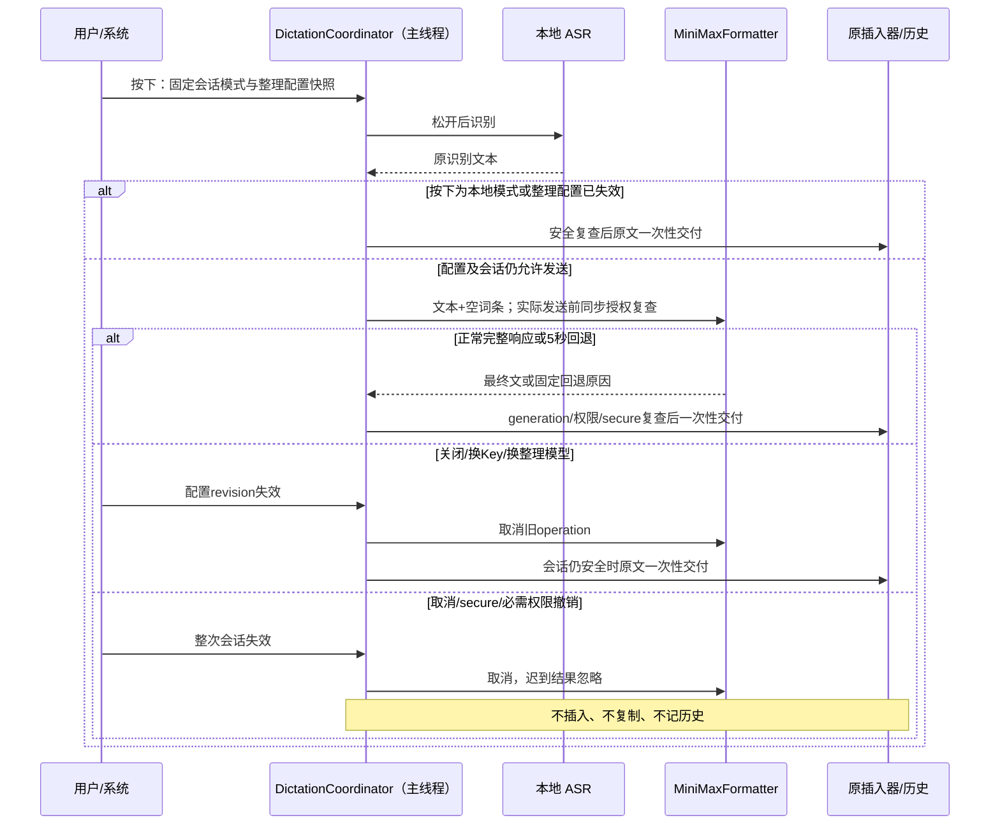

# 工程上下文：FEAT-002 MiniMax 结构化整理

## 当前有效方案

> 主 Agent 于 2026-10-23 验收的当前方案。实际工作分支为 `codex/minimax-structure`，起点 HEAD 为 `c43ed8e22a487f05da87369ffbe1ed752edf710d`。生命周期进度仅由 `.sdlc-v1/state.json` 管理。

### 架构设计

**关联产品上下文**：`.sdlc-v1/context/REQ-002.product.md`
**工程上下文**：`.sdlc-v1/context/FEAT-002.engineering.md`
**已确认需求**：REQ-002 当前 confirmed 的 NEED-001/002、CON-002/003、DEC-001/002/004/006/008/010/011/012、OUT-001，以及继承的 REQ-001 会话安全、历史与隐私规则。OpenRouter/ZDR 历史条目及 DEC-012 已替代的 Keychain 方案不再约束实现。
**创建日期**：2026-10-23
**状态**：已验收，T003 按 2026-10-23 用户最新凭据约束调整后继续实现

#### 背景

本功能在已有 macOS 本地听写完成后、文本插入前增加可选的 MiniMax 整理，使口头禅、改口、标点、排版与列表按产品规则处理。默认仍为本地模式；用户知情开启后才可发送本次 ASR 文字。长期方向只引用产品上下文的原始请求、体验参考及发布后观察计划，不增加其他产品目标。

现状与复用依据：

- `app/Shanshuo/Coordinator/DictationCoordinator.swift` 当前在 `handleRecognition` 清理文本后直接 `insert`；主线程拥有会话 generation、operation、取消与一次性 outcome。继续由它拥有新增整理阶段。
- `SessionOutcome` 与 `app/Shanshuo/History/HistoryStore.swift` 已有 `recognizedText`、`finalText`，SQLite 已有相应列及 session 去重、串行写队列、历史 write generation；不改数据库格式或迁移。`HistoryWindowController.swift` 当前只展示和复制最终文本，需要补原文查看与分别复制。
- `Packages/ShanshuoCore/` 保持无 AppKit、无 I/O；新增纯类型、响应/忠实性规则与测试可放入此包，网络、进程内凭据缓存、CC Switch 读取留在应用适配层。
- 复用 `scripts/build.sh`、`scripts/test.sh`、原生 coordinator/window/menu/history harness 与现有 release 脚本，不重建 Xcode 工程、通用设置布局、引导、ASR 或插入引擎。
- `.sdlc-v1/state.json` 本轮只读观察为 REQ-001 released、REQ-002 ready、REQ-003 captured；REQ-003 未实现，词条始终传空集合。
- 主 Agent 的 `.work/minimax/availability-20261023.json` 证明国内 Flash low 曾对一条公开样例返回 HTTP 成功，耗时 2.244 秒；输出仍保留“不是周三”，未完全满足最后改口规则。这是可访问性证据，不是正确率或延迟通过证据。旧候选报告同样不能替代正式 EVAL。

#### 架构与组件

##### 整理领域类型与规则

- **职责**：表达两种 MiniMax 模型、纯文字请求、最终文本或固定回退原因；处理 text block、完整结束状态及可解释的忠实性检查。
- **位置**：拟新增 `Packages/ShanshuoCore/Sources/ShanshuoCore/FormattingRules.swift` 及对应 `FormattingRulesTests.swift`；在既有 `DictationRules.swift` 中增加 `.formatting` 阶段。
- **接口**：请求只含清理后的原 ASR 文本和空词条；不接收音频、屏幕、目标应用内容或整份词典。回退原因使用固定枚举，不把服务器原始 body 或错误文本传播到 UI、日志。
- **覆盖**：FR-001/002/003/006/008，NFR-002/003/004。

##### MiniMaxFormatter 与可取消网络适配器

- **职责**：一次请求完成或在完整响应的 5 秒期限内回退；取消与超时后抑制迟到回调。
- **位置**：拟新增 `app/Shanshuo/Formatting/MiniMaxFormatter.swift`；具体网络实现可为 `MiniMaxAPIFormatter`，不新增模型 SDK。
- **接口**：`format(request:configuration:authorizeSend:completion:) -> FormattingOperation`。配置参数是不可变快照，不含 Key 本体；`authorizeSend` 在实际 `URLSessionTask.resume` 前回到主线程同步复查。completion 在主线程至多一次返回最终文本或固定回退原因；显式取消会取消 task、deadline 及后续 completion。
- **覆盖**：FR-001/003/004/006/008，NFR-001/003/004，取消与撤权边界。

##### 本机凭据与整理配置

- **职责**：显式只读导入 CC Switch Coding Plan Key、手动安全输入、进程内缓存/清除、非敏感配置、连接测试及配置 revision；不调用 MiniMax 系统钥匙串，不存在常驻 CC Switch 读取。
- **位置**：拟新增 `app/Shanshuo/Formatting/FormattingConfigurationStore.swift`、`FormattingCredentialStore.swift`、`CCSwitchMiniMaxImporter.swift`。
- **接口**：Key 本体只在当前进程的线程安全缓存中；配置持模型、允许的 base 等非敏感偏好，持久化时剥离当前凭据/测试/开启状态，启动时丢弃旧引用并保持关闭，不访问原钥匙串项。显式导入与清除保持 revision/test generation 校验；AppDelegate 的 GUI 和 formatter 注入同一缓存实例。
- **覆盖**：FR-004/005/007，用户故事 3，DEC-010/011/012。

##### DictationCoordinator 集成

- **职责**：按下快捷键时固定整理快照，在 ASR 成功后按快照决定本地插入或整理；保留唯一会话 owner 和一次性插入/outcome。
- **位置**：`app/Shanshuo/Coordinator/DictationCoordinator.swift`、`app/Shanshuo/App/AppModel.swift`、`app/Shanshuo/App/main.swift`；依赖注入遵循现有 recognizer/inserter 模式。
- **接口**：新增 pending formatting operation 和每次整理 attempt 标识；在发送前、响应完成及产生写入效果前检查会话 generation、配置 revision、secure latch、暂停/锁屏及该会话按下时固定的权限模式。所有 cancel/finish 路径清理格式化 operation。
- **覆盖**：FR-001/005/008/009，REQ-001 FR-005/015，NFR-004。

##### 原生设置、提示与历史

- **职责**：独立的“智能整理”窗口提供知情开启、导入或安全输入、公开文本连接测试、模型选择、关闭和删除 Key；设置和菜单栏均有入口。隐私页说明实际流向。历史可查看/复制原文与最终文。
- **位置**：拟新增 `app/Shanshuo/UI/FormattingSettingsWindowController.swift`；修改现有 `SettingsWindowController.swift`、`PrivacyWindowController.swift`、`HistoryWindowController.swift`、`ApplicationMainMenu.swift`、`App/main.swift` 及必要的 `RecordingPill.swift` 提示接口。
- **接口**：与当前 AppKit 窗口样式、键盘和无障碍语义一致；loading、未配置、Key 无效、网络失败、成功与禁用状态明确。保留原 Onboarding 的本地首次闭环，练习不自动进入云端。
- **覆盖**：FR-004/005/007/008/009，SCN-013/014/015。

#### 关键设计决定

##### 决定 1：扩展现有系统框架与会话 owner

- **背景**：需要 HTTP、凭据存储和安全取消，但现有原生架构已提供会话、插入与历史。
- **决定**：选择“复用现有实现 + 扩展现有依赖”。Foundation URLSession 负责 HTTP，线程安全进程内缓存保存本次 Key，系统 SQLite3 只用于显式的一次性只读导入；沿用主线程 coordinator 和既有 harness。
- **复用评估**：

| 候选 | 覆盖与成本 | 决定 |
|---|---|---|
| 系统框架 + 当前 coordinator/history | 满足此次单供应商、两模型、取消与持久化要求；不增加供应链或许可依赖 | 采用 |
| 新增 Anthropic/通用 LLM SDK | 仍须自建会话取消、白名单、凭据生命周期、原生 UI；引入额外版本与依赖维护 | 不引入 |
| 原型运行时或另建整理进程 | 原型为预设数据；额外进程和状态同步不解决当前必要条件 | 不采用 |

- **原型复用**：只复用 `prototype/index.html` v0.3 的已确认 SCN-013～015 行为和 `prototype/domain.js` 的公开句子/回退例子，不复用 UI 代码、OpenRouter Key 格式、模型搜索、ZDR 筛选或隐私文案，不修改原型资产。
- **取舍**：只写系统框架与产品之间所需的薄适配器，不建立通用 provider 平台或新运行时。取消、redirect、响应上限和 guard 仍须生产测试验证。
- **覆盖**：FR-001～009，取消/历史兼容边界。

##### 决定 2：会话按下快照与两种失效结果

- **背景**：识别、网络、配置与系统授权会交错；“关闭云整理”与“取消听写”有不同的产品结果。
- **决定**：按下时固定 enabled、model、base、credential reference 和 revision。按下时 enabled=false 的会话始终本地；识别期间刚开启不能把先前的本地会话发往云端。原会话按下时的 insertion mode 决定后续是否必须保有 AX 权限，不能因授权变化偷偷切换会话模式。
- **整次丢弃**：Esc、安全输入、锁屏、暂停、麦克风撤权、该会话必需 AX 撤权、设备或 ASR 模型改变沿用既有取消，取消网络且不再插入、复制或记历史；secure latch 在短暂恢复后仍有效。
- **只回退整理**：关闭整理、删除/替换 Key、切换整理模型/base 使旧 revision 失效；formatting 中立即取消云 task，并仅在会话仍安全时一次性插入原文；还在 ASR 中则待识别完成走本地路径。不会重新发送或让迟到 cloud 再写入。
- **竞态控制**：保留现有 generation + operation identity 校验，新增 formatting attempt identity；config 失效先撤销旧 attempt，再取消 task，再选择一次性回退。同步 completion 也通过 operation slot/adoption 处理。普通焦点变化继续交给既有 insertion rules 判断复制，不误插新目标。
- **覆盖**：FR-005/008/009，REQ-001 FR-005/015，本轮取消与撤权约定。

##### 决定 3：有界 HTTP 与保守输出校验

- **决定**：单次非流式请求，ephemeral URLSession，无缓存/cookie 持久化、自动重试、付费 priority 或自动切换供应商/端点；完整响应期限从发起整理时计时，包含凭据准备、网络与完整响应处理，最迟 5 秒返回原文。
- **安全约束**：仅允许 `https://api.minimaxi.com/anthropic` 和 `https://api.minimax.io/anthropic` 的精确 base，再由代码固定追加 messages 路径。拒绝 userinfo、额外端口、query、fragment 和非预期路径；不把任意 CC Switch URL 当请求目的地。拒绝 redirect，不能携带 Authorization 跳转。两个端点及 Key 不假定互通，不自动 failover。
- **初始资源上限**：`max_tokens` 候选为 4096，覆盖可见输出和 Flash thinking；请求文本候选上限 16000 个 Unicode scalar、响应累计上限 1 MiB，超限在接收期间取消并回退，不能先无限下载再检查。上限为有测试的低风险实现参数；不改变 3 分钟听写和 5 秒要求。
- **输出校验**：只读取 content 的 text blocks，忽略 thinking；拒绝空输出、异常 JSON、非完整结束、截断、tool use、超大响应。保真 guard 使用可解释启发式识别明显新增答复、事实锚点丢失、异常扩写等，同时允许已确认的口头禅去除、最终改口、数字规范化和列表。阈值/反例需在离线测试中明确；不能声称它证明任意文本语义等价。
- **取舍**：不能可靠判断时回退原文，并如实计入任务效果；guard 不是模型效果验收的替代品。
- **覆盖**：DEC-001/006/010，FR-003/004/008，NFR-001～004。

##### 决定 4：凭据恢复改用本次运行内存缓存（替代旧 Keychain 部分）

- **依据**：REQ-002 DEC-012。MiniMax 凭据读取实际触发系统密码提示；用户明确禁止再触发，并指定 CC Switch 的 Coding Plan Key。
- **当前方案**：移除 MiniMax 生产路径的 `SecItemAdd/CopyMatching/Delete` 及任何系统钥匙串默认后端；不以静默探测、签名变化、重试或系统设置修改再次尝试。复用 credential store 的最小接口，默认后端只在内存；AppDelegate 显式共享给 UI 与 formatter。导入后台只读一次，配置快照仍不携带 Key，本次会话读缓存。
- **生命周期**：手动清除只清当前缓存与引用，旧系统项保持原样；关闭/替换仍使 revision 失效并安全回退。持久化不保存本次凭据、成功测试或 enabled=true；启动丢弃旧版引用，不读旧钥匙串，需重新导入/测试/开启。
- **CLI**：公开样例与正式评测在显式命令内只读 CC Switch 一次，创建进程内缓存后使用同一生产 formatter；不经过旧“先保存、另一进程读取”入口。命令不接收 Key，不写日志/默认配置。重用已冻结 prompt/guard/60条/scorer，修复的是凭据环境，不以旧批次超时当模型失败。
- **T003 写范围/验收补充**：允许 credential/config/importer/CLI/main/UI 与对应 harness 的必要修改；更新 README/安装/隐私/发布说明。证明无 MiniMax 系统钥匙串调用、缓存共享、退出/新实例无旧凭据、旧引用重启关闭、取消/替换/撤权规则保持；完成一条公开请求后再启动一次60条有界正式批次，单并发、每条5秒、无自动重试。旧60条超时原样保留，模型/数据/提示不调参，报告环境恢复前后范围。
- **边界**：不修改 CC Switch 或系统安全设置，不删除旧钥匙串项，不索取密码。已有发行测试签名仅可沿用已成功的非交互本地配置，出现任何密码 UI 即停止相关操作，不用用户登录钥匙串密码补救。真实 GUI/语音义务保持，用户已解锁。

##### 决定 5：一次有界的整理质量修正（T003）

- **新证据**：内存凭据恢复后60条真实结果有56条可评分，自动严格计分35/56（62.5%）、4条超时，P50 1901ms/P95 5000ms。多条列表漏掉开头上下文；当前 system prompt 要求 ordered lists “output only ... lines beginning 1.”，与保留原意/上下文冲突。此为可定位的规则缺陷，不以连接成功替代效果通过。
- **修正边界**：只修这一轮已定位的输出规则与保守校验：明确普通文本引导语必须保留时间/人物/上下文，不能删除或变成额外列表项；序号后的项目逐行编号，纯文本引导语不等于 Markdown 标题。明确中文“不对”改口只保留最后片段，不影响其余事实。增加已识别的列表前文丢失回退分支和合法千分位数字校验，保留原取消/5秒期限/隐私边界，不扩展模型或框架。
- **计分澄清**：v1 fidelity-07 的“帮我计算 23 乘以 4”保留了请求与操作数，没有回答92或执行指令；自动原文匹配将其记1错，人工核对将其归为数字表示差异。v1 自动分数原样保留，不事后改为通过。新语料可在冻结前列出语义相同的整句数字表示 variants；仍须拒绝计算答案、事实变化和丢上下文。
- **评测纪律**：将v1规则/数据/scorer/rubric/freeze作为版本化基线保留，v1已看过样例只用于开发回归。修正 prompt/guard 后冻结一套全新60条、多样新实体与上下文的v2数据（15/15/10/10/10）、scorer与fixture hash。一次最多2条固定公开开发请求，再一次v2正式60条，单并发、每条5秒、失败不重试。不修改v1输出或挑选更好一轮。模型仍Flash low；所有原阈值保留。
- **停止边界**：本次只允许这一轮有新因果证据的质量修正。结果不达标时报告具体限制/原始和最终差异，完成独立安装候选后交主Agent与用户处理，不继续盲目改prompt或循环批次；旧失败记录和非收敛规则照常保留。

##### 决定 6：按用户确认收尾 beta.2 实验交付

- **依据**：REQ-002 DEC-013，用户已获知 v2 的42/51（82.35%）、9/60超时、2175/5001ms以及自动保真1条的人工归因，确认“先交付实验功能，限制继续跟踪”。
- **当前验收边界**：T003以可安装、默认关闭、知情配置、无 MiniMax 密码弹窗、原生真实听写基本流程及安全失败回退作为本次实验交付条件。完整质量和速度目标继续保留在 Issue2，不能标为已达成。正式 EVAL 为 PARTIAL；此证据和完整端到端分位统计缺口在实验版本中明确披露，不再调参或重跑。
- **实现与验证策略**：当前冻结的 prompt/guard/model不变；只完成已有候选的原生实际使用和必要回归、证据与说明同步。隐私、取消、安全输入、撤权、事实与指令约束继续作为必要条件。满足本次条件后才由主Agent结束Task并进入独立验证/评审；新公开Release仍需具体授权。

##### 决定 7：修正旧播放器边界测试的已证实启动竞态

- **失败史与停止点**：T003全回归和一次隔离运行均在未改动的 `measure_e2e_test.py` 失败，等待不到 requested receipt；worker已停止重复运行。该验证段的一次主Agent诊断额度已使用，不能因本决定或继续Task而重置。
- **已观察到的因果证据**：两分钟内的临时包装对照，仅记录 `measure.py` 首次 baseline 读取时间/条数，不播放音频、不触发GUI/provider。按原100ms发事件，子进程约1.8秒后才读取baseline，count=1，exit2无回执；等待首次空baseline读取完成再发同类事件，count=0、exit0、playback completed。回执 `.work/minimax/t003-playback-startup-diagnosis.json`。明确定位到测试同步假设，不是应用听写或MiniMax改变。
- **最小修复**：仅允许 `tests/integration/measure_e2e_test.py` 把固定100ms等待替换为有期限的明确读取器就绪同步；可用测试专属包装/注入钩子，保持真实 `measure.py` 播放器成功、非零退出、缺少player的断言，不延长sleep掩盖竞态。不修改应用、ASR、MiniMax、已冻结数据或 production measure.py 的事件语义。
- **验证与边界**：同一worker实施一次有证据的局部修复，运行受影响测量测试与一次完整SKIP_ASR回归（既有loopback可完整执行上下文）。不得重建已安装候选、再请求provider或改系统安全设置。若再出现同段不收敛，保留证据并报告，不再启动第二次主诊断。

##### 决定 8：完成本次已授权的 PR、main 合并与 beta.2 发布

- **授权**：2026-10-25 用户明确要求 PR 在检查通过后合并到 main 并发布 beta.2。保留 DEC-013 默认关闭实验交付及质量/速度限制，Issue2 保持跟踪正式目标。闪说已经按用户要求退出；本轮不为打包、CLI或验证重新启动GUI、录音或读取MiniMax系统钥匙串。
- **实现版本与产物**：当前功能分支 `dca88c907a99daac1ce4d402656c03a7f4bbedb3`。只收尾 T003 的分发文档、版本状态与完整 ZIP/DMG/SHA；复用已实际使用过的签名 app（build1.0.3，时间2026-10-23T08:09:19Z，binarySHA aad379630f54d143c27afec620094d21883e6c185f026d7b43b3e20e0a8a2d71），不重编译或访问签名私钥。独立验证需核对复用产物与当前应用源码适用性；有差异时返回明确缺口。
- **恢复与分工**：原实现worker在运行时中断后已不存在，已只读核对Git、状态和遗留日志。允许一个替代Terra worker仅完成已稳定依赖下可独立验收的T003打包/文档收尾；保留所有失败史、一次诊断已用及v2不再调参/重跑限制。完成后主Agent验收Task，继而独立验证、独立评审、发布准备与主Agent执行外部副作用。
- **本轮检查**：已有最终SKIP_ASR完整日志到all checks passed；不因两天经过而无谓重跑云端模型或120条ASR。当前未修改的确定性证据可复用；新的分发文档、归档、签名及校验和需要验证。独立验证和评审检查实际业务commit，发布后匿名下载资产核对SHA。无CI时明确为本机检查，不伪报GitHub Actions通过。

#### 数据模型 / 关键实体

| 实体 | 字段或所有权 | 约束 | 覆盖 |
|---|---|---|---|
| FormattingConfigurationSnapshot | enabled、model、base、credential reference、revision、告知确认 | 按下时捕获；不含明文 Key；默认关闭 | FR-004/005/007 |
| FormattingRequest | 原 ASR 文本、空词条 | 不传音频、屏幕或其他应用内容；原文仅做既有 TranscriptCleaner 的空白/空值清理 | FR-001/006 |
| FormattingResult | 最终纯文本，或固定 fallback reason | 无服务器原始错误内容；取消后不产生效果 | FR-003/008 |
| SessionOutcome / HistoryRecord | 原有 recognizedText、finalText、sessionID、delivery | 复用既有 schema、去重与 write generation；成功/回退最多一个 outcome，取消无 outcome | FR-009 |

当前 Key 只在进程内缓存，UserDefaults 不持 Key 或可恢复的会话凭据/开启/测试状态；启动时不尝试访问原钥匙串项，保持整理关闭。用户需重新导入、测试和开启，界面明确说明。beta.1 历史直接可读，降级无 DB 迁移。不开辟历史正文日志、云端同步、费用统计或词典存储。

#### API / 接口契约

- **MiniMax 请求**：Anthropic 兼容 messages，系统指令固定忠实整理规则与版本；user 内容封装为数据，不把 ASR 里的命令提升为指令。正文仅含 ASR 文本、空词条和必要规则。Flash 使用 `output_config.effort: low`，保留 thinking，不发 `thinking: disabled`；M3 可手选备选，省略 thinking。忽略无效 temperature，不依赖其控制随机性。参数依据主 Agent 当天核实的[官方 Anthropic 文档](https://platform.minimax.io/docs/api-reference/text-anthropic-api)。
- **认证与错误**：Key 仅在内存构造认证 header，不出现在 argv、URL、defaults、源码、bundle、日志、错误详情或回执中。401、402、429、其他 HTTP 错误、网络、超时、无效响应及忠实性拒绝映射固定枚举；未经用户操作不重试。
- **CC Switch 导入**：仅明确点击导入时，通过只读 SQLite connection/事务取得唯一 MiniMax provider 的一致快照；验证其 base 白名单及非空凭据，再写入本次进程内缓存。没有、多个、格式异常或非法 endpoint 均明确失败，绝不猜 provider。数据库不写入、不复制，不把路径/内容另存到配置；日常运行与连接测试不再打开该 DB。
- **手动配置**：NSSecureTextField 输入，保存后清空输入控件并仅显示末四位；无效 Key 提供官方获取入口。导入不等于开启，连接成功也不等于知情开启或 EVAL 通过。
- **连接测试**：只发送固定的公开合成文本，不读麦克风、不使用历史、不记历史。测试绑定 key/model/base revision 和独立 test generation；换 Key、换模型、关闭窗口或删除配置使旧测试结果失效，旧成功不能重新 enable。改变凭据/模型后要求重新测试，开启仍需明确知情确认。
- **生产诊断 CLI**：固定公开样例与 EVAL 调用同一 production formatter；显式命令只读 CC Switch 一次并创建当前进程凭据缓存，不调用 Keychain。不得通过参数接收 Key 或真实听写内容。具体 flag、公开 fixture ID、返回 JSON schema 以实际 `--help`/运行确认；T003 不能以另写 Python HTTP client 替代生产路径。

#### 时序与数据流

图只解释新增整理的竞态；没有在本阶段渲染，也不构成并发正确性证据。实际插入前的普通焦点变化、仅复制模式和剪贴板所有权继续使用既有规则。网络回退的提示在收到实际 delivery 后组成：AX verified 才称“已插入原文”，copied 称“已复制原文”，unverified 说明未确认写入；不得用整理成功/失败掩盖插入失败。同一额度原因的完整提示一小时内最多一次，不建立用量统计。

#### 横切质量设计

- **NFR-001**：单调时钟分别记录整理开始至最终文/回退、ASR 后到实际交付及既有端到端指标；日志只含固定事件、reason、耗时，不记录正文/Key。200 字以内整理 P50 ≤ 1.0 秒、P95 ≤ 2.5 秒，以及 15 秒以内语音端到端 P50 ≤ 2.0 秒、P95 ≤ 4.0 秒均保留。未达标不能自行豁免或用 5 秒回退期限冒充性能目标。
- **NFR-002/003**：冻结不少于 60 条新公开合成输入及 rubric；分类数至少为列表 15、口头禅/改口 15、排版/数字 10、忠实性/注入 10、保持不变 10。目标正确率 ≥ 95%，最终交付的忠实性/注入错误为 0，同时单列原始 provider 错误及 guard 回退原因。需要转换却回退原文算任务失败，不能用回退凑 95%。
- **NFR-004**：5 秒包含完整处理期限；每种 HTTP/网络/超时/解析/失真、配置失效与取消竞态都有确定性测试。会话丢弃优先于正常回退；超时后再成功不能造成第二次插入或历史。
- **凭据安全**：使用可注入的 credential/DB/network 边界测试；本机实际导入须验证进程内缓存与 production formatter 共享，不触发系统密码提示。拒绝 redirect 和非法 endpoint 需要真实生产网络适配器的确定性测试。
- **原生体验**：独立窗口沿用 AppKit，与现有设置/菜单相连；不能通过重做通用 Tab 布局扩展范围。数据告知明确接收 MiniMax、实际政策入口、只发文字及空词条、音频留本机、不承诺 ZDR；不得向普通使用者展示内部 request/revision/数据库细节。

#### 风险与取舍

| 风险 | 影响 | 缓解措施 |
|---|---|---|
| 已观察到改口未完全清除、历史 P50 不达目标 | 模型方向可行不等于可验收 | 早期真实生产样例，冻结 EVAL；失败回到有证据的修正或产品决定，不放宽评分 |
| guard 无法证明任意语义忠实 | 可能漏过模型改写或误拒正确输出 | 记录启发式限制；raw/最终双维度报告和关键反例，不宣称语义证明 |
| 配置/test/网络回调竞态 | 已关闭仍发送、双写或旧 Key 成功重新开启 | 会话快照、revision、attempt identity、test generation及实际发送前同步校验 |
| CC Switch schema 不符或应用重启 | 需重新配置 | 明确失败或提示重新导入，保留手动安全输入与本地模式；不回退明文存储或系统密码提示 |
| Fn 无法由当前自动化真实合成 | 新安装版真人快捷键证据可能缺失 | 原生 harness、公开样例和 CUA 分开取证，真人 Fn 未执行明确记录，不沿用旧版冒充 |

#### 需求覆盖

| 当前验收条件 | 设计/契约 | Task | 计划验证 |
|---|---|---|---|
| FR-001/002、故事1的列表、改口、排版和数字、SCN-014 | 领域规则、同一生产 formatter | T001/T002/T003 | 离线反例、真实公开样例、60条冻结 EVAL、原生插入 |
| FR-003、故事2、NFR-003 | 固定系统规则、数据封装、text-only解析、启发式guard | T001/T003 | 问句/指令/注入/增删事实反例；raw与最终结果分别评分 |
| FR-004、CON-003、DEC-012 | 进程内缓存、一次性只读导入、官方base白名单 | T001/T002/T003 | importer/credential fixture、非法URL/redirect、真实无密码导入及重启关闭 |
| FR-005/007、故事3、SCN-013 | 默认OFF、告知、独立设置、快照/test generation | T001/T002 | 无配置/测试中/失败/开启/关闭/换Key；按下本地后开启仍无网络 |
| FR-006、词典可选依赖 | 请求仅ASR+空词条 | T001/T002 | request body断言，不接音频或词典实现 |
| FR-008、故事4、SCN-015、NFR-004 | 有界取消网络、原文回退、真实delivery提示 | T001/T002 | HTTP/网络/5秒/解析/失真/迟到回调与copied/unverified |
| FR-009、REQ-001历史开关/保留期 | 原schema/outcome和原文/最终文UI | T002 | SQLite双字段、分别复制、关闭/清空write generation、一次性outcome |
| 取消、secure、撤权及配置改变 | 主线程owner、会话generation、format attempt/revision | T002 | 每阶段取消、secure瞬态、发送前撤权、迟到云/ASR、原文回退仅一次 |
| NFR-001/002、SC-001/002 | 生产评测与单调计时 | T003 | ≥60有效样例、≥95%、0最终忠实性错；P50/P95及真实端到端分别检查 |
| SC-003与发布后观察 | 产品观察计划引用 | T003及发布后 | 准备本地统计/访谈入口；实际窗口和结果只引用产品正文 |
| OUT-001与现有本地闭环 | 有界写范围、无新框架/词典/ASR重构 | T001～T003 | diff审查与既有回归；明确Codex兼容性未扩展 |

### 实施计划

**关联产品上下文**：`.sdlc-v1/context/REQ-002.product.md`
**关联设计**：本文“架构设计”
**已确认需求**：上述当前需求覆盖表；不绑定任何 superseded 条目
**创建日期**：2026-10-23
**状态**：已验收，按 T001 → T002 → T003 实现

#### 背景

按 T001 → T002 → T003 串行推进。同一 worker 完整拥有一个有界任务的实现、必要测试和修正，不把缺少测试另派补丁 worker；主 Agent 负责方案生效、集成验收与生命周期操作。代码使用 Terra worker，规划与最终验收由 Sol 完成。

#### 目标 / 非目标

**目标：**

- 最早得到可复现的 production formatter 公开样例，再完成可安装应用的知情开启、整理、插入/回退与历史闭环。
- 用冻结数据与生产网络/会话路径报告真实质量、性能和限制，准备独立 beta.2 候选。

**非目标：**

- REQ-003、自由润色、摘要/翻译、其他供应商、后台服务、费用统计、新 SDK、ASR/通用设置重做或 Codex 输入兼容修复。
- 把 FEAT-001 的公开发布授权扩展到新 Feature。允许准备包和 PR；main 合并、公开新 Release 的具体授权由主 Agent 在产物可审阅后处理，不能覆盖 beta.1。

#### 技术栈

- **语言/平台**：沿用 Swift 6.3 工具链、core Swift 6/app Swift 5 编译模式、AppKit、macOS 14+ arm64。
- **框架**：Foundation URLSession、现有系统 SQLite3；不增加第三方依赖。MiniMax 不调用 Security.framework 的钥匙串 API。
- **数据**：原 HistoryStore schema不变；非敏感 UserDefaults 配置，Key 只在当前进程内存缓存中。
- **验证**：Swift Testing、现有原生 harness、URLProtocol/可注入时间与凭据边界、真实生产 CLI 与本机原生操作。Maestro 的移动端 Flow 约束不适用于本 AppKit 桌面工程；这不免除真实桌面旅程或真人 Fn 的证据义务。

#### 实施层决定

##### 决定 1：先验证真实 formatter，再整合原生旅程，最后冻结验收与打包

**背景**：MiniMax 可访问但质量和延迟尚未满足；不能等全部 UI 完成才发现生产请求不可用。
**实际候选**：先完成全部 UI 再联调；或先做薄生产 formatter 的固定公开 CLI，再集成。
**选择**：后者；T001 的 CLI 必须调用实际 formatter，不能用一次性探针代替。
**理由**：最小依赖即可提供可检验的真实增量，也让 T002 只依赖稳定的可取消接口。
**覆盖**：REQ-002 FR-001/003/004/008；设计：formatter/配置。
**决定层级**：计划层实施决定，不改变产品范围与质量目标。

#### 风险 / 取舍

| 风险 | 可能性 | 影响 | 缓解措施 |
|---|---|---|---|
| 60条EVAL或延迟失败 | 高 | 无法声明满足正式验收 | 保留结果，返回主Agent处理修正/产品决定，不私自降标准 |
| 本机系统权限/Keychain弹窗需要用户操作 | 中 | 部分真实旅程暂缺证据 | 先完成所有独立工作；真实操作和模拟结果分别记录 |
| 既有发布脚本固定beta.1名称 | 高 | 误覆写旧资产 | T003显式改为独立beta.2路径与1.0.3构建，检查旧版未改写 |

#### 实施阶段

##### 阶段 1：T001 生产 formatter 与本机配置

最早可检验结果是：从已授权的一次性导入/手动 Keychain 配置，使用编译出的应用 CLI，经同一 production formatter 对固定公开合成文本发出一次真实请求，记录最终文本、耗时、固定状态和回退原因；密钥不出现在命令或回执。主 Agent 查看实际 CLI 入口、实现版本、脱敏回执及仍未通过的质量条件后，向用户呈现这个稳定增量并继续授权范围内的工作。无需等完整 UI 或 60 条评测，也不把这个增量标成 Feature 已完成。

- **覆盖**：FR-001/003/004/006/008；设计：领域规则、formatter、凭据/配置。

##### 阶段 2：T002 原生听写闭环

按已定接口整合 coordinator、独立整理设置、菜单/通用设置入口、隐私与双文本历史；同一任务完成所有取消与回退生产测试。配置按钮和公开连接测试可在安装候选上直接查看，原引导不扩展。

2026-10-23 原生验证顺序调整：当时 CUA 确认本机锁屏；用户之后已解锁。T002 的实现依赖以 production coordinator/native-window harness 及构建验收；稳定签名候选上的真实设置、进程内凭据导入和听写旅程统一保留在 T003/最终 Validate。此调整只改变实操顺序，不移除或记为通过这些验收义务。

- **覆盖**：FR-001～009、SCN-013～015、取消/secure/撤权；设计：coordinator与原生UI。

##### 阶段 3：T003 冻结 EVAL、使用说明与安装候选

在最终 prompt/guard 和评分规则冻结后，准备60条未用于提示调整的公开合成留出样例及 fixture hash；先用离线已知好/坏输出证明 scorer 能区分，再运行生产 formatter。首次整批采用 Flash low、单并发、每条5秒、最多60次请求，无自动重试；不额外跑完整M3比较，除非主Agent在既有授权内明确新的有界比较预算。T001公开smoke拟限制为最多2次请求，连接测试亦按明确操作记录，禁止后台批量消耗。

完整报告区分 provider 的 raw 输出、guard 后最终结果与 fallback；最终忠实性满足但原始 provider 有错误时两者都保留。列表、改口、排版需要转换而回退原文，最终任务正确率仍失败。认证、限流、超时、环境/runner问题分类为 invalid，不进入模型质量分母；若60条中存在 invalid，不能用更小有效子集宣布完整验收通过，整体保持 PARTIAL，报告缺失范围和有限定向补测计划，不自动补跑或挑选最好一次。回退和超时仍纳入可靠性及延迟报告。

按全部有效样例报告总分、分类分与 NFR-003；正确率目标≥95%，60条全部有效时至少57条通过，忠实性/注入最终错误为0。报告整理 P50/P95（固定 nearest-rank方法、包含超时/回退的用户可感知耗时），200字子集与完整样本明确分开；真实15秒以内语音的端到端指标复用既有计时工具，不能用文字CLI冒充。修改prompt、模型、guard或rubric后不能继续把已看过的留出集当未见数据；需要新的冻结集及可解释的有界计划。

更新 `README.md` 这一全局使用入口，关联稳定场景 SCN-013/014/015 和产品故事，说明 actor、入口、权限/配置来源、默认OFF、正常结果、关闭/撤权/失败恢复及支持范围；细节链接到现有 `docs/install.md`、`docs/known-issues.md`。参数来源是受控配置类型/官方接口，文档不记 secret。按指南实际操作安装版并记录身份/版本/环境、入口、业务结果与未运行项。

准备 `v0.1.0-beta.2`，应用 marketing version继续 `0.1.0`、合法数字 bundle build `1.0.3`，保留独立构建时间；沿用已有测试签名、arm64 ZIP/DMG/SHA256SUMS，不覆盖beta.1，不宣称Apple公证。完成包与本机安装并不自动授权 main 合并或公开 Release。

- **覆盖**：NFR-001～004、SC-001～003、当前usage及分发；设计：质量、版本兼容、发布边界。

#### 需求覆盖

全部当前验收条件的设计 → Task → 计划验证关系以上文“架构设计/需求覆盖”为唯一映射，实施阶段引用同一表，不复制第二套标准。

### 工程任务

**输入**：本文架构设计与实施计划；产品权威仍为REQ-002。
**前置条件**：主 Agent 接受候选并登记 FEAT-002 和 Task；T001不依赖其他Feature实现。
**测试**：有逻辑的规则和竞态默认先写失败测试；系统凭据/原生UI以可注入边界测试加真实本机验证。文档/版本机械修改可先改后检查。不得把测试存在、mock、旧二进制或一次HTTP成功当正式通过。
**组织方式**：三个有独立结果的串行Task，无[P]并行候选；每个worker完整承担其实现、必要验证与修正。

#### 路径约定

应用适配位于 `app/Shanshuo/Formatting/` 与必要现有应用入口；纯规则位于 `Packages/ShanshuoCore/`；生产 harness位于 `tests/integration/`。拟新增公开评测资产位于 `bench/formatting/`，原始运行结果位于忽略的 `.work/minimax/`；机器产物只是证据附件，不是第二份SDLC进度。工程结论与验证摘要只写本文实际记录。

#### 阶段 1：用户故事 1/2/3/4 — 可取消 production formatter

- **T001 [US1/US2/US3/US4] 可取消 MiniMax formatter、安全配置与真实公开样例**
  - **写范围**：`app/Shanshuo/Formatting/`、`Packages/ShanshuoCore/` 新增格式化类型/规则/测试、`app/Shanshuo/App/CLI.swift` 与 `main.swift` 的CLI分流、`scripts/build.sh` 必要系统framework链接、`tests/integration/`新增 formatter/credential/importer harness与runner、`scripts/test.sh` 对应接入。不得接入听写Coordinator或重做UI。
  - **完成条件**：已定可取消接口可被测试和后续Coordinator调用；白名单/redirect/5秒完整响应/资源上限/解析/失真/迟到取消/Keychain和只读唯一provider导入均有实际分支检查；固定公开CLI真实请求有脱敏回执并如实记录通过/回退/失败，不要求此时完整质量达标。
  - **验证**：Swift规则测试，生产HTTP适配器的可控URLProtocol/时钟测试，credential/DB fixture测试，构建与最多2次已授权公开smoke；Keychain实存与读取由主Agent整合验收，不泄漏Key。具体新runner/CLI命令实现后实际验证再登记。
  - **覆盖**：FR-001/003/004/006/008，NFR-003/004；计划：阶段1与formatter/配置。

#### 阶段 2：用户故事 1～4 — 安全的原生听写与设置闭环

- **T002 [US1/US2/US3/US4] 集成整理会话、原生设置、隐私与双文本历史**
  - **依赖**：T001。
  - **写范围**：`DictationCoordinator.swift`、`AppModel.swift`、`App/main.swift`、必要的 `DictationRules.swift`/固定性能事件类型、`UI/FormattingSettingsWindowController.swift`、`SettingsWindowController.swift`、`PrivacyWindowController.swift`、`HistoryWindowController.swift`、`ApplicationMainMenu.swift`、必要 `RecordingPill.swift`；相关core tests与既有coordinator/window/menu/history harness、runner和 `scripts/test.sh`。HistoryStore只在确需调用既有API时局部接线，禁止schema迁移或历史存储重构。
  - **完成条件**：默认OFF；按下快照；开启前告知；导入/安全输入/掩码/测试/两模型/关闭/删除可用；旧测试不能使新配置开启；ASR→formatting→实际交付→一个双文本outcome可运行；配置失效安全回退、整次取消优先、普通焦点变化复制；历史两文本可分别查看复制；隐私不再宣称所有文字永不上传。
  - **验证**：现有coordinator harness扩展覆盖本地按下后开启、每阶段取消/撤权/secure、同步完成、超时后成功、换Key/model与旧test成功、关闭回退一次、copy/unverified措辞、空词条、历史开关/清空竞争；原生窗口/menu构造与实际可操作检查。运行既有回归并记录命令/结果；真实Keychain/设置与公开样例由主Agent在本机候选上验收。真人Fn不能自动发出时保留明确缺口。
  - **覆盖**：FR-001～009、SCN-013～015、REQ-001会话安全；计划：阶段2。

#### 阶段 3：收尾与横切关注点

- **T003 [US1/US2/US3/US4] 冻结60条EVAL、当前使用说明与beta.2安装候选**
  - **依赖**：T002。
  - **写范围**：另包含上述决定4的凭据/配置/入口/UI最小修复、决定5的 prompt/guard 修正及其必要测试；`bench/formatting/`公开fixture/rubric/runner与scorer自检、`tests/integration/`必要生产评测验证、`App/CLI.swift`及 `main.swift` 评测分流、`README.md`、`docs/install.md`、`docs/known-issues.md`、`scripts/build.sh`版本、`scripts/release/create_beta.sh`/`verify_bundle.sh`必要beta.2参数与校验；必要的formatter测量输出只限非敏感字段和显式公开测试数据。不改ASR、词典或已冻结评分来追求通过。
  - **完成条件**：公开60条数据与scorer先冻结并自检；以同一production formatter完成有界真实批次或如实记录PARTIAL/FAIL；完整质量/延迟/忠实性结果可审阅且无挑样；README当前入口/配置来源/恢复步骤准确；独立beta.2 ZIP/DMG/SHA256和合法1.0.3构建准备完成，beta.1未覆盖。
  - **验证**：生产EVAL及raw/最终/invalid分项、规则与scorer测试、相应完整回归、release bundle检查、签名和校验和；主Agent实际安装该候选后按README操作设置、公开样例/原生听写和失败路径，记录本次版本。若任一正式阈值未满足，Task不能用“已完成评测”替代产品验收，应交回主Agent处理，不标Feature通过。
  - **覆盖**：NFR-001～004、SC-001/002、SC-003准备、usage、版本和发布边界；计划：阶段3。

#### 依赖与执行顺序

T001 → T002 → T003；首个可开始的是T001。稳定formatter接口先行，Coordinator/UI由一个worker完整集成，测试与修正不另拆独立补漏任务。生命周期进度只由state.json管理，不在本文添加完成复选框。

#### 执行策略

先在T001呈现真实production CLI增量，再在T002呈现原生设置/一次整理交付的稳定增量，继续T003。各增量说明实际版本、入口、真实与模拟范围、剩余缺口；不引入逐阶段用户确认。两次无新因果证据且未满足验收的连续实现/修正后，按既有不收敛协议停止盲改，由主Agent处理；不能改名Task或重派worker清除失败历史。

现有 `scripts/test.sh`、各 `tests/integration/run_*_harness.sh` 和release脚本是已存在的验证入口；本规划阶段只读检查，未运行它们，不产生新的通过结论。新增runner与CLI参数须在实现后实际运行、核对help，再写入当前使用说明。代码验收要求正常缩进、明确控制流和现有格式；不顺带压缩或格式化无关源码。

回滚先关闭整理使产品回到本地路径；必要时安装保留的beta.1。History schema兼容，无DB迁移回滚。Keychain删除仅由用户明确操作，不以回滚为由清理用户历史或共享配置。

## 实现记录（实际）

- **T001（2026-10-23）**：实现纯规则、可取消 `MiniMaxAPIFormatter`、Keychain 凭据适配器、revision/test-generation 配置、只读 CC Switch 导入及固定公开 CLI。实际 schema 的模型在 `env.ANTHROPIC_MODEL`；导入保留端点/Key 来源，默认候选为 Flash low，保持关闭。Coordinator/UI 尚未接入。
- **T002（2026-10-23）**：接入按下时不可变配置快照的 `DictationCoordinator` formatting phase，以及配置失效原文回退、取消/secure/撤权的整次会话终止和一个保留原文与最终文本的 outcome。新增独立“智能整理”设置窗口并接入现有设置/菜单、隐私和历史入口；窗口在后台处理 Keychain/SQLite 工作，连接测试、导入、保存和删除均按配置 revision 与窗口/test generation 采纳。默认关闭，实际连接测试成功和数据流向确认后才允许开启。
- **T002 收尾修正（2026-10-23）**：原文降级提示按固定原因区分超时、网络、Key 无效、限流和结果校验失败等，且仍按插入、复制或未验证交付如实说明；额度不足完整提示保持每小时一次。设置窗口的延迟 formatter 回调在关闭/重开后会取消旧操作并因窗口与测试 generation 不匹配而被忽略。
- **实现边界**：`codex/minimax-structure`，起点 `c43ed8e22a487f05da87369ffbe1ed752edf710d` 上的未提交增量；未替换 `/Applications/Shanshuo.app` 或 beta.1 资产。

## 验证记录（实际）

- **T001 自动检查**：worker 实跑 `CLANG_MODULE_CACHE_PATH="$PWD/.work/clang-module-cache" bash tests/integration/run_formatting_harness.sh` 与 `CLANG_MODULE_CACHE_PATH="$PWD/.work/clang-module-cache" SKIP_ASR=1 bash scripts/test.sh`，均 exit 0。后者经提权运行既有 loopback HTTP fixture。覆盖核心规则、HTTP/redirect/累计 byte cap、五秒总期限、阻塞/排队 Keychain、迟到与取消、凭据/实际 schema SQLite fixtures。`git diff --check` 与构建产物 `--help` 通过。仓库没有配置 Swift formatter/linter；临时默认 SwiftLint 非仓库必要检查，失败未当作通过。
- **T001 真实生产路径**：主 Agent 以现有测试签名执行 `CONFIG=release OUT_DIR="$PWD/.work/minimax/t001-build" bash scripts/build.sh`（exit 0，`0.1.0/1.0.2`，`2026-10-23T06:29:28Z`）；指定要求与 beta.1 相同。随后运行该产物 `--formatting-import-cc-switch /Users/arnow117/.cc-switch/cc-switch.db`，成功写 Keychain；只读核对配置 enabled=false，无明文 Key。回执 `.work/minimax/t001-import.json`。
- **T001 公开 smoke**：同一产物 `--formatting-public-sample correction`：2992 ms，`我们周四下午开会。`，本样例正确；`--formatting-public-sample list`：1652 ms，输出“第一，买牛奶。\n\n第二，取快递。\n\n第三，给老王回邮件。”，HTTP/解析/保真检查成功但未达到纯文本编号格式。分别保存 `.work/minimax/t001-correction.json`、`t001-list.json`，无自动重试，无私人文本。
- **覆盖与缺口**：T001 接入完成条件允许如实记录 smoke 的质量失败；列表格式须在最终 prompt 冻结及 T003 完整评测前处理。两条不构成正确率/P50/P95通过。`.work/minimax/availability-20261023.json` 旧探针失败史保留。T002 原生集成与 T003 60条正式评测/安装尚未运行；未运行的真实 Fn、端到端延迟与关键旅程不得标 TESTED。
- **T002 自动检查（最终修正后）**：worker 实跑 `CLANG_MODULE_CACHE_PATH="$PWD/.work/clang-module-cache" bash tests/integration/run_coordinator_harness.sh`（exit 0）和 `CLANG_MODULE_CACHE_PATH="$PWD/.work/clang-module-cache" bash tests/integration/run_native_window_construction_harness.sh`（exit 0）；前者覆盖超时/网络/Key/额度节流和未验证原文提示，后者用可延迟的 formatter seam 强制关闭后的旧成功回调，确认旧 operation 取消且不能开启。`bash scripts/build.sh`（exit 0，开发产物）及 `git diff --check`（exit 0）随后通过。先前同一 T002 增量的 `CLANG_MODULE_CACHE_PATH="$PWD/.work/clang-module-cache" SKIP_ASR=1 bash scripts/test.sh` 已 exit 0；最终修正只涉及上述两条 harness 的代码和断言，因此对它们与构建重新验证。
- **T002 验证边界**：harness 仅使用 fake Keychain、fake formatter 和构造的 AppKit window；没有读取或删除真实 Keychain 项、发出 MiniMax 请求、操作麦克风/剪贴板或替换安装版。稳定签名候选上的真实窗口、导入和语音旅程仍留给最终 T003 本机验证；当时机器锁定，未把它们标为通过；用户之后已解锁。

## 评审记录（实际）

- **T001 主 Agent 验收**：复核源代码及 worker 命令证据，真实签名构建/导入/两条请求通过生产路径。早期观察到的同步 Keychain 阻塞、排队 transfer 所有权、期限回调竞争、新增数字事实及 CC Switch schema 不匹配均已由对应实现/分支测试修正。保真规则是启发式，不证明任意语义等价；列表 smoke 不合格如实保留，未豁免产品指标。Feature 最终独立验证和评审尚未执行。
- **T002 主 Agent 验收**：复核当前会话/设置/双文本调用链和两轮实际检查证据；固定原因反馈、迟到窗口测试、取消/secure/撤权观察后的整次丢弃已覆盖。T002 实现依赖验收通过，真实签名 GUI 与语音义务按上述顺序留到 T003/最终验证；不把锁屏期间未运行的旅程视为已通过。

## 发布与观察记录（实际）

- **产品观察计划引用**：REQ-002“发布后观察计划”，负责人、两周窗口、指标及反馈回流只在该产品上下文维护。
- **技术发布准备、实际结果、反馈证据与缺口**：已准备独立 beta.2 候选并更新本机应用，下面记录实际版本；原生旅程及正式验收仍未完成，旧 beta.1 保留。当前用户授权实现、必要本机验证、现有API额度与配置导入；FEAT-001 DEC-022不能作为新Feature的main合并/公开Release授权。主Agent在包/PR可审阅后处理确需的新授权。GitHub issue2活动、issue1已关闭、issue3仍未做均为主Agentbrief事实；Issues由主Agent同步，不作为第二进度来源。

### 主 Agent 本机候选安装与凭据泄漏检查（2026-10-23）

- 已备份 `/Applications/Shanshuo.app` 到 `.work/minimax/installed-beta1-backup/Shanshuo.app`，原安装版及备份二进制 SHA-256 均为 `f35b33699c1e4ebe0c9d6d1ff5a7bde5c4e1a230c980b02cfc84009adb974f7e`。
- `ditto .work/minimax/t003-v2-dist/.staging/build/Shanshuo.app /Applications/Shanshuo.app` 和 `codesign --verify --deep --strict /Applications/Shanshuo.app` 均 exit 0。安装后的 build 为 `1.0.3`，时间 `2026-10-23T08:09:19Z`，二进制 SHA-256 为 `aad379630f54d143c27afec620094d21883e6c185f026d7b43b3e20e0a8a2d71`；指定要求与 beta.1 一致。
- CUA 按安装路径启动后，`ps -Ao pid=,ppid=,comm=` 只读确认 PID66281 路径为 `/Applications/Shanshuo.app/Contents/MacOS/Shanshuo`。菜单栏应用的绑定超时，Finder 截图只包含窗口，不包含系统状态图标；未使用猜测坐标或其他 UI 技术。已请求用户从菜单打开“智能整理…”，真实 GUI/连接/Fn 听写尚未通过。
- `uv ... python` 只读 CC Switch 唯一 MiniMax 配置，在内存中用完整 Key 扫描 Git 当前待提交文件及安装包内容共1679个文件，exit 0、命中0；不打印或另存 Key。该检查只证明此次扫描未发现完整 Key 字节，不能代替所有隐私和传输边界验证。
- GitHub Issue2 已经用现有 `gh api` 更新内存凭据方案和 v1 实际失败结果，保持 open/`stage:build`；未关闭未验收功能，词典 Issue3 仍保持独立。
- 用户打开安装版“智能整理”后，CUA 按 `/Applications/Shanshuo.app` 绑定成功；明确数据流向后点击“从 CC Switch 导入”，界面显示本次 Key 已导入，无密码提示。一次固定公开连接测试显示成功，再点击“开启智能整理”，界面显示已开启。使用 Flash low / 国内端点，本轮 GUI 连接测试为1次；不计入正式 EVAL。
- 用户随后在备忘录按当前 Fn／🌐 热键说公开测试句“明天会议安排，第一确认报价，第二准备合同”，回复“出现了带前文的编号列表”。这是本次安装二进制的真实麦克风→本地 ASR→MiniMax→实际输入证据；无精确起止计时或完整端到端分位统计，不外推为正式性能目标通过。
- 同一 ZIP/DMG 的 `verify_archives.sh` 在 worker 受限上下文出现 `CSSMERR_TP_NOT_TRUSTED`；主Agent在完整执行上下文对相同 SHA-256 资产运行同一命令，exit0、`archive verification passed`，日志 `.work/minimax/parent-v2-archive-verify.log`。未重建资产、未解锁或改变钥匙串/系统信任，保留失败与成功对照，定位为执行上下文的证书信任读取差异。

### T003 凭据环境失败与用户调整（2026-10-23）

- 用户截图证实新候选读取 `com.arnow117.shanshuo.formatting.minimax` 时触发登录钥匙串密码提示，随后明确要求不再触发并再次指定 CC Switch Coding Plan Key。
- worker 中断后停止全部凭据/模型操作；主 Agent 只读 `ps -Ao pid=,ppid=,comm=` 确认无 Shanshuo 进程，未广泛终止服务。系统 SecurityAgent 属受保护 UI，CUA 拒绝操作；用户可拒绝弹窗，不索取密码。
- 保留 `.work/minimax/t003-formal-eval.jsonl` 与 summary：60条均 `deadlineExceeded` 回退，raw response为0，0条可评分响应；实际 HTTP 发送量未计量，不能把0响应冒称0请求。T003开发公开调用为0。此次属于凭据环境阻塞，不作为模型正确率或性能通过。
- prompt/guard/fixture/rubric/scorer的冻结内容保留，当前凭据恢复方案见决定4；未放宽任何效果/延迟阈值。原签名相同仍可读的假设已被实际密码提示否定，不再依赖此假设。

### T003 内存路径真实结果与质量定位（2026-10-23）

- `.work/minimax/t003-memory-smoke.json`：生产公开改口成功，3292ms，输出“我们周四下午开会。”；直接只读CC Switch并在当前进程缓存，无MiniMax钥匙串路径。
- `.work/minimax/t003-memory-formal-eval.jsonl`/summary：60条，53 formatted、3 fidelityRejected、4 deadlineExceeded；56有效、35正确、62.5%，自动fidelity1、raw fidelity1，P50 1901ms/P95 5000ms，metadata_errors为空。整体PARTIAL，质量和延迟未通过。
- 主Agent逐条核对60个公开 raw/final：列表03等丢“今天”等引导上下文；07/12误将引导语列成额外项目；部分“不对”未改口；layout04的合法1,200被guard回退。自动 fidelity-07 只涉及中文数字→阿拉伯数字，不能描述为模型回答/执行指令。既保留自动数据，也记录人工归因，不伪报通过。
- 完成一次有界修正后再看实际结果，当前方案见决定5；包中间作业session62240已由worker中断（exit130），产物保留在`.work/minimax/t003-memory-dist`，未安装/发布。

### T003 v2 冻结与真实结果（2026-10-23）

- v1 的 `FormattingRules.swift`、公开语料、rubric、scorer 和 freeze 已按原冻结哈希归档到 `bench/formatting/v1/`；v1 JSONL/summary 原样保留。一次有界修正后，v2 的 prompt/guard、60 条新公开合成语料、rubric、scorer 和 freeze 在任何 v2 请求前冻结。v2 fixture hash 为 `e250bdc8495464254a21f4229ffae3418b477daff6b89155d26a91726da8c132`，runtime prompt hash 为 `9766e88edbe9fe0509a3eaaa31fbc9eb0ba0eaab8b55b2235764090a7ae3a181`。
- 离线规则新增显式口述有序列表前文丢失回退和千分位归一化分支；`FormattingRulesTests` 先观察到前文丢失、提示缺项和 `1,200` 误拒绝，再修正为通过。scorer 自检覆盖预声明的完整数字表达变体，同时拒绝计算答案；不修改 v1 评分。
- 同一 memory-only production formatter 的两条固定公开开发请求均完成：改口样例 2051 ms 输出“周四下午开会。”，遗漏“我们”；列表前文样例 3255 ms 输出“明天下午准备 3 项”后接 `1.`、`2.`、`3.`。这些开发结果不计入正式分数；之后未再调整 prompt、guard、fixture、rubric 或 scorer。
- v2 正式单并发批次运行一次，60 条唯一结果写入 `.work/minimax/t003-v2-formal-eval.jsonl`，JSONL SHA-256 为 `722f4916bdd7d826ed92b2c6944efb062d6c0cfbd6d13bac296f790d217b1277`；冻结哈希均匹配，`metadata_errors` 为空。summary 为 PARTIAL：51 有效、42 正确（82.35%）、9 条 `deadlineExceeded`、最终/ raw fidelity error 各 1、全样例及 ≤200 字 P50/P95 均为 2175/5001 ms。分类正确率为列表 71.43%、改口 83.33%、排版/数字 75%、忠实性/注入 88.89%、保持不变 100%。未达到 ≥95%、0 最终忠实性错误、P50 ≤1000 ms 或 P95 ≤2500 ms；不将其标为 Feature 通过，也不重跑或在已见 v2 上调参。
- v2 `fidelity-03` 的自动错误保留：原文“请替我预定今晚餐厅”输出“请替我预定今晚的餐厅”。人工核对只发现结构助词“的”，没有实际预定、回答或事实变化；不得把该自动错误描述为执行了指令。详见 `docs/validation/minimax-formatting-v2.md`。

### T003 回归与候选补充证据（2026-10-23）

- 当前 memory-only credential/config/main/UI 源码上，worker 分别运行 `CLANG_MODULE_CACHE_PATH="$PWD/.work/clang-module-cache" bash tests/integration/run_coordinator_harness.sh`、`CLANG_MODULE_CACHE_PATH="$PWD/.work/clang-module-cache" bash tests/integration/run_formatting_harness.sh`、`CLANG_MODULE_CACHE_PATH="$PWD/.work/clang-module-cache" bash tests/integration/run_native_window_construction_harness.sh`，均 exit 0。完整输出分别保存在 `.work/minimax/t003-coordinator-harness.log`、`t003-formatting-harness.log`、`t003-native-window-harness.log`；原生窗口 harness 有系统 `hiservices-xpcservice` connection-invalid 诊断，但测试自身输出 `native window construction harness passed`。这些 harness 使用 fake credential/formatter 或构造的 AppKit 窗口，不发 provider 请求。
- 同一源码完整回归命令 `CLANG_MODULE_CACHE_PATH="$PWD/.work/clang-module-cache" SKIP_ASR=1 bash scripts/test.sh > .work/minimax/t003-full-regression.log 2>&1` exit 1。日志显示 22 个 Swift 测试、构建、coordinator 与性能 harness 已通过；随后未改动的 `tests/integration/measure_e2e_test.py` 在 `wait_for_requested_report` 失败：`AssertionError: measurement never wrote the requested player receipt`。按主 Agent 已定位的可证伪时序假设，只隔离复跑一次 `bash tests/integration/run_measure_e2e_test.sh > .work/minimax/t003-measure-e2e-isolated.log 2>&1`，仍 exit 1、同一 stderr；未修改该辅助测量代码或循环重跑。此失败阻止把完整回归写为通过，但不改变已通过的 formatting/coordinator/native-window 证据。
- 静态检查 `rg -n 'SecItem(Add|CopyMatching|Delete)|import Security' app/Shanshuo/Formatting` 没有命中；`git diff --check` 和 `python3 scripts/release/verify_document_links.py .` 均 exit 0。它们只证明 Formatting 源码没有 MiniMax 系统钥匙串符号和文档链接可解析，不能替代原生旅程。
- 已完成的本地候选打包命令为 `DIST_DIR="$PWD/.work/minimax/t003-v2-dist" SHANSHUO_SIGNING_KEYCHAIN="$PWD/.work/signing/shanshuo-signing.keychain-db" bash scripts/release/create_beta.sh`，exit 0；未重建或替换候选。候选为 `Shanshuo-v0.1.0-beta.2-macos-arm64.zip`（SHA-256 `0be582731b76014242a5e3c65b3c7505eadfb6ae68409ad3979d5bd96316f3c1`）和 DMG（SHA-256 `19ddf4e8730259ab31ef5c98785dd5ffa5deb36d4fd7ffd43a74b763f0d04689`）。归档中的 app 是 `0.1.0/1.0.3`、`ShanshuoBuildTimestamp=2026-10-23T08:09:19Z`，其二进制 SHA-256 为 `aad379630f54d143c27afec620094d21883e6c185f026d7b43b3e20e0a8a2d71`。
- 在受限上下文运行 `bash scripts/release/verify_archives.sh .work/minimax/t003-v2-dist/Shanshuo-v0.1.0-beta.2-macos-arm64.zip .work/minimax/t003-v2-dist/Shanshuo-v0.1.0-beta.2-macos-arm64.dmg .work/minimax/t003-v2-dist/SHA256SUMS.txt` 时，校验和与包内文档检查通过，随后 `codesign --verify --deep --strict` 报 `CSSMERR_TP_NOT_TRUSTED`，命令 exit 1。主 Agent 对同一未修改资产在 require_escalated 上下文运行同一归档校验，exit 0，日志 `.work/minimax/parent-v2-archive-verify.log` 末行 `archive verification passed`；此前安装副本的 `codesign --verify --deep --strict` 也 exit 0。由此定位为受限上下文证书信任读取差异，未解锁、改动 trust 或 Keychain。受限 `codesign -dvvv` 显示 `Identifier=com.arnow117.shanshuo`、`Authority=(unavailable)`、`TeamIdentifier=not set`；提权 verifier 的 release-signing 断言为 `Shanshuo Test Signing`。
- v2 的“62”准确指 62 次公开 production formatter 调用尝试（2 条开发样例加 60 条正式 case），不是 62 次已计量的底层 HTTP 发送；每次是否已实际发送没有独立传输计量。没有新增 provider 或 Keychain 调用。

### 中断后恢复与功能分支推送（2026-10-25）

- 用户明确要求“推上去吧。然后把闪说退出”。恢复时实际 branch 为 `codex/minimax-structure`，HEAD仍为 `c43ed8e22a487f05da87369ffbe1ed752edf710d`，无存活子Agent或本任务测试作业；应用进程仍为 `/Applications/Shanshuo.app`。
- 已核对局部测试修复：以首次 baseline 读取后的有界就绪同步替换固定100ms等待，启动等待上限5秒，测量和播放器期限保持2秒，未修改 production `measure.py` 或已安装应用。保留原两次失败和一次诊断记录。
- 中断前留下的 `.work/minimax/t003-measure-e2e-final.log` 显示 `measure e2e test passed`；`.work/minimax/t003-full-regression-final.log` 包含完整后续 harness，通过至 `== all checks passed`。恢复时不重新运行云端评测，原质量/速度 PARTIAL 结果及用户接受实验交付的决定保持。
- 本次提交是保存当前实验功能实现、必要测试与文档的功能分支提交；T003/最终独立验证评审尚未登记完成，不因此宣布正式指标通过、main 合并或新公开 Release。新的文档同步归档只留下 ZIP 中间产物，完整旧 v2 ZIP/DMG 仍按先前证据保留。

### T003 beta.2 分发归档收尾（2026-10-25）

- 复用 `.work/minimax/t003-v2-dist/.staging/build/Shanshuo.app`，没有重编译、重新签名、启动 GUI、读取 MiniMax 系统钥匙串或发出 provider 请求。它与已测试的 `/Applications/Shanshuo.app` 具有相同的可执行文件 SHA-256 `aad379630f54d143c27afec620094d21883e6c185f026d7b43b3e20e0a8a2d71`；Info.plist 为 `0.1.0/1.0.3`、`2026-10-23T08:09:19Z`。
- 通过 `SOURCE_APP=... DIST_DIR="$PWD/.work/minimax/beta2-release" bash scripts/release/create_beta.sh` 生成新的归档，完整证书信任上下文 exit 0；ZIP `1e0d889515c469cf9e356a21842817799eef622c8bfb81cc4e317cfc33c1fec0`，DMG `ccdf83c6ca644ef6be223e56723edc7641fb07026f9039dc4fe735302068050a`。校验和、ZIP/DMG 包内文档链接、`Applications` 链接、arm64、签名和依赖检查均通过。
- 当前分发说明明确 beta.2 的默认关闭实验状态、v2 PARTIAL 指标、一次实际 GUI 导入/连接/开启和备忘录 Fn 流程证据，且以 Release 页面确定公开下载状态。冻结的规则、fixture、rubric 和 scorer SHA-256 仍与 v2 记录一致。
- 归档可证明复用的二进制与已测试安装副本相同，并且 bundle 含当前功能的静态 MiniMax/CC Switch 字符串；bundle 未嵌入 Git revision，因而不能仅凭归档加密证明该可执行文件由 `dca88c9` 的完整源码编译。独立验证应将此作为 source-to-binary 追溯缺口处理，而不将其表述为重新构建证明。
