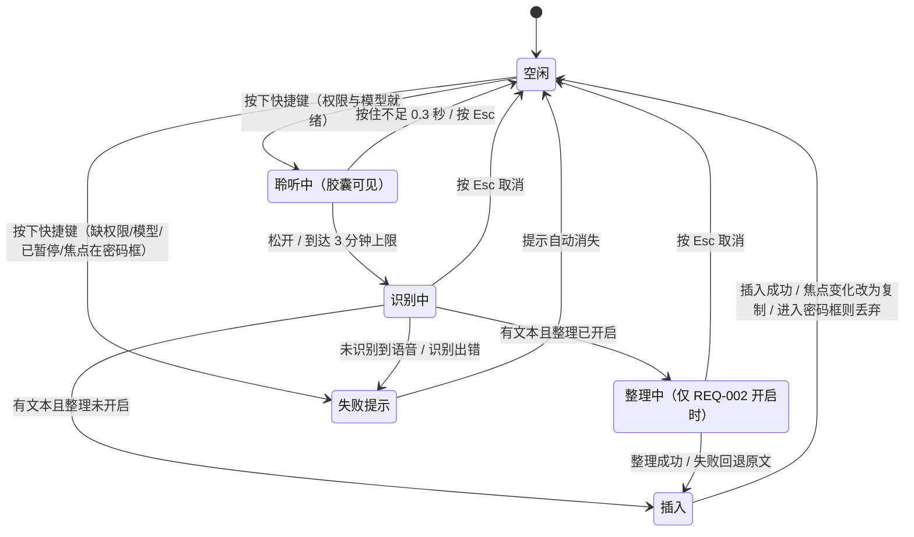
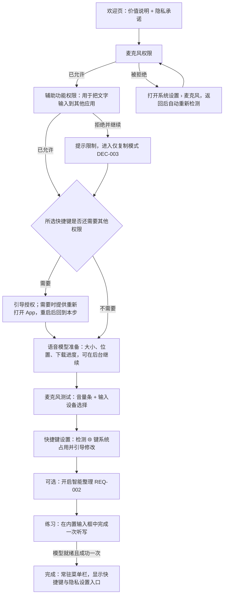

# 产品上下文：REQ-001 按住快捷键语音输入核心闭环（闪说）

## 已确认的需求：桌面端按住说话语音输入（核心闭环）

**Requirement ID**： `REQ-001`
**状态**： Ready（产品方案与交互原型 v0.3 已确认；开放问题已全部关闭）
**上次确认**： 2026-10-21 20:19

> 文内功能条目使用 `FR-*` 编号，避免与 state 中的 Requirement ID（`REQ-001`～`REQ-003`）混淆。关联需求：[REQ-002 文本整理](REQ-002.product.md)、[REQ-003 个人词典](REQ-003.product.md)。

### 权威规则

- 仅状态为 `confirmed` 的条目是下游可绑定的输入。
- `open` 条目不得转写为已确认的产品需求。
- 被替代条目保留在本文档中，状态为 `superseded` 并链接到替代项。
- AI 推断必须标为假设，并在成为绑定输入前取得用户确认。

### 原始请求

> 开发一个桌面端语音输入产品。用户在任何应用中按下全局键盘快捷键后，可以直接开始说话；产品将语音识别并处理成适合书面表达的文本，再插入当前系统中处于活跃状态的输入框。
> 需要对齐：1. Onboarding 流程尤其是权限引导；2. 按住热键语音转文字，配置 OpenRouter 模型把 ASR 文本转成结构化输入，当前仅支持按住快捷键；3. 结合项目及知识库近期 ASR 调研，找一个支持中英文、本地性能不错的模型；4. 专有词与个人词典记忆；5. 文本处理与插入，如"一二三"转有序列表；6. 隐私与信任，给用户充分的掌控感，录音时一定要显示提醒。

本 Requirement 覆盖第 1、3、6 点和第 2 点中的"按住录音、插入"部分。第 2、5 点的文本整理拆到 REQ-002，第 4 点拆到 REQ-003（见 DEC-001）。

### 需求

#### NEED-001: 在任意应用中按住快捷键说话，松开后把识别结果插入当前输入框

- **状态**： confirmed
- **陈述**： 用户在任何应用中按住全局快捷键即可开始说话，松开后产品完成识别，并把文本插入系统当前处于活跃状态的输入框。
- **理由**： 这是产品的核心价值，口述比打字快，并且不需要切换应用。
- **用户证据**： 原始请求"用户在任何应用中按下全局键盘快捷键后，可以直接开始说话……再插入当前系统中处于活跃状态的输入框"。
- **确认时间**： 2026-10-21

#### NEED-002: 首次使用有 Onboarding，重点是权限引导

- **状态**： confirmed
- **陈述**： 新用户能在产品引导下完成所需系统权限授权、模型准备和快捷键设置，并完成第一次成功听写。
- **理由**： 麦克风和"向其他应用输入文字"都依赖系统权限；授权失败是这类产品首日流失的主要原因。
- **用户证据**： 原始请求第 1 点"用户的 Onboarding 流程尤其是权限引导"。
- **确认时间**： 2026-10-21

#### NEED-003: 本地中英文语音识别，质量与性能都要好

- **状态**： confirmed
- **陈述**： 语音识别在用户本机完成，支持中文、英文和中英混说，识别质量和速度满足日常听写。
- **理由**： 本地识别保证音频不出本机，也不依赖网络。
- **用户证据**： 原始请求第 3 点"找一个支持中英文的本地性能不错的模型"。
- **确认时间**： 2026-10-21

#### NEED-004: 录音时一定显示提醒，用户对录音有充分掌控感

- **状态**： confirmed
- **陈述**： 只要产品在采集麦克风音频，屏幕上就必须有明显提示；用户可以随时取消、暂停，并清楚知道数据去了哪里。
- **理由**： 全局听写工具能在任何应用里录音，用户信任是使用前提。
- **用户证据**： 原始请求第 6 点"给用户充分的场控感，录音的时候一定要显示提醒"。
- **确认时间**： 2026-10-21

### 约束

#### CON-001: 当前只支持"按住快捷键录音，松开结束"

- **状态**： confirmed
- **陈述**： 首发版本只有按住说话（push-to-talk）一种录音方式。
- **用户证据**： 原始请求第 2 点"当前仅支持按住快捷键的语音录入转文字"。

#### CON-002: 语音识别在本机运行

- **状态**： confirmed
- **陈述**： 音频的识别在本机完成，音频不上传任何云端服务。
- **用户证据**： 原始请求第 3 点"本地性能不错的模型"。

#### CON-003: 首发平台为 macOS（Apple Silicon，macOS 14 及以上）

- **状态**： confirmed
- **陈述**： 首发只做 macOS；Windows 在核心体验验证后另立 Requirement。
- **理由**： 全局快捷键、权限和跨应用插入在每个操作系统上的机制完全不同；先在一个平台把权限引导和插入可靠性做好，代价最小。当前团队的开发与测试环境也是 macOS。
- **用户证据**： 2026-10-21 19:34 用户回复"可以的，我们先这么做"，确认首轮建议方案。

### 决定

#### DEC-001: 把原始需求拆成 3 个 Requirement

- **状态**： confirmed
- **决定**： REQ-001 核心闭环（本文件，P0）；REQ-002 文本书面化与结构化整理（云端供应商与隐私前置条件见 REQ-002，P1，依赖 REQ-001）；REQ-003 专有词与个人词典（P1，依赖 REQ-001）。
- **原因**： REQ-001 单独交付时已是可用的"本地听写"产品；REQ-002 引入云端调用和新的隐私告知，REQ-003 引入独立的数据维护，二者可以分别验收和发布。
- **用户证据**： 2026-10-21 19:34 用户回复"可以的，我们先这么做"，确认首轮建议方案。

#### DEC-002: 默认快捷键为按住 Fn（🌐），可改为其他按住式组合

- **状态**： confirmed
- **决定**： 默认按住 Fn（🌐）。外接键盘没有 Fn 时默认改为按住右 Option。用户可在设置中改为"单个修饰键"或"修饰键 + 一个普通键"的按住组合；不接受系统保留组合和无修饰键的普通键。
- **已拒绝的替代项**： 无（未讨论）。
- **原因**： Fn 在 Mac 上没有常用组合键冲突，单手可按住；业内同类产品（Wispr Flow、Superwhisper）也以此为默认。macOS 默认把"按下 🌐 键"用于表情或听写，Onboarding 需要检测并引导用户改为"不执行任何操作"。
- **用户证据**： 2026-10-21 19:34 用户回复"可以的，我们先这么做"，确认首轮建议方案。

#### DEC-003: 未授予"向其他应用输入文字"所需权限时，进入"仅复制模式"

- **状态**： confirmed
- **决定**： 麦克风权限是必需项，没有就不能使用。插入所需权限（辅助功能）被拒绝时，产品仍可使用，但结果只复制到剪贴板并提示"已复制，按 ⌘V 粘贴"；菜单栏持续显示"未完成授权"提醒，用户可随时补授权。
- **原因**： 让不愿立即授予辅助功能权限的用户先体验，同时不伪装成完整功能。
- **用户证据**： 2026-10-21 19:34 用户回复"可以的，我们先这么做"，确认首轮建议方案。

#### DEC-004: 默认本地识别模型为 Qwen3-ASR-0.6B，轻量备选为 SenseVoice-Small

- **状态**： confirmed（默认模型部分有效；"轻量备选 SenseVoice-Small"部分已被 DEC-021 替代）
- **决定**： 默认使用 Qwen3-ASR-0.6B（sherpa-onnx int8 包，约 1 GB）；设置中可切换到 SenseVoice-Small（约 230–250 MB，更快，但不支持识别阶段热词）。Fun-ASR-Nano 和 Qwen3-ASR-1.7B 只进入对比评测。
- **已拒绝的替代项**： Whisper large-v3-turbo（中文和中英混说不占优，速度最慢）；Paraformer（只适合中文）。
- **原因**： 项目内近期调研（blurt、yovoice）的默认是 SenseVoice，但它没有热词能力，无法满足第 4 点；Qwen3-ASR-0.6B 支持中英混说，公开基准中文优于 Whisper，并原生支持 prompt 上下文热词，sherpa-onnx 已提供 macOS/Windows 支持，团队在 yovoice 中已有 sherpa-onnx 落地经验。证据见 [ASR 选型笔记](../../research/asr-model-selection.md)。
- **用户证据**： 2026-10-21 19:34 用户回复"可以的，我们先这么做"，确认首轮建议方案。

#### DEC-005: 录音提示的形态

- **状态**： confirmed
- **决定**： 录音时同时出现三种提示：屏幕底部居中的悬浮胶囊（实时音量条 + 计时 + "正在聆听"文字），菜单栏图标切换为录音状态，以及开始提示音。胶囊和菜单栏状态不可在设置中关闭；只有提示音可以关闭。胶囊显示在当前活跃窗口所在的屏幕，包括全屏应用之上。
- **原因**： 视觉提示不能被关闭，才能保证"录音时一定显示提醒"；提示音在会议等场景可能打扰，所以允许关闭。
- **用户证据**： 2026-10-21 19:34 用户回复"可以的，我们先这么做"，确认首轮建议方案。

#### DEC-006: 单次录音时长的下限与上限

- **状态**： confirmed
- **决定**： 按住不足 0.3 秒视为误触，不处理也不插入。单次最长 3 分钟，最后 15 秒在胶囊上倒计时，到时自动结束并照常处理。
- **原因**： 防止误触插入垃圾文本；限制最长时长，避免忘记松开导致长时间录音，也控制处理延迟。
- **用户证据**： 2026-10-21 19:34 用户回复"可以的，我们先这么做"，确认首轮建议方案。

#### DEC-007: 音频不落盘，文本历史本地保存 7 天

- **状态**： confirmed
- **决定**： 音频只在识别过程中存在，识别完成或取消后立即删除，不提供"保存录音"选项。识别与插入的文本保存在本机历史中，默认保留 7 天；用户可以关闭历史、删除单条或一键清空。
- **原因**： 音频是最敏感的数据，不保存是最简单的信任承诺；文本历史支撑"插入失败后找回""从历史纠错加入词典（REQ-003）"。
- **用户证据**： 2026-10-21 19:34 用户回复"可以的，我们先这么做"，确认首轮建议方案。

#### DEC-009: 首发无账户、无遥测

- **状态**： confirmed
- **决定**： 不需要注册或登录；不内置使用数据上报。本地诊断日志只记录事件类型、耗时和错误码，不记录音频和文本内容。
- **原因**： 降低隐私顾虑和首发成本；首发验证依赖内部试用和本地评测。
- **用户证据**： 2026-10-21 19:34 用户回复"可以的，我们先这么做"，确认首轮建议方案。

#### DEC-012: 插入成功率的必测目标应用清单

- **状态**： confirmed（首个公开测试版的本机实测范围由 DEC-023 细化）
- **决定**： 备忘录、TextEdit、Safari 和 Chrome 中的网页输入框、微信、飞书、Slack、VS Code、Cursor、Notion、Terminal、iTerm2。
- **原因**： 覆盖系统原生控件、浏览器、Electron 应用、聊天工具、编辑器和终端几类不同的文本输入实现。
- **用户证据**： 2026-10-21 19:34 用户回复"可以的，我们先这么做"，确认首轮建议方案。

#### DEC-013: 插入目标以松开按键那一刻的焦点为准；密码框中不支持语音输入

- **状态**： confirmed
- **决定**： 插入目标是松开快捷键时系统的活跃输入框。若插入前焦点已切换到其他应用或其他输入框，则不插入，改为复制到剪贴板并提示"焦点已变化，已复制"。插入完成后恢复用户原来的剪贴板内容。焦点在密码框等安全输入框时，闪说不可用：按下快捷键不开始录音，提示"密码框中不支持语音输入"。录音或处理期间焦点进入安全输入框时，丢弃本次内容：不插入、不写剪贴板、不记历史，并提示"密码框中不支持语音输入，本次内容已丢弃"。
- **替代**： DEC-008（原规则为密码框中不插入、不写剪贴板，但保留在历史中）。
- **原因**： 避免把话发到错误的聊天窗口；不覆盖用户剪贴板；密码类内容不进入识别、剪贴板和历史中的任何一处。
- **用户证据**： 2026-10-21 20:19 用户回复"3 密码框就不支持语音就好了，更不用什么历史"。

#### DEC-014: 产品名称为"闪说"

- **状态**： confirmed
- **决定**： 产品中文名为"闪说"，用于应用名、菜单栏、Onboarding、系统权限弹窗说明、设置窗口和隐私页。英文名尚未讨论，不阻塞开发，需要时另行确认；Bundle ID 等工程标识由 plan 阶段决定。
- **用户证据**： 2026-10-21 20:19 用户回复"4 就叫闪说好了"。

#### DEC-015: Onboarding 交互细节按原型执行

- **状态**： confirmed
- **决定**： 快捷键步骤必须按住测试成功一次才能继续；引导中可以点击已访问过的步骤返回；关闭引导窗口后，从菜单栏"继续设置…"续接。
- **原因**： 确保用户离开引导时快捷键确实可用；中途离开也能找回进度。
- **用户证据**： 2026-10-21 20:19 用户回复"1 原型OK 继续推进"、"2.1 没问题的快捷键"。

#### DEC-016: 仅复制模式下随处提供"开启直接插入"入口

- **状态**： confirmed
- **决定**： 仅复制模式下，每次听写结束的胶囊提示和菜单栏菜单都提供"开启直接插入…"，点击直达系统设置的辅助功能页面；授权后自动恢复直接插入，无需重启。
- **原因**： 把补授权放在用户最需要的时刻，降低仅复制模式的长期停留。
- **工程说明**： 直达系统设置页面和授权后免重启生效的可行性由 plan 阶段核实；做不到时回到产品确认替代方式。
- **用户证据**： 2026-10-21 20:19 用户回复"2.2 可以的，能实现最好了"。

#### DEC-017: 不申请"输入监控"权限，快捷键监听只依赖辅助功能

- **状态**： confirmed
- **决定**： 闪说只申请麦克风和辅助功能两项权限，不申请"输入监控"。Onboarding 去掉"按键监听"步骤。辅助功能步骤的说明改为同时覆盖它的三项用途：在任何应用中按住 fn / 右 Option 说话、把文字直接放到光标处、插入后留意用户是否改了刚插入的那段文字以学习专有词（REQ-003 DEC-007）。
- **原因**： 用户指出同类语音输入产品都不申请输入监控，而且这项权限范围太广。Apple 开发者论坛的实测显示，授予辅助功能后即可创建键盘事件监听，应用不需要出现在输入监控列表中；Wispr Flow 与 Handy 的安装说明也只要求麦克风和辅助功能（来源见 [plan 调研笔记](../../research/plan-reuse-and-platform-notes.md)）。
- **工程风险**： FEAT-001 T002 在本机上实测；若某个受支持的 macOS 版本必须授予输入监控才能监听 fn，回到产品确认。
- **用户证据**： 2026-10-21 20:48 用户回复"2必选权限里面的输入监控我看了下现在没有语音输入类在用的，且输入监控范围太广了吧。。。"

#### DEC-018: 首发只做测试版，不做公开分发

- **状态**： confirmed（测试版签名和不公证部分继续有效；“不做公开分发”由 DEC-022 替代）
- **决定**： 首发是测试版，供本机和少量测试者使用；不做 Apple 公证，也不上 Mac App Store。测试版必须使用固定的代码签名身份，否则每次重新构建后，macOS 会把它当成新应用，麦克风和辅助功能权限需要重新授予。本机目前没有任何代码签名证书，工程方案见 FEAT-001 ED-012。测试者第一次打开时，需要在“系统设置 › 隐私与安全性”中手动允许打开，安装说明写明这一步。
- **用户证据**： 2026-10-21 20:48 用户回复"3就做测试版就行"。

#### DEC-019: 性能基线以开发机实测为准，并在项目中写明缺少 M1 数据

- **状态**： confirmed
- **决定**： NFR-002、NFR-003 以开发机（Apple M5、16 GB 内存、macOS 26.4.1）的实测结果为验收依据。没有 M1 等较老机型可测，项目 README 和验证报告都要写明"未在 M1 等较老机型上测试，较老机型上的识别延迟可能更高"。
- **用户证据**： 2026-10-21 20:48 用户回复"4没有，我们在项目里面说明好了"。

#### DEC-020: 没有辅助功能时，快捷键自动改为按住 ⌃⇧ Space
- **状态**： confirmed
- **决定**： 保留仅复制模式（DEC-003）。没有辅助功能时，快捷键自动改为按住 ⌃⇧ Space，松开后结果复制到剪贴板，由用户自己粘贴；此模式下不做自动学习。用户之后补授辅助功能，可以在设置中改回 fn。如果使用中辅助功能被关闭，立即弹出提示，告诉用户快捷键已改为 ⌃⇧ Space。⌃⇧ Space 是暂定值，避开了 ⌃Space、⌃⌥Space 两个输入法切换快捷键，由 FEAT-001 T002 验证不与系统和常见输入法冲突；有冲突时换成 T002 选出的组合，不改变本决定的其余部分。
- **已拒绝的替代项**： 把辅助功能改为必需权限、取消仅复制模式：不愿授权的用户将完全无法使用。
- **替代**： OPEN-004。
- **用户证据**： 2026-10-21 21:20 用户回复"可以，我们先推进吧。"，确认上一轮列出的两项建议。

#### DEC-021: 首个测试版只提供 Qwen3-ASR-0.6B，不提供轻量模型切换；首个集成交付只含 REQ-001
- **状态**： confirmed
- **决定**： 首个测试版只内置一个识别模型 Qwen3-ASR-0.6B，设置 › 语音模型只显示当前模型、大小、位置以及删除和重新下载，不显示"切换到轻量模型"。首个集成交付只包含 REQ-001；REQ-002（智能整理）和 REQ-003（词典与静默学习）在之后的 Feature 中交付。
- **已拒绝的替代项**： 保留 SenseVoice-Small 作为轻量备选：T001 实测英文 WER 31.5%，远超 NFR-003 的 8%；首个交付加入 REQ-002 或 REQ-003：会推迟可用版本。
- **原因**： FEAT-001 T001 评测（`bench/asr/reports/2026-10-21-m5.md`）；用户要求加速集成交付。
- **替代**： DEC-004 中的轻量备选部分。
- **用户证据**： 2026-10-21 22:37 用户选择"A：只做 REQ-001 核心闭环，去掉 SenseVoice（推荐）"。

#### DEC-022: 完成首版后公开源码与安装包

- **状态**： confirmed
- **决定**： 继续完成 REQ-001，交付可安装、可实际使用的原生应用；将现有 `arnow117/voice-dictation` 仓库公开，提供版本标签及含安装包与校验和的 GitHub Release。开源范围仅限本项目，不包括本机父仓库和其他项目。项目自有代码采用 MIT，第三方材料沿用自身许可。提交、推送、合并主分支、修改本仓库公开状态与发布均已授权，必要实现、验证、评审完成后执行，不再逐阶段请求相同授权。
- **分发限制**： 继续使用已有本地测试签名身份；不购买证书或服务，不声称 Apple 公证。首次打开步骤、未测试的机型和实际质量限制须在用户文档和 Release 中写明。发布前检查所有公开历史、分支和资产，不公开签名私钥、凭据、个人音频和听写内容。
- **范围**： REQ-002、REQ-003 继续作为后续需求，DEC-021 继续有效。此决定不自动放宽现有质量指标或把未完成的验证记为通过。
- **替代**： DEC-018 中“不做公开分发”的部分。
- **用户证据**： 2026-10-22 用户说“我们新开个对话，把闪说做完吧。整个github也开源出去好了。”；新对话交接明确上述项目边界、发布授权和交付验收。

#### DEC-023: 首个公开测试版验证本机已安装的八个目标应用

- **状态**： confirmed
- **决定**： 首版实测兼容性范围为备忘录、TextEdit、Safari、Chrome、微信、飞书、VS Code、Terminal。Slack、Cursor、Notion、iTerm2 本机未安装，作为未测试的公开测试版限制写入 README、验证报告与 Release，不计入通过数量或插入成功率分母。
- **质量标准**： 实测范围仍按 NFR-005 的插入成功率 ≥ 98% 验收；此决定不放宽权限、安全输入、取消、音频隐私、延迟和识别准确率要求。
- **用户证据**： 2026-10-22 用户回复“按本机 8 个应用验证，4 个列为未测试（推荐）”。
- **细化**： DEC-012 对首个公开测试版的验证环境范围；其余应用仍保留为后续兼容性目标。

#### DEC-024: 首个公开测试版接受已披露的中文与混说准确率限制

- **状态**： confirmed
- **决定**： `v0.1.0-beta.1` 可以接受完整 120 条原始公开音频复测中的中文 CER 6.48% 和混说 MER 12.94%，分别高于原定 6% 和 10%。英文 WER 6.03%，达到原定 8% 目标。本次运行没有空输出，评分、测试集与失败证据均不替换。
- **披露**： README、验证报告和 Release 明确公布实测结果、原定阈值及中文原生/Python 运行时差异尚未解决；不能声称 NFR-003 或 SC-003 原定指标通过。此例外只适用于首个公开测试版，不删除后续准确率目标。
- **边界**： 不放宽录音隐私、权限、安全输入、取消、真实应用插入验证或其他质量要求。实测报告见 `docs/validation/asr-rms-fix-125650.md`，冻结二进制 SHA-256 与原始 JSONL 一并保存。
- **用户证据**： 2026-10-22 用户在获知全部指标、原定目标和扩大运行时调查范围的选择后，回复“接受准确率限制，按公开测试版交付（推荐）”。同次回复也明确授权为本地闪说测试版授予麦克风和辅助功能权限。

#### DEC-025: 优先交付可安装、可使用的公开测试版

- **状态**： confirmed
- **决定**：首个测试版以可安装和实际听写为当前交付目标。必要条件是应用可构建和运行、真实热键与麦克风识别闭环已有证据、插入与取消/安全输入/剪贴板/隐私的生产回归检查通过、模型可用、安装包内容与签名可验证，且没有未解决的已知关键缺陷。非关键问题集中写入已知问题清单，后续处理，不继续要求用户反复配合设置页诊断。
- **本次取舍**：设置页 Tab/Shift-Tab 与旁白深入验证、冷启动相对 5 秒目标的超标、完整延迟/显示分布及八应用八十次兼容性评测，保留实际失败或未完成状态，移入测试版后续清单；不声明原 NFR 或 ≥98% 兼容性指标通过。当前真实听写证据包含原生练习完整通过，以及用户确认备忘录中按住热键可以输入。未测环境和控件明确披露。
- **边界**：录音隐私、安全输入、取消和剪贴板所有权的既有行为与必要检查继续有效；关键缺陷仍须修复。自签名、不公证、不购买服务、仅公开本项目及必要发布操作的 DEC-022 继续有效。整理与词典仍属后续 REQ-002、REQ-003。
- **用户证据**：用户先要求“要抓大放小”，随后明确“继续吧，先把闪说做成可安装、可实际使用的版本，非关键问题列个清单后面再处理”。已知问题见 `docs/known-issues.md`。

### 范围外

#### OUT-001: 免按住的录音方式（双击开始、再按结束等）

- **状态**： confirmed
- **陈述**： 不做 hands-free 切换式录音。
- **原因**： CON-001。
- **用户证据**： "当前仅支持按住快捷键的语音录入转文字"。

#### OUT-002: 其他首发不做的能力

- **状态**： confirmed
- **陈述**： 选中文本后用语音改写的"命令模式"；边说边上屏的流式插入；会议录音和音频文件转写；唤醒词或后台持续监听；Windows/Linux/移动端；对中英文以外语言的质量承诺；云端同步和多设备。
- **原因**： 与"按住说话 → 插入"核心闭环无关，或会显著扩大隐私面。
- **用户证据**： 2026-10-21 19:34 用户回复"可以的，我们先这么做"，确认首轮建议方案。

### 开放问题

当前没有开放问题。

### 已替代条目

#### OPEN-004: 没有辅助功能时，快捷键怎么办

- **状态**： superseded（由 DEC-020 替代，2026-10-21 21:20 用户确认建议）
- **背景**： 不申请输入监控之后（DEC-017），如果用户也没有授予辅助功能，macOS 只允许应用注册"修饰键 + 普通键"的组合快捷键，单独按住 fn 或右 Option 无法被识别。
- **建议**： 保留仅复制模式（DEC-003）；在此模式下快捷键自动改为按住 ⌃⇧ Space，结果复制到剪贴板，不做自动学习。用户之后补授辅助功能，可以在设置中改回 fn。⌃⇧ Space 是暂定值，避开了 ⌃Space、⌃⌥Space 这两个输入法切换快捷键，由 T002 验证它不与系统和常见输入法冲突。如果使用中辅助功能被关闭，立即弹出提示，告诉用户快捷键已改为 ⌃⇧ Space。原型 v0.3 按这个建议实现。
- **替代方案**： 把辅助功能改为必需权限，取消仅复制模式。实现路径更简单，但不愿授权的用户就完全无法使用。
- **阻塞**： 不阻塞 T001～T005；T006（权限与快捷键）开始前必须关闭。
- **负责人**： 用户

#### DEC-008: 插入目标以松开按键那一刻的焦点为准

- **状态**： superseded（由 DEC-013 替代：密码框中改为不支持语音输入，不再保留历史）
- **决定**： 插入目标是松开快捷键时系统的活跃输入框。若插入前焦点已切换到其他应用或其他输入框，则不插入，改为复制到剪贴板并提示"焦点已变化，已复制"。插入完成后恢复用户原来的剪贴板内容。焦点在密码框等安全输入框时不插入、也不写入剪贴板，只保留在历史中。
- **原因**： 避免把话发到错误的聊天窗口；不覆盖用户剪贴板；不往密码框里输入。
- **用户证据**： 2026-10-21 19:34 用户回复"可以的，我们先这么做"，确认首轮建议方案。

#### DEC-010: 以签名并公证的 DMG 直接分发，不上 Mac App Store

- **状态**： superseded（由 DEC-018 替代：用户决定只做测试版）
- **决定**： 首发通过 Developer ID 签名、Apple 公证的 DMG 分发。
- **原因**： 跨应用插入文字和全局按键监听依赖辅助功能等权限，Mac App Store 沙箱应用无法获得这类能力。具体限制由 plan 阶段核实。
- **用户证据**： 2026-10-21 19:34 用户回复"可以的，我们先这么做"，确认首轮建议方案。

#### DEC-011: 性能与准确率的基线机型为 M1 / 16 GB

- **状态**： superseded（由 DEC-019 替代：用户没有 M1 测试机）
- **决定**： NFR-002、NFR-003 以 Apple M1、16 GB 内存的 Mac 为验收基线；另记录一台最新 Apple Silicon 机型的结果作参考，不作为验收依据。
- **原因**： 选较低配置作为基线，达标后在更新机型上体验只会更好。
- **用户证据**： 2026-10-21 19:34 用户回复"可以的，我们先这么做"，确认首轮建议方案。

#### OPEN-003: 产品名称

- **状态**： superseded（由 DEC-014 替代）
- **原问题**： 影响 Onboarding 文案、权限说明文案和应用标识。

#### OPEN-001: 性能和准确率指标的基线机型

- **状态**： superseded（由 DEC-011 替代）
- **原问题**： NFR-002、NFR-003 需要固定机型才可验证。

#### OPEN-002: 必测的目标应用清单

- **状态**： superseded（由 DEC-012 替代）
- **原问题**： 插入成功率（NFR-005）的验收范围。

### 确认日志

#### 会话 2026-10-21 19:30

- **展示的摘要**： 首轮草案：需求拆分（DEC-001）、平台（CON-003）、快捷键（DEC-002）、权限降级（DEC-003）、默认模型（DEC-004）、录音提示（DEC-005）、时长（DEC-006）、数据保留（DEC-007）、插入规则（DEC-008）、无账户无遥测（DEC-009）、分发方式（DEC-010）及开放问题。
- **用户确认**： 见 2026-10-21 19:34 会话。
- **已确认条目**： NEED-001～NEED-004、CON-001、CON-002、OUT-001（均来自原始请求）。
- **执行说明**： 当前 Manus 运行时没有可直接派发的阶段子 Agent，spec 阶段由主 Agent 按协议串行内联执行，不属于独立评审。加载角色：product-owner、design、security。Impeccable 已在运行时技能列表中，本阶段只借用其 shape 的发现维度，未运行 launcher。按 sdlc-prototype 选择策略，本需求属于首次 UI 设计，需要原型；计划在核心决定确认后制作，覆盖 Onboarding、录音胶囊和设置页。

#### 会话 2026-10-21 19:34

- **展示的摘要**： 19:30 会话中的全部建议默认方案，以及开放问题的建议答案。
- **用户确认**： "可以的，我们先这么做。记得起一个github项目来追踪。"
- **已确认条目**： CON-003、DEC-001～DEC-012、OUT-002；OPEN-001、OPEN-002 按建议答案关闭（DEC-011、DEC-012）。OPEN-003 产品名称仍开放，不阻塞 spec。
- **后续**： 制作交互原型（Onboarding、录音胶囊、设置与词典）供用户确认，确认后再标记 ready。进度在 GitHub 私有仓库的 Issues 中同步跟踪，SDLC 进度仍以 `.sdlc-v1/state.json` 为准。

#### 会话 2026-10-21 20:19

- **展示的摘要**： 交互原型 v0.1（commit `32a5331`）及待确认的演示假设：快捷键测试（2.1）、仅复制模式入口（2.2）、历史纠错提议可修改（2.3）、关闭零数据保留的确认方式（2.4）、密码框处理（3）、产品名称（4）。
- **用户确认**： "1 原型OK 继续推进；2.1 没问题的快捷键；2.2 可以的，能实现最好了；2.3 这个我没在原型里面见到，可以和我再对齐下；2.4 关闭零数据保留是指什么？；3 密码框就不支持语音就好了，更不用什么历史；4 就叫闪说好了"
- **已确认条目**： 原型 v0.1 的整体交互；DEC-013（替代 DEC-008）、DEC-014（替代 OPEN-003）、DEC-015、DEC-016。2.3 属于 REQ-003、2.4 属于 REQ-002，分别记为对应文档的开放问题，不阻塞 REQ-001。
- **后续**： 原型按本次回复更新为 v0.2（commit `eae5529`）。REQ-001 标记为 ready，进入 plan。

#### 会话 2026-10-21 20:48

- **展示的摘要**： FEAT-001 工程草案及待确认项：技术栈（1）、必需权限（2）、分发方式（3）、M1 测试机（4）、测试集（5）、Bundle ID（6）。
- **用户确认**： "技术栈选1；2必选权限里面的输入监控我看了下现在没有语音输入类在用的，且输入监控范围太广了吧。。。；3就做测试版就行；4没有，我们在项目里面说明好了；5好的，专有词你也可以找一些现成的；6可以的"；并追问"插入文字后恢复原剪贴板需要程序读取剪贴板，这块会有这类语音输入的场景么？"
- **已确认条目**： DEC-017（不申请输入监控）、DEC-018（替代 DEC-010）、DEC-019（替代 DEC-011）。技术栈、测试集和 Bundle ID 属于工程决定，记在 FEAT-001。
- **新增开放问题**： OPEN-004（没有辅助功能时的快捷键），附建议方案，原型 v0.3 已按建议实现，等待用户确认。
- **后续**： 原型更新为 v0.3。剪贴板的问题在 FEAT-001 ED-005 中回答。

#### 会话 2026-10-21 21:20

- **展示的摘要**： FEAT-001 已确认并进入 build；剪贴板读取问题的结论（ED-005）；待确认的 OPEN-004 建议（没有辅助功能时快捷键改为按住 ⌃⇧ Space）。
- **用户确认**： "可以，我们先推进吧。"
- **已确认条目**： DEC-020（替代 OPEN-004）。
- **后续**： FEAT-001 开始 T001～T003；T006 的前置条件"OPEN-004 已关闭"已满足。

#### 会话 2026-10-21 22:37
- **展示的摘要**： T001、T002 定稿；用户要求加速集成交付后，询问首个交付范围（A 只做 REQ-001 / B 加 REQ-002 / C 三个都做）与是否去掉 SenseVoice。
- **用户确认**： "A：只做 REQ-001 核心闭环，去掉 SenseVoice（推荐）"。
- **已确认条目**： DEC-021（替代 DEC-004 的轻量备选部分）。
- **后续**： FEAT-001 按 ED-017 加速执行，T008 只实现 Qwen3-ASR，T012 不做模型切换。
## 功能规格：按住快捷键语音输入核心闭环

**关联 Requirement**： `REQ-001`
**产品上下文**： `.sdlc-v1/context/REQ-001.product.md`
**关联分支**： `none`
**创建日期**： 2026-10-21
**状态**： Ready
**输入**： 用户原始请求；方向来源：[ASR 选型笔记](../../research/asr-model-selection.md)、`workspace/20260922-agent-native-research/templates/clips/desktop/design-refs/wispr-ux.md`（Wispr Flow 体验参考）、`workspace/20260928-blurt-analysis/repo/skills/blurt/reference/asr.md`。新项目，尚无 `project.md` 和长期产品文档（记为 `none`）。

### 用户场景与测试 *(必填)*

#### 用户故事 1 - 按住说话，松开插入（优先级：P1）

用户在任意应用的输入框里，按住快捷键说一段话，松开后文字出现在光标处。整个过程不需要切换窗口，也不需要看产品界面。

**为何此优先级**： 这是产品存在的理由，其他能力都建立在它之上。

**独立测试**： 在备忘录中按住快捷键说一句中英混合的话并松开，检查文字插入位置、内容和剪贴板是否被恢复。

一次听写会话的状态变化如下：

**验收场景**：

1. **给定** 已完成 Onboarding、光标在备忘录中，**当** 用户按住 Fn 说"今天下午三点开会"并松开，**则** 按下后 150 毫秒内出现录音胶囊和开始提示音；松开后胶囊变为"识别中"；文字"今天下午三点开会。"插入到光标处；用户原有剪贴板内容保持不变。（NEED-001、DEC-005、DEC-013）
2. **给定** 同上，**当** 用户说"帮我把这个 PR merge 到 main 分支"，**则** 插入文本中的英文词保持英文拼写（PR、merge、main），中文部分正确。（NEED-003）
3. **给定** 同上，**当** 用户按住快捷键不足 0.3 秒就松开，**则** 不插入任何内容，胶囊直接消失。（DEC-006）
4. **给定** 用户正在按住说话，**当** 用户按下 Esc，**则** 录音立即停止，音频被丢弃，不插入任何内容，胶囊显示"已取消"后消失。（NEED-004）
5. **给定** 用户按住快捷键但没有说话，**当** 松开，**则** 胶囊提示"没有听到声音"，不插入。
6. **给定** 用户持续按住快捷键，**当** 录音达到 2 分 45 秒，**则** 胶囊开始 15 秒倒计时；到 3 分钟时自动结束并照常识别、插入。（DEC-006）
7. **给定** 用户松开快捷键后、文本插入前切换到了另一个应用，**当** 识别完成，**则** 不向新应用插入，文本复制到剪贴板并提示"焦点已变化，已复制"。（DEC-013）
8. **给定** 光标在密码输入框（系统安全输入），**当** 用户按下快捷键，**则** 不开始录音，胶囊提示"密码框中不支持语音输入"；输入框、剪贴板和历史都不变化。（DEC-013）
9. **给定** 当前没有可编辑的输入框（例如焦点在桌面），**当** 用户完成一次听写，**则** 文本复制到剪贴板并提示"未找到输入框，已复制"。
10. **给定** 上一段仍在识别或整理中，**当** 用户再次按下快捷键，**则** 不开始新录音，胶囊提示"上一段仍在处理"。
11. **给定** 麦克风被拔出或被其他应用独占，**当** 用户按下快捷键，**则** 不开始录音，胶囊显示"麦克风不可用"和处理建议。
12. **给定** 用户正在录音或文本正在处理，**当** 焦点进入密码输入框，**则** 丢弃本次内容，不插入、不写剪贴板、不记历史，并提示"密码框中不支持语音输入，本次内容已丢弃"。（DEC-013）

---

#### 用户故事 2 - 首次使用引导与权限授权（优先级：P1）

新用户第一次打开产品，按步骤完成麦克风和输入权限授权、下载本地模型、测试麦克风、确认快捷键，并在内置练习框里完成第一次听写。

**为何此优先级**： 没有权限，用户故事 1 无法发生；权限引导失败会直接导致流失。

**独立测试**： 在全新 macOS 用户账户上安装产品，按引导走完，记录用时、每一步的授权结果和异常恢复。

| 步骤 | 是否必需 | 完成条件 | 失败或拒绝时 |
|---|---|---|---|
| 欢迎 | 是 | 用户点击开始 | — |
| 麦克风权限 | 是 | 系统状态为已允许 | 显示原因和"打开系统设置"直达按钮；返回后自动重测 |
| 辅助功能权限 | 否（但缺失时为仅复制模式） | 系统状态为已允许 | 允许"稍后再说"，明确提示限制 |
| 快捷键所需的其他权限 | 视工程方案 | 系统状态为已允许 | 需要重启才能生效时提供"重新打开"按钮 |
| 语音模型准备 | 是 | 模型下载完成并通过校验 | 断网可暂停、续传、重试或切换国内镜像源；校验失败自动重下 |
| 麦克风测试 | 否 | 检测到声音 | 提示检查静音或切换输入设备 |
| 快捷键设置 | 是 | 快捷键已登记且按住测试成功 | 冲突时说明冲突来源并给出修改入口 |
| 智能整理（REQ-002） | 否 | 填写 Key 并测试成功，或选择跳过 | 跳过即本地模式 |
| 练习 | 是 | 在练习框中成功插入一次 | 失败时显示具体原因并允许重试 |

**验收场景**：

1. **给定** 首次启动，**当** 欢迎页出现，**则** 页面用三句话说明：音频只在本机识别、录音时一定有提示、云端整理需要用户主动开启。（NEED-004）
2. **给定** 麦克风步骤，**当** 用户点击"允许"并在系统弹窗中同意，**则** 状态立即变为"已允许"并自动进入下一步。（NEED-002）
3. **给定** 用户在系统弹窗中拒绝了麦克风，**当** 回到引导页，**则** 显示为什么需要该权限和"打开系统设置"按钮，按钮直达"隐私与安全性 › 麦克风"；用户在系统设置中打开开关并返回后，2 秒内自动识别为已允许。
4. **给定** 辅助功能步骤，**当** 用户在系统设置中打开本产品的开关，**则** 引导页无需用户手动点"下一步"即自动前进；列表里找不到本产品时，页面提供添加方法说明。
5. **给定** 某项权限需要重启应用才生效，**当** 用户点击"重新打开"，**则** 应用重启后回到同一步骤，已完成的步骤保持完成状态。
6. **给定** 模型正在下载，**当** 网络中断，**则** 下载暂停并显示"重试"和"切换下载源"；恢复后从断点继续；用户可以在下载期间完成后续不依赖模型的步骤。
7. **给定** 系统把"按下 🌐 键"设置为表情或听写，**当** 用户来到快捷键步骤，**则** 页面提示冲突并提供打开键盘设置的按钮，或建议改用右 Option。（DEC-002）
8. **给定** 用户中途退出引导，**当** 再次打开应用，**则** 从第一个未完成的步骤继续。
9. **给定** 用户在辅助功能步骤选择"稍后再说"，**当** 完成引导后听写，**则** 快捷键改为按住 ⌃⇧ Space，结果只复制到剪贴板并提示粘贴方式，菜单栏持续显示"未完成授权"。（DEC-003、DEC-020）
10. **给定** 已完成引导的用户后来在系统设置中撤销了麦克风权限，**当** 用户按下快捷键，**则** 不开始录音，弹出修复卡片，指出缺少哪项权限并提供直达按钮。

---

#### 用户故事 3 - 录音提示与隐私掌控（优先级：P1）

用户任何时候都能看到产品是否在录音，能取消、能暂停，能看到并清除自己的历史，也能在一个页面看清哪些数据留在本机、哪些会离开本机。

**为何此优先级**： 原始请求明确要求"录音的时候一定要显示提醒"，这是使用前提。

**独立测试**： 在普通窗口、全屏应用和多显示器下各录音 10 次，检查提示可见性、停止及时性和历史管理功能。

**验收场景**：

1. **给定** 任意前台应用（含全屏应用），**当** 用户按下快捷键，**则** 在开始采集音频之前录音胶囊已显示在当前活跃窗口所在屏幕，菜单栏图标同时切换为录音状态。（NEED-004、DEC-005）
2. **给定** 设置页，**当** 用户查找关闭录音胶囊的选项，**则** 不存在该选项；只能关闭提示音。（DEC-005）
3. **给定** 录音胶囊因异常无法显示，**当** 用户按下快捷键，**则** 不开始录音，并提示错误。
4. **给定** 正在录音，**当** 用户松开或按 Esc，**则** 100 毫秒内停止采集，系统菜单栏的麦克风使用指示随之消失。
5. **给定** 用户在菜单栏选择"暂停语音输入"（1 小时或直到手动恢复），**当** 暂停期间按下快捷键，**则** 不录音，胶囊提示"语音输入已暂停"。
6. **给定** 一次听写已完成或被取消，**当** 检查本机存储，**则** 不存在该次音频文件。（DEC-007）
7. **给定** 历史页，**当** 用户查看，**则** 可以看到最近 7 天每次听写的时间、插入目标应用和文本，可以复制、删除单条、一键清空，也可以关闭历史。（DEC-007）
8. **给定** 隐私页，**当** 用户打开，**则** 页面列出：音频只在本机识别且不保存；文本历史保存在本机；只有开启 REQ-002 时，识别出的文字会发送到 REQ-002 当前确认的云端接收方及所选模型提供商。
9. **给定** 任意一次听写，**当** 检查诊断日志，**则** 日志中没有音频和文本内容。（DEC-009）

---

#### 用户故事 4 - 本地语音模型管理（优先级：P2）

用户能在设置中看到当前使用的识别模型、占用空间和位置，可以删除或重新下载模型（首个测试版不提供轻量模型切换，见 DEC-021）。

**为何此优先级**： 首发需要，但对核心体验的影响小于前三个故事。

**独立测试**： 在设置中切换模型、删除模型，再按快捷键，检查提示和恢复路径。

**验收场景**：

1. **给定** 设置页，**当** 用户打开"语音模型"，**则** 显示当前模型名称、大小、存储位置和可选模型列表。（DEC-004）
2. ~~**给定** 用户切换到轻量模型，**当** 下载完成，**则** 下一次听写使用新模型，旧模型可由用户删除。~~（首个测试版不做，见 DEC-021）
3. **给定** 模型文件缺失或损坏，**当** 用户按下快捷键，**则** 不开始录音，提示"语音模型需要修复"，并提供重新下载入口；应用不崩溃。

#### 边界情况

- 用户在一次听写中切换了输入设备（例如插上耳机）：本次使用按下快捷键时的设备；下一次使用新的默认设备。
- 用户同时按住快捷键和其他按键（例如 Fn + 方向键）：视为用户在使用系统组合，不开始录音或立即取消。
- 屏幕锁定或系统睡眠发生在录音中：立即停止并丢弃音频。
- 外接显示器上的全屏应用：胶囊显示在活跃窗口所在屏幕。
- 目标应用不接受粘贴（如部分游戏、远程桌面）：插入失败后改为复制并提示。
- 用户说出的是命令式内容（例如"删除所有文件"）：仅作为文本插入，产品不执行任何操作。
- 识别结果极长（接近 3 分钟语音）：允许处理时间按 NFR-002 的比例增加，胶囊持续显示处理状态。

### 需求 *(必填)*

#### 术语

| 术语 | 含义 |
|---|---|
| 听写会话 | 从按下快捷键到文本插入（或取消、失败）的一次完整过程 |
| 录音胶囊 | 录音期间显示在屏幕底部居中的悬浮提示 |
| 活跃输入框 | 松开快捷键时系统键盘焦点所在、可编辑的文本控件 |
| 仅复制模式 | 缺少插入权限时，结果只写入剪贴板的工作方式 |
| 本地模式 | 未开启 REQ-002 智能整理时，只使用本地识别结果的工作方式 |

#### 功能需求

- **FR-001**：系统必须在任意前台应用中响应用户配置的按住式全局快捷键，按住期间录音，松开结束。
  - 来源：NEED-001、CON-001、DEC-002
- **FR-002**：系统必须在本机完成中文、英文和中英混说的识别，无需用户手动切换语言。
  - 来源：NEED-003、CON-002、DEC-004
- **FR-003**：系统必须把识别结果插入松开快捷键时的活跃输入框，并在插入后恢复用户原有剪贴板内容；焦点变化、无输入框时按 DEC-013 处理。
  - 来源：NEED-001、DEC-013
- **FR-004**：系统必须在采集音频前显示录音胶囊和菜单栏录音状态，且该提示不可关闭；提示无法显示时不得录音。
  - 来源：NEED-004、DEC-005
- **FR-005**：用户必须能够在录音和处理期间用 Esc 取消，取消后不插入任何内容并丢弃音频。
  - 来源：NEED-004
- **FR-006**：系统必须提供引导式 Onboarding，覆盖麦克风权限、插入权限、快捷键所需权限、模型准备、麦克风测试、快捷键设置和练习，并支持中途退出后续接。
  - 来源：NEED-002
- **FR-007**：系统必须实时检测各项权限状态；任何必需权限缺失时，按下快捷键不得静默失败，必须显示修复入口。
  - 来源：NEED-002、DEC-003
- **FR-008**：系统必须在缺少插入权限时以仅复制模式工作，并持续提示未完成授权。
  - 来源：DEC-003
- **FR-009**：系统必须忽略短于 0.3 秒的按压，并在单次录音达到 3 分钟时自动结束。
  - 来源：DEC-006
- **FR-010**：系统不得持久保存音频；文本历史默认保存 7 天，用户可关闭、删除单条和清空。
  - 来源：DEC-007
- **FR-011**：用户必须能够从菜单栏暂停和恢复语音输入。
  - 来源：NEED-004
- **FR-012**：系统必须提供隐私页，说明各类数据的存放位置和是否离开本机。
  - 来源：NEED-004
- **FR-013**：系统必须支持下载、校验、切换和删除本地识别模型，并在中国大陆网络下提供可用的下载源。
  - 来源：NEED-003、DEC-004
- **FR-014**：诊断日志不得包含音频和文本内容。
  - 来源：DEC-009
- **FR-015**：焦点在安全输入框时系统不得开始录音；录音或处理期间焦点进入安全输入框时，必须丢弃本次内容，不插入、不写剪贴板、不记历史。
  - 来源：DEC-013

*开放项：* 无。

#### 质量要求

- **NFR-001 提示及时性**：按下快捷键到录音胶囊可见，P95 ≤ 150 毫秒。测量方式：自动化记录按键事件与胶囊首帧时间。
- **NFR-002 端到端延迟（本地模式）**：在基线机型上，15 秒以内的语音，从松开到文本插入 P50 ≤ 1.0 秒、P95 ≤ 2.0 秒；30 秒语音 P95 ≤ 3.5 秒。测量方式：plan 阶段 eval-bench。（基线机型见 DEC-011。plan 阶段先实测基线；若目标不可达，回到产品确认调整，不由研发自行放宽）
- **NFR-003 识别准确率**：在自建听写测试集（不少于 120 条：中文 40、英文 30、中英混说 30、专有词密集 20）上，中文 CER ≤ 6%，英文 WER ≤ 8%，混说 MER ≤ 10%。（plan 阶段先实测基线；若目标不可达，回到产品确认调整。首个公开测试版仅按 DEC-024 接受已披露的中文与混说限制，原定指标不计为通过。）
- **NFR-004 空闲开销**：未按快捷键时不采集音频，平均 CPU 占用低于 1%。
- **NFR-005 插入成功率**：在 DEC-012 的目标应用清单中，插入成功率 ≥ 98%。
- **NFR-006 冷启动**：应用启动后 5 秒内可以开始第一次听写；常驻期间的听写不因模型重新加载额外增加超过 1 秒。
- **NFR-007 无障碍**：Onboarding 和设置页可全程键盘操作，控件有 VoiceOver 标签；录音胶囊的状态同时用文字表达，不只依赖颜色。

#### 关键实体

- **听写会话**：开始时间、时长、状态（聆听、识别、整理、插入、取消、失败）、失败原因、插入目标应用。
- **录音提示**：与听写会话一一对应，状态随会话变化。
- **权限状态**：每项系统权限的当前状态（未请求、已允许、已拒绝），由系统实时提供，产品不自行缓存为真值。
- **本地识别模型**：名称、版本、大小、校验值、存储位置、是否为当前使用。
- **历史记录**：时间、插入目标应用、识别文本、最终插入文本（REQ-002 开启时两者可能不同）、插入结果。

### 成功标准 *(必填)*

#### 可衡量结果

- **SC-001**：内部测试者中，至少 90% 能在 5 分钟内（不含模型下载时间）完成 Onboarding 并在练习框中成功听写一次。
- **SC-002**：NFR-002 延迟目标在基线机型上达成。
- **SC-003**：NFR-003 准确率目标在自建测试集上达成。首个公开测试版的中文与混说例外见 DEC-024，发布时不得将该例外写成目标已达成。
- **SC-004**：所有录音会话都能观察到录音提示（自动化测试 100% 通过，人工抽查无遗漏）。
- **SC-005**：内部试用两周后，测试者愿意把它作为日常默认输入方式（人工访谈判断）。

### 范围外

- 免按住录音方式：见 OUT-001。
- 命令模式、流式上屏、会议和文件转写、唤醒词、其他平台、云同步：见 OUT-002。
- 文本书面化与结构化整理：在 REQ-002 中定义。
- 专有词与个人词典：在 REQ-003 中定义。

### 假设

- 目标用户使用 Apple Silicon、macOS 14 及以上的 Mac（CON-003）。
- 用户可以接受首次下载约 1 GB 的模型（DEC-004 默认模型）。
- 首发为测试版，使用固定签名身份，不公证（DEC-018）。

### 依赖

- 本地推理运行时对所选模型的支持（当前候选为 sherpa-onnx 的 Qwen3-ASR 支持），版本由 plan 阶段固定。
- 模型托管源（Hugging Face 或 ModelScope 等）在用户网络下可访问。
- macOS 隐私权限机制（麦克风、辅助功能；不申请输入监控，DEC-017）。
- 系统安全输入开启时能否收到快捷键事件，由 plan 阶段核实；收不到时按键无反应、不录音，同样满足 DEC-013，只是无法显示提示。

### 需求可追溯性

| 已确认需求 | 规格覆盖 | 备注 |
|---|---|---|
| NEED-001 | FR-001、FR-003，用户故事 1 | 完整 |
| NEED-002 | FR-006、FR-007，用户故事 2 | 完整 |
| NEED-003 | FR-002、FR-013，NFR-002、NFR-003 | 默认模型见 DEC-004，plan 阶段实测 |
| NEED-004 | FR-004、FR-005、FR-010～FR-012、FR-015，用户故事 3 | 完整 |
| CON-001 | FR-001，OUT-001 | 完整 |
| CON-002 | FR-002 | 完整 |

## 原型 baseline（spec 阶段）

**版本**：v0.2，commit `eae5529`（v0.1 为 `32a5331`），入口 `prototype/index.html`。离线静态文件，双击即可打开；状态只在内存中，刷新即重置。三个 Requirement 共用同一个原型，本节只列与 REQ-001 相关的场景。
**产品确认**：2026-10-21 20:19 用户回复"原型OK 继续推进"，确认 v0.1 的整体交互；v0.2 按同次回复改名为"闪说"，并改为密码框中不支持语音输入（DEC-013、DEC-014）。下表场景已绑定到 confirmed 决定，plan 阶段映射为生产验收。

### 场景映射

| 场景 | 规则来源 | 原型入口与操作 | 可观察结果 | 实现程度 | 验证 |
|---|---|---|---|---|---|
| SCN-001 首次引导走完 | FR-006、SC-001 | 场景「新用户」逐步完成 | 引导关闭，胶囊提示「闪说已就绪」 | 本地可交互；系统界面为模拟 | 点击通过 |
| SCN-002 拒绝麦克风后恢复 | 用户故事 2 | 麦克风步骤：不允许 → 打开系统设置 → 打开开关 | 自动检测到授权，继续按钮可用 | 模拟系统弹窗与系统设置 | 点击通过 |
| SCN-003 跳过辅助功能 | DEC-003 | 辅助功能步骤点「稍后再说」，完成后说话 | 快捷键变为 ⌃⇧ Space；输入框不变，结果进剪贴板，胶囊提供「开启直接插入」 | 本地可交互 | 点击通过 |
| SCN-004 模型下载中断 | DEC-004、用户故事 2 | 勾选「模型下载中途断网」后下载 | 40% 中断并保留进度；重试或切换 ModelScope 镜像后完成 | 模拟下载 | 点击通过 |
| SCN-005 🌐 键冲突 | DEC-002 | 快捷键步骤按住快捷键 | 只弹出表情面板、不录音；改系统设置或改用右 Option 后测试成功 | 模拟系统设置 | 点击通过 |
| SCN-006 按住说话插入 | NEED-001、DEC-005、DEC-013 | 场景「本地模式」，在备忘录中按住 | 胶囊与菜单栏同时显示录音；松开即结束；文字插入光标处，剪贴板恢复 | 识别结果为预设句子 | 点击通过 |
| SCN-007 误触、取消、静音 | DEC-006 | 短按；按住时按 Esc；选「没有说话」 | 均不插入内容，分别提示原因 | 本地可交互 | 点击通过 |
| SCN-008 处理期间焦点变化 | DEC-013 | 勾选「处理期间切换焦点」后说话 | 不插入，复制到剪贴板并提示 | 模拟焦点切换 | 点击通过 |
| SCN-009 密码框中不支持语音 | DEC-013 | 前台应用选登录页后按住快捷键 | 不录音，提示「密码框中不支持语音输入」；输入框、剪贴板、历史均不变 | 本地可交互 | 点击通过 |
| SCN-010 3 分钟上限 | DEC-006 | 按住时点「录音快进到 2:45」 | 最后 15 秒倒计时，到 3:00 自动结束并处理 | 时间快进为演示控制 | 点击通过 |
| SCN-011 权限撤销、模型缺失 | DEC-003、FR-004 | 演示设置改权限，或在设置中删除模型后按住 | 显示修复卡片且不录音；辅助功能被撤销后改为复制并提示修复 | 本地可交互 | 点击通过 |
| SCN-012 暂停 | DEC-005 | 菜单栏「暂停 1 小时」后按住 | 胶囊提示已暂停，可直接恢复 | 本地可交互 | 点击通过 |
| SCN-019 历史保留 | DEC-007 | 点两次「时间快进 3 天」 | 超过 7 天的记录被清理 | 时间快进为演示控制 | 点击通过 |

### 验证证据

**v0.3（2026-10-21 20:48 回复后）**：去掉输入监控步骤（DEC-017）；辅助功能步骤说明三项用途；跳过辅助功能后快捷键只能选 ⌃⇧ Space（OPEN-004 建议）；使用中辅助功能被关闭时立即提示。状态测试 27/27，界面点击验证 72/72（`.work/ui-check-v03.log`）。以下为 v0.1/v0.2 的记录。

状态测试 `node prototype/tests/domain.test.js` 20 组全部通过，测试加载的是界面使用的同一份 `prototype/domain.js`。界面点击用 Playwright（Chromium，1440×900，另查 1280×800 布局）从真实入口点击和按住键盘，58 项检查全部通过（含产品名称和密码框新规则），无页面错误和控制台错误；验证脚本与截图保存在工作区 `.work/`，不入库。表中"点击通过"均指这次运行，对应 commit `eae5529`。

### 原型限制

识别结果按预设句子模拟，不代表 Qwen3-ASR 的真实准确率和延迟，NFR-002、NFR-003 由 plan 阶段 eval-bench 实测。浏览器无法捕获 fn 键，原型用屏幕按键、`` ` `` 键或右 Option 代替。系统弹窗、系统设置、剪贴板和模型下载都是本地模拟。原型 v0.3 已去掉输入监控步骤和对应的演示开关（DEC-017）。录音或处理期间焦点进入密码框的路径只有状态测试覆盖，界面没有对应的演示开关。

### 原型交互细节的确认

原型中的三处演示假设已确认并写入决定：快捷键步骤需按住测试成功一次、引导步骤可返回且可从菜单栏续接（DEC-015）；仅复制模式下胶囊和菜单栏提供「开启直接插入」入口（DEC-016）。

### 可供 plan 复用

`prototype/domain.js` 中的录音开始检查、插入决策、时长规则和历史保留可作为生产实现的行为参照和测试用例来源；界面代码和样式只是演示，不作为生产代码。

## 发布后观察计划（SDLC 补充）

- **观察条目**：首次听写完成率、端到端延迟、插入失败率、权限修复卡片出现次数、用户主观满意度。
- **基线或未知原因**：新产品无基线；首发无遥测（DEC-009），数据来自应用内本地统计页和内部试用访谈。
- **目标或判断方式**：SC-001～SC-005。
- **观察窗口**：首个内部试用版本发布后 2 周。
- **负责人**：用户（产品负责人）。
- **反馈回流**：问题记录到新的 Requirement 或更新本文件开放问题；`none`（尚未产生）。
- **确认来源/关联决定**：DEC-009。
